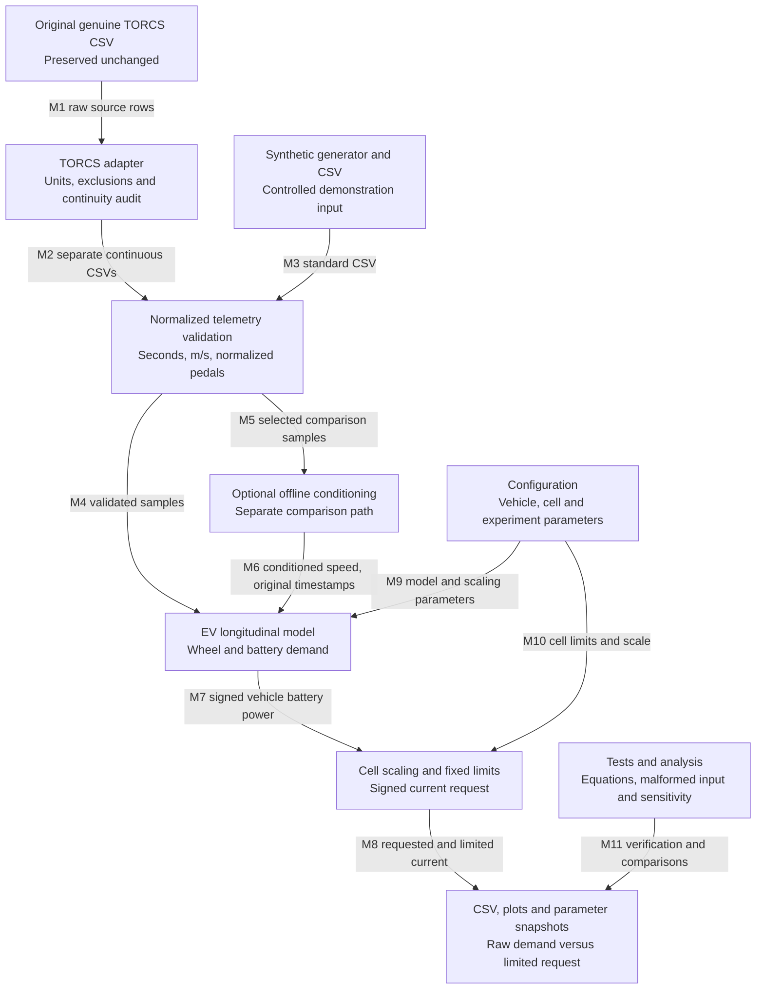
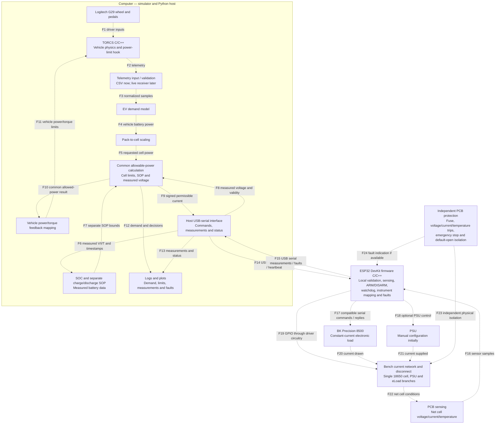

# APS380 revised software block diagram

Revision: October 8, 2026. Based on `PROJECT_CONTEXT.md` and the implemented starter. This document distinguishes working offline software from the intended final architecture. It does not claim that future communication links, hardware protection or simulator hooks have been implemented.

The system's purpose is to let driving behavior create a real battery workload, then let measured battery capability constrain the vehicle. Python computes high-level demand and battery capability. The ESP32 measures and controls the bench locally. TORCS simulates the vehicle and applies power/torque restrictions. Independent PCB protection provides a separate physical protection layer.

## Diagram 1 — working Milestone 1 pipeline

All arrows in this diagram are implemented file operations or Python function calls. Nothing here sends a physical command.



### Components and code responsibilities

| Component | Existing implementation | Explanation |
| --- | --- | --- |
| Genuine TORCS source | `data/Torcs_Sample_Data.csv` | Public simulator recording, not this team's G29 session or an EV battery measurement. Original bytes are preserved. |
| Adapter | `torcs_adapter.py` | Maps raw SCR fields to the standard schema. It audits timestamps and optional track/race-distance diagnostics, reports exclusions, and splits discontinuities. |
| Synthetic input | `make_demo_data.py`, `data/demo_synthetic.csv` | Provides repeatable acceleration/braking examples without requiring TORCS. Synthetic and real data enter the same downstream interface. |
| Validation and orchestration | `battery_model.py` | Validates numeric values, nonnegative forward speed/time, strictly increasing timestamps and pedal ranges; computes interval acceleration and mean speed; calls the physics and scaling functions. |
| Optional conditioning | `telemetry_conditioning.py` | Centered local-linear speed smoothing using recorded, possibly irregular timestamps. Operates independently inside each segment. Uses future samples and is therefore offline only. |
| EV model | `ev_model.py` | Converts acceleration and road resistance into wheel power; models drive losses, limited regeneration, friction braking and auxiliary demand. It estimates a simplified EV equivalent following the trajectory. |
| Cell model interface | `cell_scaling.py` | Scales vehicle demand by nominal cell-to-pack energy ratio, optionally reduces it by an explicit experiment factor, and clips charge/discharge current separately. It is not an electrochemical battery model. |
| Configuration | `config.json`, `config_torcs.json` | Holds unit-labelled parameters. The TORCS-informed variant uses a candidate source-car mass and body drag area; battery and EV conversion parameters remain assumptions. |
| Outputs | `run.py`, `output/` | Produces profiles, plots and effective parameter snapshots. A field named `cell_current_command_A` is still only a saved offline request. |
| Verification and study | `tests.py`, `compare_profiles.py`, `analyze_telemetry.py` | Checks implementation behavior and quantifies conditioning, clipping and energy changes. Does not establish physical calibration. |

### Every Milestone 1 connection

| ID | Transfer | Meaning and constraints |
| --- | --- | --- |
| M1 | Raw CSV → adapter | Reads `curLapTime`, `speedX`, `accel`, `brake`, and available continuity diagnostics. The source is never rewritten. |
| M2 | Adapter → validation | Writes `time_s=curLapTime`, `speed_mps=speedX/3.6`, `throttle=accel`, and `brake=brake`. Each file is a separate continuous forward-driving segment. No lap-clock stitching or invented time. |
| M3 | Synthetic CSV → validation | Supplies the same four-column interface; requires no simulator. |
| M4 | Validation → EV model | Supplies recorded intervals, `a=Δv/Δt` and interval-average speed. Pedals are retained diagnostics, not a direct power equation. First sample assumes zero acceleration and has zero integration duration. |
| M5 | Validation → optional conditioning | Used by comparison/analysis scripts only. Normal processing remains raw by default. |
| M6 | Conditioning → EV model | Replaces speed values explicitly while retaining timestamps/pedals. No interpolation across missing rows, segments or laps. |
| M7 | EV model → cell scaling | Transfers signed electrical vehicle battery demand in watts, after drivetrain conversion and auxiliaries. Negative wheel power does not necessarily mean negative net battery power. |
| M8 | Cell scaling → outputs | Records requested power/current, limited current/power and saturation flags. Positive means discharge; negative means charge. |
| M9 | Configuration → EV model | Supplies mass, drag area, rolling coefficient, efficiencies, auxiliaries and regeneration assumptions. |
| M10 | Configuration → cell scaling | Supplies nominal cell voltage/capacity, equivalent pack energy, optional experiment scale and separate fixed current limits. Limits are illustrative until cell selection and approval. |
| M11 | Verification → reports | Produces automated check results and comparison evidence, including time-weighted energy/RMS metrics and braking diagnostics. This is a reporting relationship, not a runtime control command. |

## Diagram 2 — intended full system

Every connection below is planned. The diagram describes responsibilities and interfaces rather than completed integrations. Numbered arrows are explained in the following table. Hardware signal/power paths provide context for the software and are not proposed wiring instructions.



### What each future component does

**TORCS and G29.** The G29 supplies steering and pedal inputs to the simulator. TORCS owns vehicle motion and driver interaction. Telemetry extraction and a vehicle-compatible power/torque limitation hook must be identified or built. A common multiplier on steering, throttle and brake is not the planned feedback mechanism.

**Python telemetry and demand calculation.** The existing offline adapter/validation and EV/scaling functions establish these responsibilities. A later live receiver will expose a compatible data contract. UDP transport does not automatically solve dropped packets, ordering, timestamps or stale telemetry; those policies remain to be designed.

**Python SOC/SOP estimation.** SOC begins with coulomb counting of measured net cell current using measurement elapsed time, configured capacity and initial SOC. SOP supplies separate positive magnitudes for permissible discharge and charging power based on measured conditions and configured cell limits. No measured battery stream or SOC/SOP estimator is implemented today.

**Python common allowable-power calculation.** One decision reconciles requested cell power, charge/discharge SOP, cell operating limits and valid measured voltage. It produces both the cell-current request and the vehicle feedback information. This replaces the current fixed offline clipping stage when live limits exist; it is not an extra competing controller.

**Python serial interface and logging.** The host sends high-level signed current requests to the ESP32 and receives timestamped measurements, state and faults. The protocol and synchronization are not finalized. Commands, actual measurements and limitations must be logged separately so a successful message is not confused with achieved cell current. Present-day CSV/plots are the starting point; a GUI is unnecessary for this architecture.

**ESP32 firmware.** The ESP32 performs local request validation, acquisition, ARM/DISARM handling, heartbeat supervision, instrument translation and relay/MOSFET coordination. It can reject or limit host commands and report the applied request/state. Board, pins, timing and firmware environment remain unconfirmed. Local supervision is additional to independent hardware protection.

**Sensing PCB.** A bidirectional net-cell current measurement, cell voltage and temperature feed the ESP32. INA228 and an external ADC such as ADS1115 are proposed, not final selections. Temperature acquisition depends on the eventual sensor and analog design. Instrument branch readbacks cannot substitute for net battery sensing.

**Electronic load and PSU.** The BK 8500 draws current; the PSU supplies current. Together they can create positive or negative net cell current if the physical circuit supports it. Initial PSU configuration is manual; remote communication is optional. The ESP32-to-load serial electrical interface, isolation and low-voltage operation require verification.

**Bench network, isolation and independent protection.** This block represents the physical cell and instrument branches, plus controlled disconnection. Protection must remain functional without Python or ESP32 execution. The intended mechanisms include fuse protection, voltage/current/temperature trips, emergency stop and default-open isolation; implementation and validation are separate hardware work.

### Every future connection

| ID | Direction and interface | Payload / purpose |
| --- | --- | --- |
| F1 | G29 → TORCS, USB/input mapping | Driver steering, accelerator and brake commands. Mapping is a simulator setup task, not cell scaling. |
| F2 | TORCS → Python, recorded CSV first; proposed localhost UDP later | Timestamped motion/pedal telemetry. Exact exporter and live integration remain unverified. |
| F3 | Telemetry input → EV model, internal Python data | Validated SI samples and elapsed-time acceleration; no derivatives across session breaks. |
| F4 | EV model → scaling, internal Python data | Signed requested vehicle battery power in W. |
| F5 | Scaling → allowable-power block, internal Python data | Signed requested cell power in W and known effective scaling relation. |
| F6 | Host measurement receiver → SOC/SOP, internal Python data | Measured net cell current, voltage, temperature, measurement timestamps and validity. SOC must not use requested or eLoad current. |
| F7 | SOC/SOP → allowable-power block, internal Python data | Separate maximum discharge and charge power magnitudes, plus estimate validity. |
| F8 | Host measurement receiver → allowable-power block | Actual cell voltage and validity are needed to convert allowed power to current. Offline code currently uses nominal voltage. |
| F9 | Allowable-power block → host serial interface | Signed cell-current request in A, accompanied by the appropriate operating state/command metadata once the protocol is defined. |
| F10 | Allowable-power block → feedback mapping | The same requested/allowed power decision used for current generation, with propulsion and regen restrictions handled separately. |
| F11 | Feedback mapping → TORCS, proposed localhost UDP | Vehicle-compatible available power/torque restriction. Regen restriction must permit friction braking to handle unrecovered braking demand; steering is unaffected by a power multiplier. |
| F12 | Allowable-power block → logger | Requested and permitted power, commanded current, saturation/limiting reason and configuration. |
| F13 | Host serial interface → logger | Measured V/I/T, timestamps, actual state, faults and available acknowledgements/readbacks. |
| F14 | Python → ESP32, proposed USB serial | Signed current request, ARM/DISARM requests and heartbeat. Exact message format, sequence numbers and command-expiry policy remain design tasks. |
| F15 | ESP32 → Python, proposed USB serial | Timestamped net-cell V/I/T, local state, faults and acceptance/application status. Stale or invalid measurements must be distinguishable from valid values. |
| F16 | Sensor circuits → ESP32, proposed I²C/ADC acquisition | Cell current/voltage from selected sensing devices and temperature via the chosen acquisition path. Device addresses, pins and sample rates are not assigned. |
| F17 | ESP32 ↔ BK 8500, verified compatible serial interface | Constant-current load commands and supported status/readback exchanges. This is not an assumed I²C/SPI link or direct connection of arbitrary ESP32 logic levels. |
| F18 | ESP32 → PSU, optional model-dependent interface | Remote control only if the chosen supply supports it and validation justifies it. Initially the supply is manually configured. |
| F19 | ESP32 → disconnect driver, GPIO | Controlled arm/disarm and isolation requests through appropriate circuitry. Independent trip behavior must still prevail. |
| F20 | eLoad → bench network, physical branch | Draws current from the common network; this arrow represents its effect, not energy-flow direction or software packets. |
| F21 | PSU → bench network, physical branch | Supplies current; actual output can differ from the current-limit setting. |
| F22 | Cell/network → sensing circuits, physical measurement | Provides actual net battery conditions, distinct from commanded values and instrument branch currents. |
| F23 | Protection → isolation/network, independent hardware path | Opens/isolate the cell on a trip or emergency stop independently of Python/firmware. It must address unintended charging as well as discharge. |
| F24 | Protection → ESP32, optional fault signal | Allows fault reporting if the PCB exposes it. Protection cannot depend on the MCU receiving or acknowledging this signal. |

## Equations connecting demand, measurement and feedback

Current convention throughout: **positive = cell discharge; negative = cell charge**. Power uses the same sign. Voltage is the positive cell terminal voltage magnitude.

The existing offline model uses:

```
a = (v[i] - v[i-1]) / dt
v_bar = (v[i] + v[i-1]) / 2
P_wheel = (m*a + m*g*Crr + 0.5*rho*CdA*v_bar²) * v_bar
P_vehicle = P_wheel/eta_drive + P_aux                  for propulsion
P_vehicle = -min(-P_wheel*f_regen, P_regen_cap)*eta_regen + P_aux
                                                       for negative wheel demand
k = (V_nominal * capacity_Ah / pack_energy_Wh) * experiment_scale
P_cell_requested = k * P_vehicle
I_raw = P_cell_requested / V_nominal
I_offline = clamp(I_raw, -I_charge_limit, I_discharge_limit)
```

With validated live measurements and SOP, a future limiter would reconcile power bounds with current bounds, then calculate `I_request = P_cell_allowed / V_measured`. For example, a discharge power bound should also respect `V_measured * I_discharge_limit`. Invalid voltage must trigger a defined control response rather than unchecked division. This describes intended behavior; no live limiter is implemented.

The effective scale `k`, including any experiment reduction, must also be reflected in vehicle feedback. An allowed cell power can map back to an equivalent vehicle battery power using the same `k`; drivetrain, auxiliaries and TORCS torque conversion then need consistent treatment. A ratio `P_allowed/P_requested` is meaningful only for the relevant nonzero signed demand. Zero demand and charge/discharge transitions need explicit handling. Do not divide by zero or scale every driver input by that ratio.

SOC updates from actual measurements:

```
SOC_next = clamp(SOC_previous - I_cell_measured*dt/(3600*capacity_Ah), 0, 1)
```

Instrument mapping is a separate ESP32 responsibility:

```
I_cell = I_eLoad - I_PSU
I_eLoad_request = I_bias + I_cell_request    only for verified constant PSU bias
```

The second relationship is conditional, not a verified bench model. The requested load current must be nonnegative and physically achievable; the combined system limits charging and discharging capability. A zero cell-current request does not guarantee zero real cell current, especially if the load switches off while the PSU remains connected.

## Changes from the teammate's original diagram

- The broad computational unit is expanded into telemetry validation, EV demand, scaling, SOC/SOP, a common limiter, feedback mapping and logging. These have different inputs and maturity levels.
- The generic MCU is explicitly the ESP32 DevKit, responsible for local measurements, control and instrument communication.
- The original controller/multiplier becomes a vehicle power/torque feedback hook in TORCS, not a common steering/pedal multiplier.
- The generic safety block is separated into Python operating limits, ESP32 local supervision and independent physical PCB protection. Software supervision does not replace the independent layer.
- V/I/T measurements travel from the sensing hardware through ESP32 to Python. Python sends a signed current request in the opposite direction; it does not command measurement voltage as its primary control variable.
- The BK 8500 uses a verified serial interface; I²C is reserved for compatible sensing devices. SPI is not asserted as a required interface.
- The PSU/eLoad branch-current relationship is explicit and conditional on verified bias behavior.
- A separate BMS software box is not asserted without a selected implementation. Its intended estimation, supervision and physical protection responsibilities are assigned to the relevant blocks above.
- CSV replay, preserved source data, optional conditioning, configuration and output evidence are now visible as the current milestone. A GUI remains deferred.

## Present status and remaining design work

The offline pipeline, real-source adapter, comparisons and analysis are implemented, with 19 passing tests at this revision. Genuine simulator replay is established; live TORCS/G29 export and closed-loop feedback are not. The source-informed model and smoothing/scaling choices support engineering comparisons rather than calibrated hardware operation.

Next work is to select and document a representative profile, verify source sensor/action ordering, obtain this team's TORCS recording, select the exact cell, define/mock USB serial, then validate sensing/instrument control before adding SOC/SOP and vehicle derating. Independent hardware protection proceeds as a separate design and verification responsibility.
