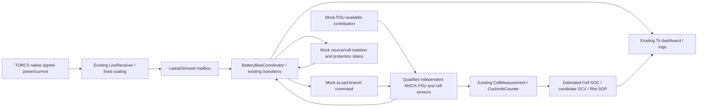

# Battery Bias Mode — mock only

## Development deferred; unresolved adversarial review

### Opt-in SOC/SOP propulsion connection

The later `--propulsion-feedback` option now connects the existing bias observer
and Rint estimator to the existing `PowerFeedback`/native torque limiter.
Earlier statements that this mode has no propulsion feedback refer to its default
configuration. Safety/ESP32 findings below remain unresolved and are not bypassed.

From the repository root:

```powershell
& .\.venv-bench\Scripts\python.exe -B bench/bk8500/live_torcs.py --control-mode battery-bias --device mock --propulsion-feedback --torcs keyboard --keyboard-profile 8s --duration 600 --dashboard
```

Starts DISARMED; use ARM or Arm mock. READY balances with zero propulsion.
RUNNING uses counted mock Cell SOC -> candidate OCV -> unvalidated Rint SOP ->
existing scaled vehicle availability. Native commanded/applied fractions appear
in the existing dashboard and telemetry CSV. G29 uses `--torcs g29` without the
keyboard-profile option; saved mappings are untouched.

DISARM disables/isolate mocks and causes native availability to expire to zero.
Re-ARM does not automatically clear the native fault: wait for RUNNING, then
type RESET POWER or use Reset propulsion feedback. STOP latches mock emergency
stop; use RESET, then ARM, wait for RUNNING and RESET POWER. RESET POWER alone
never arms instruments. QUIT/close/Ctrl+C requests and verifies a new native zero
acknowledgement before stopping healthy telemetry. If TORCS already exited, that
acknowledgement is unavailable and is reported unverified rather than assumed.

Reproduce matched-input comparisons and native fault/recovery tests:

```powershell
& .\.venv-bench\Scripts\python.exe -B scripts/validate_bias_power.py --output .local/bias-power/my-comparison
& .\.venv-bench\Scripts\python.exe -B scripts/validate_bias_power_faults.py --output .local/bias-power/my-faults
& .\.venv-bench\Scripts\python.exe -B scripts/validate_battery_bias.py --live-dashboard --propulsion-feedback --output .local/bias-power/my-dashboard
```

Use fresh directories. Comparison uses the existing isolated keyboard fixture,
identical keys and 0.05 A imposed mock source contribution; limits and slew remain
unchanged. Compare 7..8 s after isolated startup. These are mock assumptions, not
physical operating settings. The fault script cuts the demand stream while UDP
continues so native applied-zero can be observed. A separate launcher process-loss
injection tests actual UDP silence, after which native acknowledgement cannot be
observed. All physical Battery Bias restrictions remain in force.

At the user's request, further Battery Bias safety-state-machine development,
ESP32 measurement integration and alarms/notifications are deferred until the
sensing hardware is available. Preserve the current implementation and completed
mock evidence. This deferral does not resolve the findings below or authorize
physical operation. Earlier passing tests and fix descriptions are limited to
their exercised scenarios; the later adversarial review takes precedence.

Unresolved findings:

| Severity | Finding | Evidence / affected code |
| --- | --- | --- |
| High | Final connection can accept non-neutral current through a fresh cached sensor frame. A 30 mA readback disagreement allowance can mask a source change despite the 2 mA neutral criterion. | `BatteryBiasCoordinator._read()` and `_before_isolation_close()`; reproduced approximately +24.8 mA at connection with cached 0.2 A sensing and actual 0.225 A source contribution. |
| High | Mutable `hardware_faults` lists can bypass protection evaluation on repeated reads. | `MeasurementGuard.accept()` returns early for an equal cached frame before the protection check; mutation to include a fault was accepted. |
| Medium | Valid asynchronous frames can fault when the consumer skips intermediate frames already validated at ingestion. | `LatestBiasMeasurement.publish()` and coordinator `_sample()` both enforce contiguous sequences. |
| Medium | The asynchronous mailbox has no explicit reset/recovery lifecycle. | `LatestBiasMeasurement.error` remains latched; coordinator recovery does not reset the mailbox. |
| Medium | Launcher cleanup is not fully exception-contained. | `battery_bias_runner.main()`: a throwing `receiver.begin_shutdown()` prevented receiver close; log closure and artifact generation remain unguarded. |
| Medium | Independent-disconnect capability is declared but not enforced. | `SourceCapabilities(True, True, False)` was accepted and reached READY. |

Review verdicts: H1 PASS; H2 PARTIAL; H3 PARTIAL; M1 PASS within mock isolation
assumptions; M2 PASS for the configured service; M3 PARTIAL. Passing regression
tests do not close the remaining findings. Do not loosen checks to obtain PASS.

Known limitations remain: cell sensing shares mock plant truth, source isolation
is a Boolean, and mock isolation locally disables both instruments. These do not
establish independent physical isolation, realistic sensor dynamics or battery
safety. SOP-to-TORCS feedback is connected only with `--propulsion-feedback`;
it does not resolve these findings or authorize physical operation.

Defer ESP32 transport and clock qualification, sensor calibration/noise studies,
warning and fault thresholds, physical isolation feedback and hardware alarms.
Keep all mock-only restrictions, existing safety checks and independent hardware
protection requirements intact. The proven PSU-only TORCS-to-BK8500 workflow and
its approved settings remain unchanged. No physical test is authorized here.

## Previous fix description (subject to the unresolved findings above)

Review fixes: READY continuously enforces cell isolation and the final connection
check rereads source/load/cell state and rechecks balance, freshness, enable
states and demand validity. Shutdown verification failures are reported as
unknown/unverified; failed cell disconnect still requests source disconnect and
both output disables.

Normal DISARM preserves the last counted SOC and excludes the verified-isolated
gap. Re-ARM anchors on a fresh measurement at that preserved SOC. Explicit fault
RESET retains its documented initial-SOC assertion. Isolated current within the
shared neutral tolerance integrates as zero, with the raw value retained.

`LatestBiasMeasurement` separates packet ingestion from cached control reads.
Invalid/duplicate/reordered packets fault at ingestion; repeated access to an
identical fresh frame is allowed and does not advance SOC. No ESP32 transport is
enabled. `SourceCapabilities` explicitly rejects unsupported manual sources;
their sensing/disconnect adapter remains future work. Actuator feedback is still
mock state, not proof of physical isolation. Physical Battery Bias stays blocked.

This opt-in mode prepares the planned battery/source/load composition. It does
not enable physical operation or change the proven PSU-only BK8500 workflow.
No serial transport is available in Battery Bias Mode; `--device hardware`,
`--port`, and approval-file arguments are rejected before service creation.
The original physical driver and replay code are reused unchanged by the
**existing PSU-only workflow**, not connected to this new mock coordinator.

## Architecture



PC Python owns current mapping, instrument commands and SOC/SOP. A future ESP32
transport supplies sensing, local status and isolation supervision; it is not an
instrument-command bridge. Independent hardware protection remains necessary.
This mode estimates SOP but **does not connect that estimate to native propulsion
feedback**. The existing separate `rint-live-mock` propulsion workflow remains
available and unchanged. Do not run two receivers on the same UDP port.

## Mapping and current signs

All cell currents are charging-positive. Native TORCS pack current remains
discharge-positive; the existing scaler converts it without changing equations.

```
I_cell = I_PSU - I_eLoad
I_eLoad_target = fresh measured I_PSU - applied signed I_cell_target
feasible I_cell = [I_PSU - load_max, I_PSU - load_min]
```

The feasible interval is intersected with the central prototype cell limits.
The original request, prototype-limited request, slew-applied net target,
unslewed bias load target, branch command, setting readback, branch measurements
and independent cell measurement remain separate. Operational infeasibility
latches FAULT rather than pretending a clipped target was delivered.

For an imposed **mock measured** source contribution of 0.2 A: a -0.1 A discharge
request needs 0.3 A load; neutral needs 0.2 A; +0.08 A charging needs 0.12 A.
The PSU's configured 1 A CC limit is not substituted for its 0.2 A readback.
Source variation changes the bias target. Both signed net targets and load
branch commands are slew limited; rapid source variation may exceed tracking
capability and fault. No source-current controller or instantaneous response is
assumed. Explicit reversal phases slew to neutral, prove measured neutral dwell,
then follow the newest direction; old commands do not queue.

Central prototype ranges remain `prototype_current_config.py`: PSU 0–1 A
(configured CC limit 1 A), load 0–3 A, cell -2 to +1 A. These are mock experiment
limits, not verified physical battery limits. New-mode net and branch slew are
0.02 A/s; the original PSU-only slew is untouched. The new mode runs at 10 Hz
independently of approximately 50 Hz telemetry and waits after transactions
without catch-up. Source variation can consume branch slew budget.

## Measurement contract and model qualification

`BiasMeasurement` contains session, contiguous sequence, monotonic acquisition
and receipt times, source/quality/validity, independent signed cell current,
PSU branch current, V/T, cell/source isolation, source/load enables, protection,
E-stop and hardware faults. Timestamp clocks must be qualified into one local
monotonic timebase before a future external transport is accepted.
`MeasurementGuard` rejects missing, duplicate, skipped, reordered, stale, future,
invalid and unqualified frames; acquisition/receipt ordering is checked.

`MockBiasSensors` supplies separate mock sensor channels over simple instrument
plant state, with independent offset/fault injection. It does not use target
current for SOC or infer cell current from the BK8500 alone. Perfect KCL in the
accelerated experiment follows the mock construction, not independent physical
validation. When cell isolation is open, its sensor current is zero even while
the simplified isolated mock branches balance; that is a software fixture, not
a validated circuit model.

`BiasCellStream` reuses `CellMeasurement`, `LiveCellObserver`, `CoulombCounter`
and `RintEstimator`. Only its explicitly qualified **mock-independent-sensor**
source profile is accepted. Raw sensor frames are checked every acquisition;
the slower SOC publication stream has its own contiguous sequence.
SOC is a fraction, integrated at measurement time:

```
SOC_next = SOC_previous + (I_previous + I_now)/2 * dt/(3600 * capacity_Ah)
```

Initial SOC, voltage, temperature, capacity/R0/OCV applicability and Rint
constraints are unvalidated mock assertions from the existing opt-in SOP JSON.
The default example uses imposed 3.65 V, 25 C and initial SOC 80%; voltage does
not simulate an electrochemical response to current. Rint outputs are estimates,
not measured OCV or physical safety protection. TORCS pack SOC stays separate.

## States and shutdown

* **DISARMED:** source/cell isolated, both mock outputs disabled. No automatic ARM.
* **READY:** an explicit mock ARM has qualified sensors/protection. The cell
  remains isolated while fresh branch readbacks balance at neutral, settle and
  satisfy the startup voltage-consistency check. Demand feasibility is deferred
  until RUNNING. A startup timeout faults. Source contribution is a measured
  mock CV/CC envelope, not necessarily the configured CC limit.
* **RUNNING:** close mock cell isolation only after neutral qualification;
  check freshness, feasible targets, branch KCL, independent cell tracking,
  current direction, outputs and isolation each cycle.
* **FAULT:** latch the original reason; request cell isolation first, source
  isolation and both outputs OFF. Verify all three obligations separately.
  Source/relay failures leave shutdown **unverified**; OFF alone is insufficient.
  Clear the injected cause, then explicit RESET verifies safe state and returns
  DISARMED. It never re-arms. RESET explicitly reanchors the synthetic initial
  SOC; unknown intervals are not integrated. A new ARM and fresh demand follow.

The inherited mock isolation also locally disables both instruments during a
communication failure. This is an idealized independent interlock used for
tests; there is no physical relay or E-stop backend. V/T qualification
(`MockBiasQualification`: 2.5–4.2 V, 23–27 C, startup difference 0.02 V), 90 s
startup timeout and neutral dwell are explicit configurable demonstration
assumptions, never physical cell ratings or settling guarantees.

## Run from the APS380 repository root in PowerShell

Close another TORCS/receiver using port 50001. No approval record or serial port
is needed or accepted. Use the existing virtual environment.

```powershell
# Graphical keyboard driving; default is DISARMED. 3s/5s/8s are unchanged presets.
& .\.venv-bench\Scripts\python.exe -B bench/bk8500/live_torcs.py --control-mode battery-bias --device mock --torcs keyboard --keyboard-profile 8s --duration 600 --dashboard

# Existing G29 profile, unchanged analog mapping/calibration.
& .\.venv-bench\Scripts\python.exe -B bench/bk8500/live_torcs.py --control-mode battery-bias --device mock --torcs g29 --duration 600 --dashboard
```

Type `ARM` and Enter in the terminal, or press **Arm mock** in Safety & Logs.
READY balances the isolated branches for about 10 seconds with the default
0.2 A mock contribution and 0.02 A/s branch ramp; actual readiness depends on
readbacks. `DISARM` isolates, `STOP` latches emergency stop, `RESET` explicitly
recovers after fixing the cause, and `QUIT`/Ctrl+C/window close saves results
after shutdown. These commands affect in-memory mocks only.

The dashboard reuses Vehicle, Battery, SOC & SOP, Instruments and Safety & Logs.
Cell current is labelled **MOCK independent sensor model**, V/T **MOCK imposed**,
SOC **ESTIMATED / MOCK counted**, OCV **CANDIDATE**, SOP unvalidated. Native
propulsion feedback displays NOT CONNECTED for this mode. Retained samples and
age remain visible. No new physical control buttons are introduced.

```powershell
# Reproducible accelerated-clock signs/source/fault experiment and graphs
& .\.venv-bench\Scripts\python.exe -B scripts/validate_battery_bias.py --output .local/battery-bias-validation/my-offline-run

# Actual short TORCS AI smoke test; explicit MOCK-only automatic arming
& .\.venv-bench\Scripts\python.exe -B bench/bk8500/live_torcs.py --control-mode battery-bias --device mock --torcs ai --duration 50 --auto-arm-mock --no-console --output .local/battery-bias-validation/my-native-run

# Actual TORCS/Tk mock integration, visits every tab and records render timings
& .\.venv-bench\Scripts\python.exe -B scripts/validate_battery_bias.py --live-dashboard --output .local/battery-bias-validation/my-dashboard-run

# Deliberate telemetry-loss response; expected fault success is separate from normal PASS
& .\.venv-bench\Scripts\python.exe -B bench/bk8500/live_torcs.py --control-mode battery-bias --device mock --torcs ai --duration 30 --auto-arm-mock --no-console --inject-telemetry-loss-after 20 --expect-telemetry-fault --output .local/battery-bias-validation/my-loss-run
```

Use a fresh output folder each time. Default runs save under `.local/battery-bias/`.
Artifacts include instrument JSONL/config/summary, telemetry JSONL/CSV/HUD/timing
report, `bias_tracking.csv`, `bias_tracking.png`, `bias_model.png` and `trial.json`.
Plots exclude retained records and the isolated READY-to-RUNNING sample.
No RUNNING cycles means tracking NOT ASSESSED, not PASS. Short smoke acceptance
is separate from full-course completion; expected injected faults are reported
as fault-response success while normal operation remains FAIL.

## Before real Battery Bias operation

Integrate/qualify the team's ESP32 sensing/status transport, timestamps,
independent bidirectional cell-current and PSU branch sensors, calibration,
cell V/T, source/cell isolation feedback, local watchdog, hardware protections
and E-stop. Implement and validate source-aware isolation/disconnect requests
and failure feedback under source-on/load-off faults. A manually controlled
PSU cannot be treated as a remotely disabled source. Verify wiring/topology,
reverse-current behavior, source CV/CC behavior, current/voltage/thermal limits,
and the approved cell experiment before a separate physical backend review.
Identify battery parameters experimentally; mock success does not establish
physical safety, model validity or hardware current-tracking performance.

## Saved validation — November 16, 2026

All evidence below is **mock only**, including the native TORCS runs.

| Check | Result |
| --- | --- |
| Starter regression suite | 245 tests, PASS, including Tk; no skips |
| BK8500 fake-transport/mock suite | 102 tests, PASS, including Tk; no skips |
| Keyboard profile setup | 3 tests, PASS |
| Existing native binaries | 131 checks: 18 EV, 15 UDP, 9 HUD, 31 keyboard, 58 propulsion; PASS |
| Existing dashboard workflows | All six cases PASS: prototype, standalone BK8500, fixed Rint, live Rint, demo, injected loss |
| New mode, actual TORCS/Tk | 1,749 packets, 49.995 Hz, no missing/invalid/reordered packets or stale intervals; 226 connected RUNNING samples; PASS |
| New dashboard timing | 319 refreshes, all five tabs visited, p95 redraw 6.05 ms |
| Actual TORCS mock current tracking | Maximum independent-cell minus applied target error 2.008 mA; source/cell isolation and both outputs disabled on shutdown |
| Actual TORCS deliberate telemetry loss | `STALE_TELEMETRY` latched after RUNNING; source/cell isolation and both outputs disabled; expected-fault response PASS, normal-operation FAIL |
| Accelerated four-minute fixture | -0.1000 to +0.0800 A measured net current; max tracking error 2.557 mA; exact mock KCL; discharge/charge/neutral and source variation PASS |
| Measurement-driven model fixture | SOC range 79.944447–80.000001%; Rint SOP range 1.990017–1.990217 W, from independent mock cell current |

The exact KCL equality in the accelerated fixture is by construction; native
wall-time sampling adds small readback skew. AI smoke driving established
discharge tracking; both signs and reversals were established by deterministic
mock tests, not by claiming an unobserved AI regenerative event. The native
executables were rerun without rebuilding because no native source changed.

Evidence folders under `.local/battery-bias-validation/`: `final-deterministic`,
`final-native-dashboard`, `final-native-interruption`, and `dashboard-regression`.
The earlier `native-ai` folder is a failed zero-telemetry development run (relative
AI log path); it is not acceptance evidence. Earlier folders before `final-*`
may contain the legacy CC-only acceptance report; the final mode-specific report
checks CV/CC qualification, branch slew and independent sensor consistency.

Protected tracked driver/replay/controller, native source, SOC/SOP equations,
prototype scaling/config and keyboard/G29 profiles have no diff. The existing
dashboard regression also verified its protected source and saved input-profile
hashes. No approval file, serial instrument or real battery was accessed by the
new workflow. Generated graphs/logs stay local; nothing was committed or pushed.
