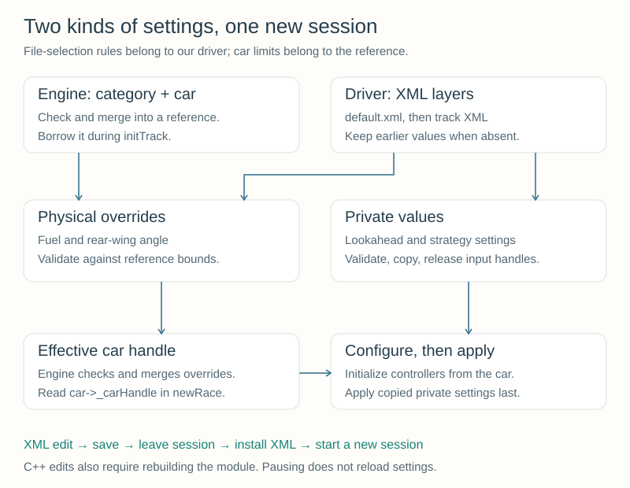

# Appendix A — Custom Car Setups and Driver Parameters {#robot_tutorial_appendix_a}

Your driver can complete a race. Now give it settings you can change without
recompiling: starting fuel, a rear-wing angle, steering lookahead, and a few
strategy choices. This appendix uses the complete [Chapter 6](chapter_6.md)
driver, supplied here as a separate checkpoint named **Tutorial A**.

**You will learn to:**
- Distinguish a physical car setup from a parameter used by your controller.
- Read XML settings, apply defaults and track overrides, and respect car limits.
- Follow the parameter handles through the robot callbacks.
- Run a controlled experiment and explain the observations.

The optional [Car Setup Workshop](setup_workshop.md) develops gearing, differential,
wheel and suspension settings, computed starting fuel, and brake-pressure estimation.

## 1. Start with a complete working driver {#robot_tutorial_a_start}

Build the supplied example using the [Linux instructions](@ref robot_tutorial_linux_appendix_a)
or [Windows instructions](@ref robot_tutorial_windows_appendix_a). You can also
download its complete folder:

\htmlonly
<p><a href="tutoriala.zip" download>Download tutoriala.zip — complete Appendix A driver</a></p>
\endhtmlonly

The archive includes every C++ helper, both platform build files, two setup XML
files, the driver description, README, and GPL license. Extract `tutoriala` under
`src/drivers/` in your configured TORCS source tree. No earlier driver module is
needed to compile it.

Choose **Tutorial A**, **CG Speedway number 1** (`g-track-1`), and a **six-lap
Quick Race** with no opponents. The car is `car1-stock1`. The default configuration
uses 60 litres and stops only when fuel or damage requires it, just as in
Chapter 6's racing defaults. This short solo baseline should need no stop.
First confirm that it finishes cleanly.

## 2. Two kinds of settings {#robot_tutorial_a_kinds}

| Kind | Example | Who uses it? |
| --- | --- | --- |
| Physical car setup | `Car/initial fuel`, `Rear Wing/angle` | The simulator, through the effective car parameter handle |
| Private driver parameter | `Tutorial A/lookahead base` | Our C++ controller |
| Driver description | `tutoriala.xml` | TORCS driver selection and module identification |

Changing the lookahead does not change the car's tyres or suspension. It changes
where our driver aims. Changing wing angle changes the simulated car even when
the driving algorithm stays the same. Keep those two causes separate when you
interpret a result.

The editable setup files are **`default.xml`** and **`g-track-1.xml`**, inside your
`src/drivers/tutoriala` working directory. They are different from `tutoriala.xml`.
Our loader reads these setup files from the **installed game's data directory**.
Editing a source file alone does not update that installed copy.

## 3. First experiment: change the starting fuel {#robot_tutorial_a_fuel}

The supplied `g-track-1.xml` is deliberately empty apart from its `params` element
and comments. Replace its contents with:

```xml
<?xml version="1.0" encoding="UTF-8"?>
<params name="Tutorial A - CG Speedway number 1" type="param">
  <section name="Car">
    <attnum name="initial fuel" unit="l" val="4"/>
  </section>
</params>
```

This is a **sparse override**: it supplies one setting, leaving the others to the
default configuration. `section` groups settings; `attnum` supplies a numeric
attribute; `name` identifies it; `val` is the number; `unit` describes its unit.
Names are case-sensitive. `Car/initial fuel` describes the section path and key;
the slash is not part of the XML attribute name.

1. Save the XML and leave the current race session.
2. Install the updated XML using your platform instructions.
3. Start a new session and inspect the fuel display near the start. It should be
   about 4 litres, decreasing once the car runs.
4. Let the race finish. Compare the fuel and stops with the full-tank baseline.

For an XML-only edit, no C++ compilation is necessary. The supplied install/build
commands also deploy XML and may simply report the binary up to date. For a C++
edit, rebuild and install as usual. **Pausing does not start a new session**, and
the driver does not reread settings every driving tick. You do not normally need
to restart TORCS. With Linux `-k`, changed plugin code remains loaded; use the
normal module-unloading workflow described in [Getting Ready](setup.md).

### Make it the strategy exercise

Keep the 4-litre setting and insert this second section immediately before
`</params>` in the same file:

```xml
  <section name="Tutorial A">
    <section name="Strategy">
      <attstr name="demonstration stop" val="no"/>
    </section>
  </section>
```

Install the file and run **12 laps**. Now stops are requested by fuel or damage
needs rather than the demonstration switch. The measured-consumption strategy
is still the one from Chapter 6. Record the fuel at each visit and compare the
number of stops with the full-tank run.

## 4. Where the values come from {#robot_tutorial_a_loading}



There are two related processes:

**The engine's car setup process:**
1. Read the category and car model, check their compatibility, and merge them.
2. Pass that reference handle into `rbNewTrack` (our `initTrack`).
3. Accept the optional override handle returned through `void** settings`.
4. Check the overrides against the reference, then merge them into the effective
   handle available as `car->_carHandle`.

**Our driver's file-selection process:**
1. Reset private parameters to their C++ defaults for this session.
2. Read `drivers/tutoriala/default.xml`.
3. Read `drivers/tutoriala/<track->internalname>.xml` and apply its supplied values.
4. Keep earlier values for missing or rejected entries.

The file paths are relative to the game's data-directory working context. For
CG Speedway number 1 the second filename is `g-track-1.xml`, not the displayed
track title. These path and precedence rules are **implemented by our driver**;
TORCS does not automatically discover a robot's track setup files.

Private settings follow **C++ defaults → default XML → track XML**. Physical
settings follow **merged car/category values → default XML → track XML**. Then
our no-side-pits policy restores starting fuel toward a full tank within the
allowed bounds. This avoids intentionally starting a long no-pit race on the
4-litre exercise setting; it cannot guarantee enough fuel for any race length.

An absent or unreadable layer leaves earlier values in place. A malformed XML
file is rejected as a whole; a valid file with one out-of-range numeric value
retains the earlier value for that setting. A wrong-type or missing key also
keeps its earlier value. Unknown names are ignored, so a spelling mistake can
look like an edit that had no effect.

All session types use these same files in this checkpoint. Separating Practice,
Qualifying, and Race settings is an optional [workshop extension](@ref robot_tutorial_setup_sessions).

## 5. Read values and respect their limits {#robot_tutorial_a_values}

The public parameter API works with an opaque `void*` handle. For example:

```cpp
const double angle = GfParmGetNum(carSettings,
    SECT_REARWING, PRM_WINGANGLE, "deg", 16.0f);
```

This requests an angle in degrees; the fallback is also expressed in degrees.
The same entry requested with `nullptr` as its unit is returned in the API's
internal representation—radians for angles. The XML reader handles supported
unit conversion. It does **not** provide dimensional type checking: a plausible
number with a wrong or misspelled unit can still be wrong. Use the supplied units.
TORCS uses litres for these fuel parameters; do not substitute cubic metres.

For nested private settings, the path is simply `"Tutorial A/Strategy"`. String
settings use `GfParmGetStr`; our demonstration switch accepts exactly `yes` or `no`.

### Physical settings

`readCarNumber` obtains the allowed interval with `GfParmGetNumBoundaries`.
Those endpoints use internal units, so the value is read and checked in internal
units too. In the supplied reference car/category combination:

| XML section/key | Default | Allowed interval | Unit |
| --- | --- | --- | --- |
| `Car/initial fuel` | 60 | 1–60 | `l` |
| `Rear Wing/angle` | 16 | 0–30 | `deg` |

The loader uses the actual incoming bounds, not these table entries as constants.
Editing `min` or `max` in your override cannot widen the car/category permissions.
The code also calls `GfParmCheckHandle` before returning its physical overrides;
the engine repeats its own check. A failed final check falls back to the standard
physical setup.

The supplied physical-setting whitelist contains only fuel and rear-wing angle.
Adding a brake or suspension section to XML alone therefore does not activate it.
The [workshop](setup_workshop.md) explains how to extend the whitelist deliberately.

### Private driver settings

These bounds belong to our example, not to the car model. They keep the exercises
within a modest range, but do not establish that every accepted setting drives well.

| Section | Attribute | Default | Accepted values / unit |
| --- | --- | --- | --- |
| `Tutorial A` | `lookahead base` | 8 | 4–12 `m` |
| `Tutorial A` | `lookahead time` | 0.33 | 0.1–0.6 `s` |
| `Tutorial A/Strategy` | `demonstration stop` | `no` | `yes` or `no`; enable only for the route exercise |
| `Tutorial A/Strategy` | `stint laps` | 0 | 0 fuels to finish; 2–10 selects a stint (fractional laps allowed) |
| `Tutorial A/Strategy` | `fuel per lap` | 1.5 | 0.1–10 `l`, per lap |

Non-finite and out-of-range numbers are rejected. Private limits are checked
explicitly in C++, rather than inferred from optional XML `min` and `max` metadata.
The fuel-per-lap value is a **fallback estimate**, used until a complete lap has
been measured. It does not override the subsequent measured estimate and 15%
margin. The half-litre reserve and other Chapter 6 control constants stay in
`pit.cpp`.

## 6. Handle ownership and callback timing {#robot_tutorial_a_lifecycle}

Follow the implementation in `settings.cpp` and `tutoriala.cpp`:

| Handle or data | Ownership and lifetime |
| --- | --- |
| Incoming `carSettings` | Borrowed from the engine during `initTrack`; our loader does not release or modify it |
| Each file's `input` | Created with `GFPARM_RMODE_PRIVATE`; released after its values have been copied |
| Returned `overrides` | A new private handle; handed to the engine, which consumes it during merging |
| `DriverSettings configuration` | Plain values kept by this one-robot module, reset on each `initTrack` |
| `car->_carHandle` | Borrowed effective car configuration; read during `newRace`, never released by the driver |

`GFPARM_RMODE_PRIVATE` makes each file read independent of shared cached parameter
data, giving us fresh content each time `initTrack` runs. We do not request
`GFPARM_RMODE_CREAT` for input files: silently creating an empty input handle would
hide open failures. We use it only with an empty filename to allocate the
in-memory output handle; this does not write a file to disk.

The loader copies string decisions before releasing the input handle. Do not keep
a pointer returned by `GfParmGetStr` beyond that handle's lifetime.

In `newRace`, configure the car-dependent controllers first, then apply the
private settings:

```cpp
driver.configure(currentTrack, car);
recovery.reset(situation->currentTime);
traffic.reset(situation->currentTime);
pits.configure(currentTrack, car);
configuration.apply(driver, pits);
```

`pits.configure` resets the pit object; applying its settings before that call
would lose them. `driver.configure` reads the **effective** car handle, so its
drag/downforce estimates see the selected wing angle. Both centerline steering
and traffic-offset steering use the configured lookahead. Pit-route steering
retains its own Chapter 6 geometry.

The initial physical fuel setting can be read from the effective parameter handle
in `newRace`, but `car->_fuel` is not yet the first published simulation fuel
value. The strategy still initializes consumption tracking during driving.

## 7. Two controlled tuning experiments {#robot_tutorial_a_experiments}

Restore 60 litres and disable the demonstration stop for these short, solo
comparisons. Keep the track, car, race length, skill level, physics module,
starting conditions, and every other parameter the same. Run **three laps** per
setting; exclude the standing-start lap when comparing lap times.

### Aim a little farther ahead

Add this attribute inside the existing `Tutorial A` section of `g-track-1.xml`:

```xml
    <attnum name="lookahead base" unit="m" val="9"/>
```

The steering distance is
\f$L= L_0 + T\max(0,v_x)\f$, capped at half the track length. Here \f$L_0\f$
is the base distance in metres, \f$T\f$ the time coefficient in seconds, and
\f$v_x\f$ forward speed in metres per second. At 20 m/s, the default distance is
14.6 m; a 9 m base makes it 15.6 m.

Predict how earlier anticipation could help and where corner cutting might get
worse. Compare 8 m with 9 m while keeping the 0.33 s coefficient fixed. Watch the
car's **corners** relative to the road edge, steering oscillations, and recovery
events. Zero damage alone does not prove the trajectory remained on the road.
See [Chapter 4](chapter_4.md) for the geometric explanation.

### Change the car, keeping the driver fixed

Restore the 8 m lookahead. Add this separate section under `params`:

```xml
  <section name="Rear Wing">
    <attnum name="angle" unit="deg" val="18"/>
  </section>
```

Compare the default 16 degrees with 18 degrees. More rear-wing angle in this
range changes downforce, drag, and the front/rear aerodynamic balance. A larger
angle is not automatically faster. The driver uses full pedal authority and
aerodynamic speed planning: added downforce can raise a corner target, while
added drag can reduce straight-line acceleration and speed. Compare the complete
lap, not just one of those effects.

Use a table like this for each experiment:

| Setting changed | Prediction | Flying-lap times | Edge excursions / recovery | Damage | Fuel / stops | Keep or restore? |
| --- | --- | --- | --- | --- | --- | --- |
| Baseline | Reference | Record | Record | Record | Record | — |
| One changed value | Write first | Record | Record | Record | Record | Explain |

Repeat a promising setting and then restore the baseline to check your comparison.
Traffic belongs in a later robustness test; it can obscure a small setup effect.

## 8. Troubleshooting {#robot_tutorial_a_help}

| Symptom | Check |
| --- | --- |
| XML edit has no effect | Did you install it into the data directory used by this TORCS instance and begin a new session? |
| Default edit has no effect on one track | The same key may be overridden by the track file |
| A low-fuel edit starts full | Check the side-pit availability policy and the allowed fuel range |
| Wing error prints bounds near 0.524 | Physical checks report internal units: 30 degrees is about 0.524 radians |
| New parameter is ignored | Check spelling, section path, numeric versus string type, and whether C++ reads that key |
| A new track file works locally but not after installation | Add its filename to `SHIP` in `tutoriala.mk` and the Windows project's install `Copy` list |
| `min`/`max` edit does not permit a value | The reference car/category limits and explicit private C++ limits still apply |
| A demonstration stop still occurs | Check every applied XML layer for an exercise override containing `yes` |
| No loading summary in the console | `GfOut` summaries are enabled in debug builds, suppressed in normal Release builds |

In a debug build, look for `Tutorial A: loading`, `Tutorial A settings`, and
`Tutorial A effective` messages. The final message reads fuel and wing angle from
the engine's effective handle. Rejected numeric values use `GfError` and remain
visible in Release. XML syntax errors also produce parser diagnostics. Missing
or wrong-type keys can fall back silently; inspect the actual installed file.

## 9. Completion exercise and source map {#robot_tutorial_a_complete}

You are finished when you can:
1. Reproduce the baseline and the 4-litre, demonstration-disabled strategy run
   through XML-only changes.
2. Explain which file supplied each edited setting and what happens if that
   track file is absent.
3. Compare one lookahead change and one wing-angle change, recording their
   different mechanisms and observed effects.
4. Restore defaults and complete the six-lap race, then repeat with an ordinary
   opponent or the optional Tutorial Pace driver.

`settings.h/.cpp` define and load the configuration. `tutoriala.cpp` connects it
to `initTrack` and `newRace`. `speed`, `steering`, and `traffic` share the selected
lookahead; `pit` receives the strategy settings. `geometry`, `braking`, `recovery`,
and `spline` provide the complete underlying driver. The build files deploy both
the module and its XML files.

Continue with the optional @subpage robot_tutorial_setup_workshop or
[Appendix B — Car Textures and Pit Logos](appendix_b.md).
[Appendix C](appendix_c.md) gives multiple robots their own configuration and
controller state. Return to the [Robot Tutorial](index.md).
