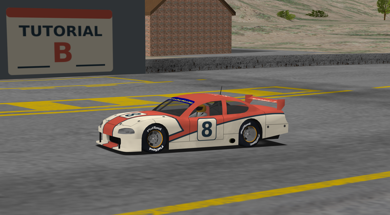
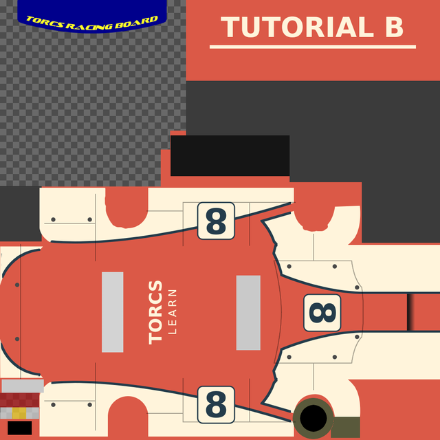
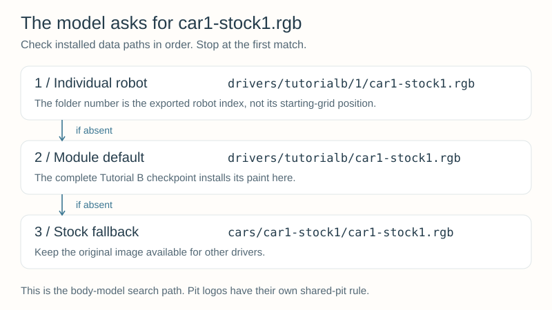
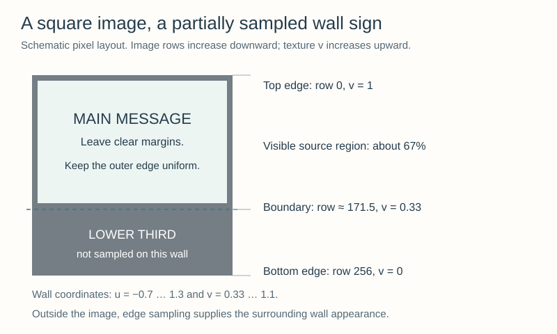

# Appendix B — Car Textures and Pit Logos {#robot_tutorial_appendix_b}

Give your robot an appearance you can recognize in traffic. This appendix adds a
red-and-cream **Tutorial B** paint scheme, number-8 badges, and a matching pit sign
to the complete [Appendix A](appendix_a.md) driver. You will edit artwork, export
game images, install them, and check the result from several cameras.

**You will learn to:**
- Find the image requested by a car's model and understand its texture mapping.
- Keep editable artwork separate from the flattened image used by the renderer.
- Preserve window transparency and export the correct SGI format.
- Place car textures and pit logos where the renderer actually searches.
- Check seams, orientation, small-scale readability, and pit-sign framing in TORCS.

## 1. Run the finished example first {#robot_tutorial_b_start}

Build using the [Linux instructions](@ref robot_tutorial_linux_appendix_b) or
[Windows instructions](@ref robot_tutorial_windows_appendix_b). The download is a
complete source folder, including the editable artwork and ready-to-use images:

\htmlonly
<p><a href="tutorialb.zip" download>Download tutorialb.zip — complete driver and editable artwork</a></p>
\endhtmlonly

Extract `tutorialb` under `src/drivers/` in your configured TORCS source tree.
No graphics editor is needed to build or run the supplied checkpoint. Select
**Tutorial B**, **CG Speedway number 1** (`g-track-1`), and a **six-lap Quick Race**
with normal graphics. Begin without opponents. The driver still starts with a full
tank and uses Chapter 6's fuel/damage strategy, without a forced demonstration stop.

Look for cream side panels, a dark number **8**, red bodywork, and **TUTORIAL B** on
the rear wing. The assigned pit wall should carry the matching sign. Use **F3** for
car views, **F4** for side views, and **F5/F6** for overhead/perspective views.
Repeated presses cycle the available views within a group. **`>`** zooms in and
**`<`** zooms out; **`*`** restores the camera's default zoom. **P** pauses for an
inspection, and **F1** shows the current controls.

[](texture-pit-scene-hires.png)

*Tutorial B's number-8 car and matching pit sign. Click the image to enlarge it.*

The car's handling, recovery, traffic, and pit algorithms are inherited from
Appendix A. The new module name also gives it its own configuration directory and
private XML section, `Tutorial B`. The artwork itself changes no physics parameters.

## 2. Know which file you are editing {#robot_tutorial_b_files}

Inside your `src/drivers/tutorialb` working copy:

| File | Purpose |
| --- | --- |
| `artwork/livery.xcf` | Layered GIMP source: body paint, side panels, details, glass, decals, and a hidden UV guide |
| `artwork/decals.svg` | Editable vector number badges and lettering used to make the XCF's decal layer |
| `artwork/logo.svg` | Editable vector source for the pit sign |
| `car1-stock1.rgb` | Exported 1024 × 1024 car texture, four channels: red, green, blue, alpha |
| `logo.rgb` | Exported 256 × 256 opaque pit-logo texture, three colour channels |
| `tutorialb.xml` | Driver description; its race-number entry is not a painting operation |
| `default.xml`, `g-track-1.xml` | Car setup and private driver parameters from Appendix A |
| `ARTWORK.txt` | Artwork authorship, source, modifications, and Free Art License notice |

An **XCF** preserves layers for further painting. An **SVG** preserves vector
shapes and text. The runtime **SGI image** stores the resulting pixels, not those
editing layers. Save your editable source before exporting the runtime image.

The decal SVG is a separate editing source: changing it does not automatically
update either the XCF's imported decal layer or `car1-stock1.rgb`. The explicit
replacement step is described below.

## 3. Why a flat picture fits a three-dimensional car {#robot_tutorial_b_mapping}

A car mesh has texture coordinates, often called **UV coordinates**, attached to
its surface vertices. They say which part of the flat image is sampled on each
polygon. An **atlas** puts several surface regions into one image. Its separated
regions are often called *islands*; their boundaries do not necessarily coincide
with the edges of an obvious painted panel.



*The atlas is derived from the stock car's artwork; see [artwork credits](@ref robot_tutorial_artwork_credits).
The image layout is not a top-down photograph of the car.*

For this particular atlas, the large central area between the window strips maps
to the roof. The number near the right-hand end maps to the bonnet. The two side
badges are rotated differently in the image so they appear upright on their
respective sides. A rear-wing region is separate near the top. Do not reuse these
positions for a different car model without checking its mapping.

Open `artwork/livery.xcf` in **GIMP**. Temporarily show the layer named
**UV guide — HIDE BEFORE EXPORT** to inspect the mapped boundaries. Hide it again
before exporting. Keep the image at 1024 × 1024, and avoid moving the underlying
details and window regions. Moving a painted region does not move the mesh's UVs.

For another car, look in `data/cars/models/<car>/` in the source tree. A supplied
layered XCF is a useful starting point; otherwise open its existing texture and
save a layered working copy. Check the model and the adjacent artwork attribution.
The installed data uses `cars/<car>/`, without the source tree's `models` component.

### Find the requested filename

For the reference car, `car1-stock1.xml` selects `car1-stock1.acc` under
`Graphic Objects/Ranges/1`. That model asks for `car1-stock1.rgb` as its body
texture. The renderer does not infer a new filename from the robot's name, and it
does not search for `tutorialb.rgb` merely because the module is named Tutorial B.

The model also uses separate detail textures. This checkpoint replaces the body
image while letting those other files come from the stock car. XML colour fields
used for display identification likewise do not recolour this model's body image.

## 4. First painting exercise: change one colour {#robot_tutorial_b_paint}

1. Open your working copy of `artwork/livery.xcf`.
2. Select **Body paint — red**. Its alpha channel is locked so filling the layer
   retains its existing coverage.
3. Choose a clearly different foreground colour, select the whole canvas, and
   use GIMP's **Fill with FG Color** operation on that layer. Do not fill the
   window, detail, or decal layers.
4. Save the XCF. Keep the UV guide hidden.
5. Export the visible composition as **`car1-stock1.rgb`** in the working folder,
   using the SGI format and 8 bits per channel. Preserve RGBA, including alpha.
6. Leave the current race session, install the updated image, and start a new
   session. Inspect both sides and the roof before comparing any finer details.

The game image has a `.rgb` filename **even though it contains an alpha channel**.
The SGI header describes its channels. Do not rename it `.rgba`: the model still
asks for the `.rgb` filename. Do not flatten the car onto an opaque background;
that would destroy the window transparency. If the editor needs to combine layers
for export, preserve their composite alpha.

No C++ compilation is needed after painting. The same platform install commands
copy the new image. An edit to the XCF alone is not enough: **save source → export
SGI → leave session → install → start new session**. Pausing keeps the current
textures in memory rather than reloading them.

### Replace a number or word

Open `artwork/decals.svg` in **Inkscape** or another SVG editor. The side badges,
bonnet badge, wing lettering, and roof lettering are separate groups. Edit the
text while retaining each group's placement and rotation. Keep generous space
inside the badges and away from texture seams.

The three number badges are linked copies of one `badge` definition. To change
all three together, open the SVG in a text editor, find the single `8` between
the `<text>` and `</text>` tags inside that definition, and replace it with `9`.
Keep the surrounding attributes and the three `<use>` elements unchanged; their
transforms place and rotate the copies. The wing and roof lettering are separate
text objects that you can edit directly in the SVG editor.

Export a **1024 × 1024 transparent PNG of the whole page**, not a cropped drawing
or selection. In GIMP, hide the old **Number 8 and lettering — source: decals.svg**
layer and open the new PNG as a layer at the image origin. It must cover the same
1024 × 1024 canvas without scaling or an offset. Save the XCF and export the car
texture again. Exported lettering is pixels, so TORCS does not need the font used
by your editor. If a font is substituted while editing, recheck the text width.

If you change the painted number to 9, you may also update `race number` in
`tutorialb.xml` for consistent identification. These remain two separate edits:
changing the XML number never draws a new number into an existing texture.

## 5. Export an actual SGI image {#robot_tutorial_b_export}

GIMP can export **Silicon Graphics Image (SGI)** files. Choose that format when
exporting the `.rgb` filename. For the supplied car, retain RGB colour mode with
an alpha channel and 8-bit integer channel precision. For the opaque logo, flatten
against its intended wall-colour background and export RGB, also at 8-bit precision.
Do not use indexed colour or a 16-bit-per-channel export for this exercise.

**Changing a PNG's extension to `.rgb` is not format conversion.** If the file is
still encoded as PNG, it is not the image expected by the SGI loader. Open the
exported file again in the editor as a quick check of its dimensions, appearance,
and transparency.

The current SGI texture loader requires **power-of-two dimensions on both axes**:
for example 256, 512, or 1024 pixels. The image need not be square in every use,
but keep the supplied 1024 × 1024 car and 256 × 256 logo dimensions while learning.
RLE is SGI's optional lossless storage compression; it is not a JPEG quality setting.
The supplied exports use uncompressed SGI, which the loader also supports.

Retain enough detail for the close view, but also inspect the car from farther
away. Small text can disappear as the renderer reduces the texture for distant
views. Bigger source images do not fix a poorly positioned badge or a label that
crosses a UV seam.

## 6. Where the body texture is found {#robot_tutorial_b_lookup}



For the reference car's model-loaded body texture, the current renderer searches:

```text
drivers/tutorialb/1/car1-stock1.rgb
drivers/tutorialb/car1-stock1.rgb
cars/car1-stock1/car1-stock1.rgb
```

The first matching file wins. These are **installed data paths**, relative to the
game's data-directory context. On Windows Release, the corresponding directory
is under `runtime/`. On Linux, use the destination printed by `make install`.
These image files belong with game data, not in the separate Linux directory
containing the compiled `.so` module.

The `1` is the robot's exported driver index, reflected in
`Robots/index/1` in `tutorialb.xml`. It is not the car's starting-grid position or
its zero-based position in the race's car array. This checkpoint puts the image
in the **module directory**, which also provides a useful default for later robots.

Leave the stock car's image in place: the final fallback lets other drivers retain
their normal appearance. More-specific leftover files can hide a newly installed
module-level image, so inspect the index directory when an update seems ignored.

This list describes the **model body texture**, not every renderer resource.
For example, the wheel-texture helper has additional car-name subdirectories in
its search path. Do not assume that a path which works for one resource is searched
for all the others. The appendix's module-level placement works for the two files
we are demonstrating.

## 7. Design the pit sign for the visible area {#robot_tutorial_b_logo}

Open `artwork/logo.svg` and edit the main message. The source is a full 256 × 256
square with a constant grey perimeter. Export the entire page as a 256 × 256 PNG,
open it in GIMP, flatten it against its opaque background, and export **SGI RGB**
as `logo.rgb` in the working folder. Save the editable SVG separately.



The current side-pit renderer maps the wall using texture coordinates
**u = −0.7 to 1.3** across its width and **v = 0.33 to 1.1** from bottom to top.
It requests non-repeating texture sampling. Coordinates beyond the image stretch
the edge appearance instead of tiling copies of the sign.

In an image editor, the origin is usually at the top left. In the texture's
vertical coordinate, v = 1 corresponds to the top. Thus the wall uses roughly
the **top 67%** of the image: about the top 172 rows of a 256-pixel image, or
86 rows of a 128-pixel image. The lower third is not sampled on this wall. Keep
important lettering comfortably inside that top area rather than on its boundary.

Use a uniform perimeter colour. A one-pixel perimeter establishes the edge texels;
the supplied design also leaves a larger margin around the lettering to avoid
filtering a bright detail into the surrounding wall. Do not place a colourful
letter or stripe against the outermost edge unless you intend it to extend outward.
The mapped wall can stretch the artwork, so the final judgment belongs in the
simulator, not just in the square editor preview.

The source includes a small mark in the unused lower third, but it has no promised
role in driver selection or race results. This is a pit-wall texture, not a general
team-emblem registration API. Tracks without this side-pit geometry will not show
the sign in the same way.

### Individual and shared pits

For a side pit assigned to one car, the renderer searches:

```text
drivers/tutorialb/1/logo.rgb
drivers/tutorialb/logo.rgb
data/textures/logo.rgb
data/img/logo.rgb
./logo.rgb
```

For **multiple cars assigned to the same pit**, it skips the individual index
directory. It uses the **module of the first car assigned to that pit**, then the
same global fallbacks. That is why a module-level `logo.rgb` is the right baseline
for a team sign. Sharing depends on pit assignment and the race's cars-per-pit
setting, not simply on having several opponents in the race.

Pit assignment, a driver's registration index, and an image filename are separate
concepts. Painting a sign neither reserves a different pit box nor changes the
service logic. [Appendix C](appendix_c.md) develops multiple registered robots and
independent per-robot state.

## 8. Verify the result in TORCS {#robot_tutorial_b_verify}

Start a new graphical session after installing each exported change. Check:

| View or observation | What it tells you |
| --- | --- |
| Both side views | Numbers are upright, seams join sensibly, and one side is not accidentally mirrored |
| Roof/bonnet view | Lettering stays inside the intended mapped regions |
| Close view through the windows | Composite alpha was preserved; paint has not covered the glass |
| Distant car view | The main colour and number remain recognizable |
| Assigned pit wall | Correct sign, readable message, and a uniform surrounding wall |
| A different driver using the same car | Your module-level override did not replace the shared stock image |

Try one deliberate experiment: change the body paint to blue or green while
keeping the cream panels, then reload the session. Restore the supplied red after
confirming the change. Next change the large letter on the pit sign and repeat.
Treat paint and logo as separate exports so a mistake is easy to locate.

When the appearance is correct, restore the supplied configuration and complete
the six-lap race. Check the paint from the car and trackside cameras as it drives.

## 9. Troubleshooting {#robot_tutorial_b_help}

| Symptom | Check |
| --- | --- |
| Still seeing the stock paint | Exact model-requested filename, installed data destination, module name, and new session |
| New module-level image has no effect | A `drivers/tutorialb/1/` override may be taking precedence |
| XCF or SVG edit has no effect | Export the runtime SGI file; for decal SVG edits also replace the imported XCF layer |
| Missing, distorted, or rejected texture | Verify real SGI encoding, 8-bit channels, dimensions, and filename case |
| Opaque or strangely coloured windows | Restore the source alpha and avoid flattening the car onto a solid background |
| Text is reversed, clipped, or painted across a window | Check the UV guide, group rotation, full-page export, and layer offset |
| All cars changed appearance | You may have replaced the stock image under `cars/car1-stock1` |
| Pit message is cut off | Keep it in the top two-thirds and allow margins for the wall mapping |
| Pit wall has streaks or unusual borders | Inspect the image's perimeter colour and transparency |
| Wrong sign when sharing a pit | The shared pit uses the first assigned car's module-level logo, not its individual logo |
| Image remains old while paused | End the session and begin another; pausing does not invalidate the texture cache |
| An added image is absent after installation | Add it to the Linux `SHIP` list and Windows installation `Copy` list |

No module rebuild is needed for image-only edits. If you edit installed images
directly, remember that the next installation replaces them from your working
copy. Preserve your editable sources and exports there.

## 10. Completion and further work {#robot_tutorial_b_complete}

You are finished when you can install the supplied appearance, make and verify
one car-paint edit and one pit-logo edit, explain the lookup order, and restore
the baseline. Keep your XCF and SVG sources with the final exported files and
`ARTWORK.txt` when sharing the result.

Continue with [Appendix C — Multiple Robots in One Module](appendix_c.md), or
return to the [Robot Tutorial](index.md).
