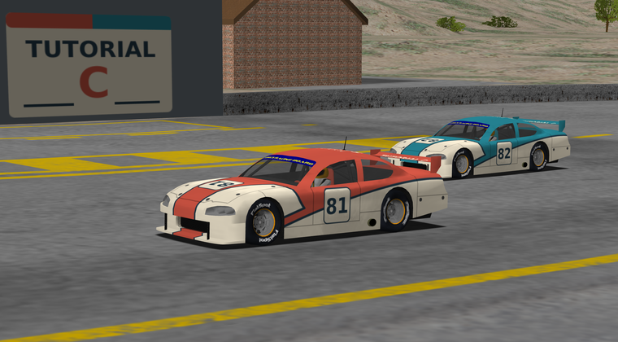
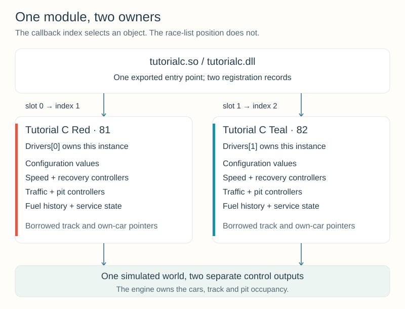
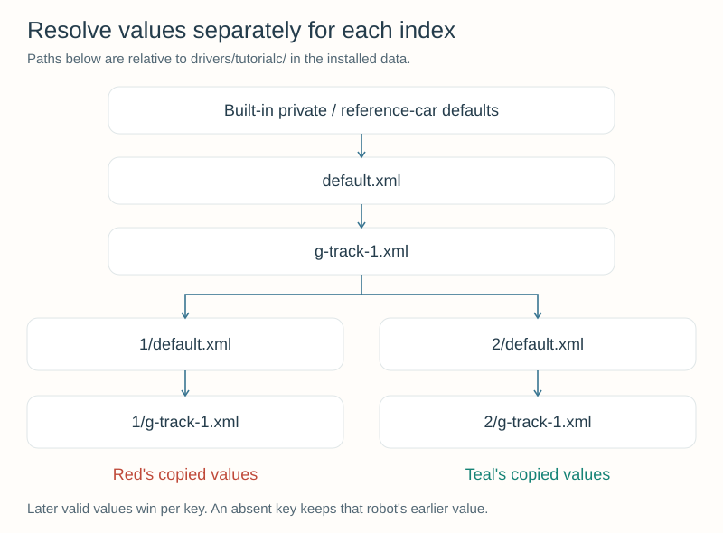

# Appendix C — Multiple Robots in One Module {#robot_tutorial_appendix_c}

One module can supply more than one robot. In this final appendix, **Tutorial C
Red** and **Tutorial C Teal** share the same driving code but own separate
configuration, recovery, traffic, and pit state. You will run either robot alone,
run both together, and give them different strategies and appearances.

This checkpoint brings together the complete driver from [Chapter 6](chapter_6.md),
the settings from [Appendix A](appendix_a.md), and the artwork workflow from
[Appendix B](appendix_b.md).

**You will learn to:**
- Distinguish registration slots, robot indices, and positions in the race list.
- Route callbacks to the correct driver object.
- Separate per-robot state from shared code and borrowed engine data.
- Load individual settings and images without changing the other robot's defaults.
- Manage instance lifetime and understand shared-pit occupancy.

## 1. Run the complete checkpoint {#robot_tutorial_c_start}

Build using the [Linux instructions](@ref robot_tutorial_linux_appendix_c) or
[Windows instructions](@ref robot_tutorial_windows_appendix_c). The archive
contains the complete source, configuration, artwork, and build files:

\htmlonly
<p><a href="tutorialc.zip" download>Download tutorialc.zip — complete two-robot checkpoint</a></p>
\endhtmlonly

Extract `tutorialc` under `src/drivers/` in your configured TORCS source tree.
No earlier driver module or artwork-generation tool is required to build it.
The build produces **one** `tutorialc.so` on Linux or `tutorialc.dll` on Windows.

Use **CG Speedway number 1** (`g-track-1`) and a **six-lap Quick Race**:

1. Select **Tutorial C Teal alone** first. It should race normally even though
   Red is absent; its full tank should cover this short race without a stop.
2. Repeat with **Tutorial C Red alone**.
3. Select both, putting Red first in the driver list. Begin with one car per pit,
   the default race setting. Both use fuel/damage strategy rather than forced stops.
4. Reverse their order and repeat. Their names, paint, and settings must follow
   their robot identities rather than their positions on the grid.

Both use `car1-stock1`. Red carries number **81**, Teal number **82**. The supplied
settings initially give both the full-tank racing baseline. Use Page Up / Page Down
to select the viewed car and the [Appendix B camera controls](@ref robot_tutorial_b_start)
to inspect its appearance.

[](multi-scene-hires.png)

*Red (81) and Teal (82) use individual liveries and a common team pit sign.
Click the image to enlarge it.*

## 2. Four numbers with different jobs {#robot_tutorial_c_indices}

| Identifier | Red | Teal | Meaning |
| --- | --- | --- | --- |
| Registration-array slot | `modInfo[0]` | `modInfo[1]` | Position in this module's metadata array |
| Exported robot index | `1` | `2` | Stable identity passed to this module's callbacks |
| XML section | `Robots/index/1` | `Robots/index/2` | Description matched to that exported index |
| Painted/XML race number | `81` | `82` | Display identification; not a callback-routing key |

There is also **`car->index`**, the engine's per-race car identifier: its original
slot in `carList`. It depends on the selected field and initialization order,
then stays with that car during the race. The `situation->cars[]` list can be
reordered as race positions change. Neither that list position nor `car->index`
is this module's robot index. When Teal runs alone, its `car->index` is 0 while
its robot index is still 2. That is why the first exercise starts with Teal alone.

The engine stores the robot identity as `car->_driverIndex`. For the driving,
new-race, pit-command, and shutdown callbacks, it passes the `index` stored in the
robot interface. Our initializer must therefore set `itf->index` correctly as
well as publishing `modInfo[slot].index`.

This example chooses consecutive indices **1 and 2** and maps them to storage
slots **0 and 1**. Index 0 is used by some other modules; our choice is not a
universal TORCS numbering rule. The current interface provides up to ten
registration slots. If you choose nonconsecutive indices, use an explicit mapping
rather than assuming every module can use `index - 1`.

## 3. Share code, give each robot an owner {#robot_tutorial_c_ownership}



In Appendix B, the module's single robot used file-scope controller objects.
Simply adding a second registration would make both cars use those same objects:
one car's `newRace` could reset the other's pit plan, and alternating driving
calls could mix their fuel observations.

`driver.h` now groups the state into a `TutorialDriver` class. Each object owns:

| Member | What must stay independent |
| --- | --- |
| `index` | The robot's stable registration identity |
| `configuration` | Loaded lookahead and strategy parameters |
| `speed` | Gear-change timing, target speed, car-dependent estimates |
| `recovery` | Recovery mode, elapsed stuck time, previous update time |
| `traffic` | Opponent observations, selected passing car, offset and manoeuvre state |
| `pits` | Route, mode, requests, visits, consumption measurements and merge state |
| `currentTrack`, `activeCar` | Borrowed references identifying this object's current session and car |

The methods in `driver.cpp` contain the integrated driving logic. The ordinary
driving, recovery, traffic, and pit helpers are still separate files. Their state
becomes independent because each `TutorialDriver` owns its own helper objects;
the driving algorithm itself does not need a second copy of its source code.

### What can remain shared?

- Function implementations and immutable constants can be shared.
- The engine's track and situation are shared observations. Each instance may
  borrow a pointer to the same track; that does not make it the track's owner.
- The registry of instance pointers is module-wide so callback wrappers can find
  the appropriate object.
- Mutable controller history belongs to an instance. A function-local
  `static double previousFuel` would still be shared across its calls; moving
  such a variable into a function would not solve the ownership problem.

The engine owns car, track, parameter, and pit-assignment structures. Our class
does not delete them. A shared pit can legitimately give two objects the same
borrowed `ownPit` pointer while their routes, fuel estimates, and decisions remain
separate. Each driving callback writes its own car's controls.

## 4. Register two interfaces and route their callbacks {#robot_tutorial_c_callbacks}

The exported `tutorialc` entry point fills two `tModInfo` records. Both use the
same `initInterface` function, with different indices and names. The remaining
records are zeroed. The description XML supplies matching `Robots/index/1` and
`Robots/index/2` entries, with distinct names and race numbers.

Registration is **discovery metadata**, not race initialization. Do not reset all
driver objects in the module entry point: discovery and loading can revisit a
module while another selected interface already has state. The entry point also
does not know which robots will actually be selected for a race.

The registry is:

```cpp
static constexpr int ROBOT_COUNT = 2;
static std::unique_ptr<TutorialDriver>
    Drivers[ROBOT_COUNT];
```

Initially both pointers are empty. `std::unique_ptr` expresses ownership: one
registry entry owns one object, and destroying or resetting that pointer destroys
the object and its owned containers. C++14 provides `std::make_unique` for creating
the object. No manual `new`/`delete` pairing is required in the callback wrappers.

The index check is centralized:

```cpp
static int
slotFor(int index)
{
    return index >= 1 && index <= ROBOT_COUNT ? index - 1 : -1;
}
```

`getDriver` uses that slot to return the selected object's pointer, or `nullptr`
for an invalid or uninitialized entry. Every wrapper follows the same pattern:

```cpp
static void
drive(int index, tCarElt* car, tSituation* situation)
{
    if (auto* driver = getDriver(index)) {
        driver->drive(car, situation);
    } else {
        car->ctrl = tCarCtrl{};
        car->ctrl.brakeCmd = 1.0f;
    }
}
```

The wrapper selects the owner; the class method performs the driving. The method
also checks that the supplied car matches its `activeCar`. This helps keep an
incorrectly routed call from using another car's controller state.

A non-static member function needs an object (`this`), so it cannot be assigned
directly to the ordinary `rbDrive` function pointer. The wrapper supplies the
bridge from TORCS's callback signature to the selected object's method.

`initInterface` validates the index and interface pointer, creates only that
selected instance, assigns the callback pointers, and sets `itf->index`. Both
robots use the same wrapper functions; the index chooses their different objects.
Adding registration records without matching XML entries, or forgetting the
interface index, is not a complete multi-robot implementation.

Register each module/index pair once in a race. Repeating the same pair in an
edited race file would route both cars to the same registry entry. A second car
needs its own registered identity.

## 5. Initialize and clean up the right object {#robot_tutorial_c_lifecycle}

| Stage | What happens in this checkpoint |
| --- | --- |
| Module discovery | Publish names, interface initializer, and indices; create no driver objects |
| `initInterface(index, ...)` | Create the selected `TutorialDriver(index)` and fill its interface |
| `rbNewTrack` | Reset this instance's controllers, borrow the track, and load its settings |
| `rbNewRace` | Associate the car, configure helpers from the effective car handle, then apply private settings |
| `rbDrive` | Dispatch to this instance and coordinate its controllers |
| `rbPitCmd` | Produce this instance's fuel/repair commands and update its service state |
| `rbShutdown` | Reset this instance's owning pointer; leave other entries alone |

The configuration ordering inside `newRace` matters: `pits.configure` resets the
pit helper, so `configuration.apply` comes afterward. This is the same ordering
explained in [Appendix A](@ref robot_tutorial_a_lifecycle), now performed separately
for each selected object.

The current engine calls `rbShutdown` during driver cleanup after a race, before
releasing the car parameter handles and unloading the race's modules. The registry
entry becomes empty again. A new selected interface gets a fresh object even if
the shared library remains loaded. Do not use module unloading as the only way to
reset per-race state.

**The current engine does not call `rbEndRace`.** The checkpoint leaves that
optional callback null and relies on the actual shutdown lifecycle. An empty
registry entry can be reset again safely; shutting down Red must not destroy Teal.

The metadata strings are a separate ownership matter. This module uses `strdup`
for the names and descriptions handed to `tModInfo`; the module loader frees those
copies. Do not also free them from each robot's shutdown callback. Temporary setup
handles are released by our settings loader, returned physical overrides are consumed by
the engine, and the class keeps copied private values. See
[Appendix A](appendix_a.md) for the parameter-handle lifecycle.

For two robots, a fixed array of whole driver objects could also work if each slot
were reset correctly. The owning-pointer version constructs only selected robots
and scales better when a driver later owns large path or learning data.

## 6. Give each robot its own settings {#robot_tutorial_c_settings}

The shared runtime files are under `drivers/tutorialc/`. Per-robot files are under
`drivers/tutorialc/1/` and `drivers/tutorialc/2/`. The numbers are the exported
indices, not the displayed race numbers 81 and 82.



For each recognized setting, `loadSettings(index, ...)` applies:

1. Built-in private defaults or the engine's reference car setup.
2. `drivers/tutorialc/default.xml`.
3. `drivers/tutorialc/<track>.xml`.
4. `drivers/tutorialc/<index>/default.xml`.
5. `drivers/tutorialc/<index>/<track>.xml`.

Later valid values override earlier ones. Missing keys retain earlier values.
Each call starts afresh; it does not inherit whichever robot was configured last.
The physical-setting whitelist and numeric validation from Appendix A still apply,
as does the final fuel fallback on tracks without supported side pits.

This precedence is our driver's policy. In particular, an **individual default
overrides a module-level track setting**. For an illustrative lookahead base of
8 m in the module defaults, 9 m in the module track file, 10 m in Red's defaults,
and 11 m in Red's track file, Red gets 11 m. If Teal's individual files omit that
key, Teal gets 9 m. The supplied individual files are empty sparse layers, so
both initially retain the module baseline of 8 m.

### Change only Teal

Replace the contents of your working `2/g-track-1.xml` with:

```xml
<?xml version="1.0" encoding="UTF-8"?>
<params name="Tutorial C Teal - CG Speedway number 1" type="param">
  <section name="Car">
    <attnum name="initial fuel" unit="l" val="4"/>
  </section>
  <section name="Tutorial C">
    <section name="Strategy">
      <attstr name="demonstration stop" val="no"/>
    </section>
  </section>
</params>
```

Save, leave the session, install, and begin a **12-lap race** with both robots.
Teal should start at about 4 litres and make fuel-driven stops. Red retains the
60-litre racing configuration. View each car's fuel display near the
start to confirm which file was applied.

Red's *parameter values* remain unchanged, but its lap times or pit-entry timing
can change in response to Teal's driving. That is interaction through the race,
not shared C++ state. A test for isolation must distinguish those two effects.

Restore Teal's sparse file after this exercise. No C++ rebuild is required for
these XML edits; both platform installation rules include the individual files.

## 7. Individual paint, common team sign {#robot_tutorial_c_artwork}

The renderer loads `1/car1-stock1.rgb` for Red and `2/car1-stock1.rgb` for Teal,
using the index-specific search described in [Appendix B](@ref robot_tutorial_b_lookup).
Each has a complete editable XCF and decal SVG under `artwork/1/` or `artwork/2/`.
The painted numbers 81 and 82 match the description XML but remain separate artwork.

The shared `logo.rgb` and its `artwork/logo.svg` source stay at module level.
Both XML entries use the exact team name **Tutorial C Team**. A single-car pit
falls back to that module logo, and a shared pit selects the module logo directly.
There is no need to duplicate it in both individual directories.

Inspect both cars in the same graphical session. Changing the viewed car should
switch the displayed name and show the corresponding colour and number. Reversing
the race list must not swap their paint. The common logo should still identify
the team if the pit is shared. Follow Appendix B's export/install workflow for
artwork edits and retain `ARTWORK.txt` with the sources.

## 8. Try a shared pit {#robot_tutorial_c_shared_pit}

Independent driver objects can share a physical resource. The track assigns pit
boxes; the engine records occupancy. Each robot observes the assigned box through
its own borrowed pit pointer. Two robots sharing a box must not both be serviced
there at once.

The default Quick Race setting is one car per pit. To try sharing:

1. Select both Tutorial C robots on the reference track and save the race setup.
2. **Close TORCS** before editing its race-manager configuration, so the loaded
   configuration cannot hide or overwrite your change.
3. Open the active user-profile file `config/raceman/quickrace.xml`:
   - Linux launcher default: `~/.torcs/config/raceman/quickrace.xml`.
   - Windows default: `%LOCALAPPDATA%/torcs/config/raceman/quickrace.xml`.
     A Windows installation unable to use that profile falls back to its runtime
     directory. A custom Linux `-l` profile uses the directory you selected.
4. Inside the **outer `Quick Race` section**, alongside its lap count—not inside
   `Starting Grid`—add or change this single attribute:

```xml
<attnum name="cars per pit" val="2"/>
```

5. For this exercise, set `demonstration stop` to `yes` in the module's
   `Tutorial C/Strategy` settings and install. Save, reopen TORCS, and run six laps.
   The matching team names and
   two-cars-per-pit allowance let these robots share an assigned box on this track.
6. Compare their entry, stopping, service, and release behavior. Restore the value
   to `1` when you want separate boxes again, and restore `demonstration stop=no`.

This file configures the **race manager**, unlike the driver settings under
`drivers/tutorialc/`. A new session reloads our private driver files, but for this
manual race-manager edit we close and reopen the game.

### Occupancy is not a reservation

The engine's occupancy flag says whether the box is in use now. It does not reserve
the box for a car still approaching. The inherited pit controller checks occupancy
before beginning an approach; if another car takes the box after entry, it limits
speed and waits before the capture region. Its front-traffic checks still apply.
After the occupant is released, the waiting car can continue when its path clears.

The supplied driver does not implement a team scheduler. It can defer an approach
because of traffic, and two independent fuel plans can create a queue. Allow fuel
margin and observe the actual delay. A possible extension is a team coordinator
that explicitly reserves service order, releases reservations on cancellation or
retirement, and considers remaining fuel. That would be intentionally shared
state with a defined owner, not an accidental shared `PitDriver` object.

## 9. Finish with a full-race comparison {#robot_tutorial_c_finish}

Keep the reference car and track. Use Red first and Teal second in the driver
list, allow two cars per pit, and configure **12 laps**. In the individual track
files, use these values:

| Setting | Red: `1/g-track-1.xml` | Teal: `2/g-track-1.xml` |
| --- | --- | --- |
| `Car/initial fuel` | 5 l | 4 l |
| `Tutorial C/Strategy/demonstration stop` | `no` | `no` |
| `Tutorial C/Strategy/stint laps` | 4 | 3 |

Use the XML structure from the previous exercise; `stint laps` is an `attnum`
inside the existing `Strategy` subsection. Leave other parameters at their
baseline values. Install and start a new session.

Before running, predict which robot will need fuel first and which will make more
visits. Record each robot's starting fuel, pit visits, fuel remaining, damage, and
classification. Watch any waiting at the shared box. The six-lap full-tank run is
the simpler comparison if a strategy experiment becomes difficult to interpret.

Teal's shorter stints can mean more pit visits and a lower finishing position.
Once the leader finishes, a lapped car can finish its race on its current lap:
for example, Red may complete 12 laps while Teal is classified with 11.
**Both drivers finishing the race does not necessarily mean both complete the
configured lap count.** Compare fuel remaining and pit visits as well as position.

You have completed the exercise when either robot works alone, both work together
in either selection order, edits reach the intended robot, shutdown/restart gives
fresh state, and you can explain their behavior at a shared pit. Restore the
supplied sparse overrides when you want to return to the racing baseline.

## 10. Troubleshooting and source map {#robot_tutorial_c_help}

| Symptom | Check |
| --- | --- |
| Only one robot appears | Both `tModInfo` records and matching description XML sections must exist |
| Teal fails when selected alone | Do not use `car->index` to select `Drivers`; Teal's robot index remains 2 |
| Settings seem to belong to the other robot | Check callback routing, stored index, and individual directory names |
| Editing a module track file has no effect | An individual default or track file may override that key |
| A recovery or service resets both cars | Look for shared mutable state, including function-local statics |
| The second robot stops after the first shuts down | Destroy only the indexed owning pointer |
| Cleanup code never runs | Do not rely on `rbEndRace`; use the supported shutdown lifecycle |
| Both cars have the same paint | Check installed `1/` and `2/` images, exported indices, and a new graphical session |
| Same team but separate boxes | The race's cars-per-pit allowance must also permit sharing |
| A shared-pit strategy is delayed | Occupancy and nearby traffic affect entry; independence is not a service reservation |
| A new individual file is missing after installation | Update its subdirectory Makefile and the Windows installation `Copy` list |

`tutorialc.cpp` contains metadata, instance ownership, and callback wrappers.
`driver.h/.cpp` contain the per-robot class and integrated control flow.
`settings.cpp` applies the five-stage per-key configuration policy. The inherited
helper files implement speed, steering, geometry, braking, recovery, traffic,
pit routing, and splines. The root and individual Makefiles, Windows project,
description XML, settings, artwork, and licenses are all included in the archive.

## The complete tutorial {#robot_tutorial_complete}

You started with a stationary module and made it drive, recover, choose speeds,
steer toward a target, share the road, and use the pits. You then separated setup
from source code, gave the driver recognizable artwork, and put two independently
owned robots into one module.

Keep the supplied checkpoints as reference points. For your next experiment,
choose one measurable question: a better trajectory, more reliable recovery,
less conservative traffic prediction, or coordinated pit strategy. State the
assumptions, change one thing, and compare complete runs as well as individual
moments. Preserve useful mathematics and explain where its model stops matching
the simulator.

Share your observations or ask for help through the
[tutorial's community links](@ref robot_tutorial_feedback).
Return to the [Robot Tutorial](index.md) or [Appendix B](appendix_b.md).
