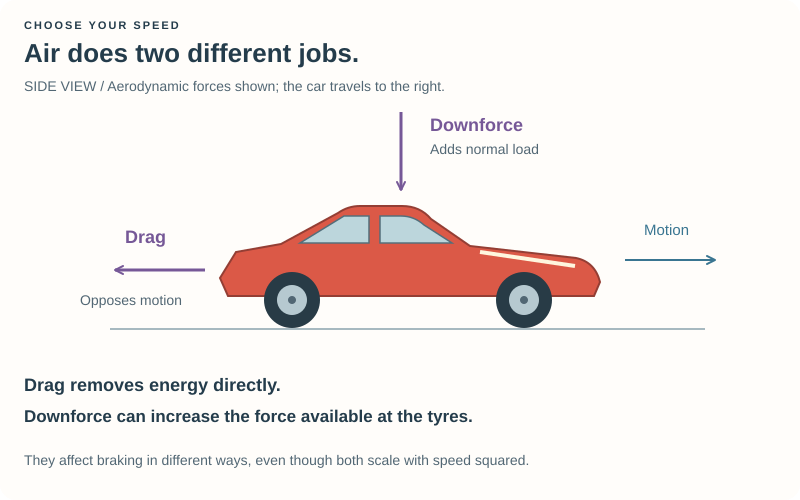
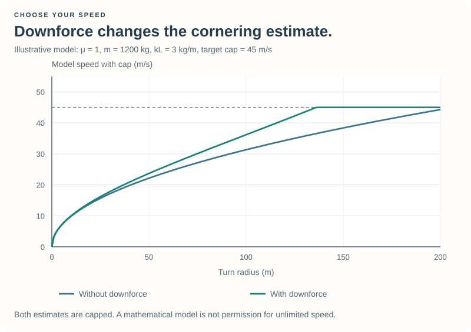
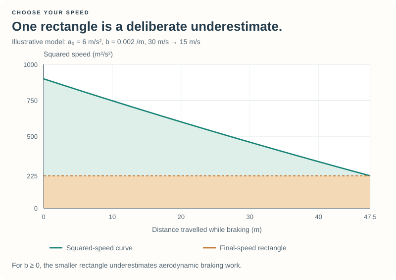
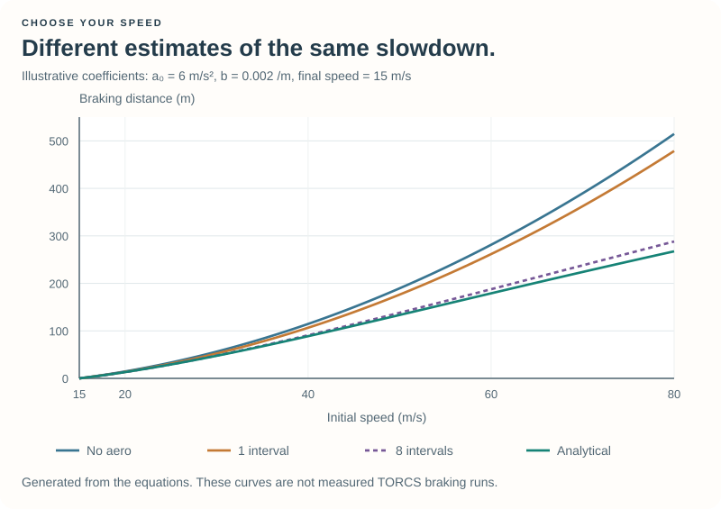
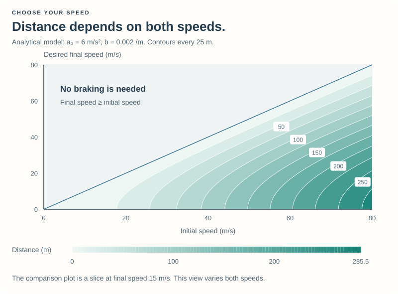

# Optional: Aerodynamics and the Analytical Solution {#robot_tutorial_braking_math}

This reading develops the cornering and braking models introduced in
[Chapter 3](chapter_3.md). Start with the pictures and the interpretations.
The calculus section is optional; you can use its result without following
every derivation step.

We are solving a **model**, not finding the universally shortest braking distance
in TORCS. Assume straight-line braking on a level surface, constant effective
grip and mass over the manoeuvre, and aerodynamic forces proportional to speed
squared. The tyres must retain positive normal load; with lift, require
\f$mg+k_Lv^2>0\f$ over the interval. Real tyre behaviour, load transfer, banking, and actuator response
still matter when driving.

## 1. Drag and downforce do different jobs {#robot_tutorial_3_aero_forces}

**Drag** acts against motion and directly helps remove kinetic energy.
**Downforce** adds normal load at the tyres; in our simple friction model that
increases the force they can transmit. It is not another backward force.

Wings can produce a force toward the ground. Flow beneath the car can also
produce downforce, often called **ground effect**. Ride height changes that
underbody flow, so the same car's aerodynamic behaviour can change as its
suspension moves.

We collect the aerodynamic properties into two coefficients:

\htmlonly

Frozen aerodynamic model

\endhtmlonly

\f[ F_D=k_Dv^2,\qquad F_L=k_Lv^2. \f]

Positive \f$k_L\f$ means downforce; negative \f$k_L\f$ means lift.
\htmlonly

\endhtmlonly

| Symbol | Meaning | Unit |
| --- | --- | --- |
| \f$k_D\f$ | Drag-force coefficient including density and area | kg/m |
| \f$k_L\f$ | Downforce coefficient including the chosen aerodynamic state | kg/m |
| \f$m\f$ | Current mass used by the model | kg |
| \f$\mu\f$ | Effective tyre/surface grip estimate | Dimensionless |

These \f$k\f$ values are not the dimensionless textbook coefficients
\f$C_D\f$ and \f$C_L\f$. For the familiar body-drag model,
\f$k_D=\tfrac12\rho C_D A\f$: dynamic pressure \f$\tfrac12\rho v^2\f$,
area, and shape together determine the force.
Here \f$\rho\f$ is air density in kg/m³, \f$A\f$ is reference area in m², and
\f$C_D\f$ is the dimensionless drag coefficient.

## 2. Cornering with downforce {#robot_tutorial_3_aero_corner}

The normal load is now approximated by \f$mg+k_Lv^2\f$. Repeating the inward-force
balance from Chapter 3 gives:

\f[
\begin{aligned}
\frac{mv^2}{R} &\leq \mu(mg+k_Lv^2),\\
v^2\left(1-\frac{\mu k_LR}{m}\right) &\leq \mu gR.
\end{aligned}
\f]

For a positive denominator:

\htmlonly

Aerodynamic cornering estimate

\endhtmlonly

\f[ v_{\mathrm{corner}}=
\sqrt{\frac{\mu gR}{1-\mu k_LR/m}}. \f]

Unlike the no-aerodynamics case, mass no longer cancels out.
\htmlonly

\endhtmlonly

With downforce, the estimate increases. With lift, it decreases. If
\f$k_L>0\f$ and \f$R\geq m/(\mu k_L)\f$, the denominator is zero or negative.
The force inequality then supplies **no finite speed bound** under this model.
It does not prove a real car can take the bend at any speed.

The implementation returns the gearing/redline search bound in that case, rather than
dividing by zero or taking a square root of a negative number. For negative
\f$k_L\f$, it also keeps the cap below the model's loss-of-normal-load speed
\f$\sqrt{mg/(-k_L)}\f$. The ordinary corner margin still applies.

## 3. Add aerodynamic work to braking {#robot_tutorial_3_aero_energy}

The tyres can provide a braking force of approximately
\f$\mu(mg+k_Lv^2)\f$, and drag contributes \f$k_Dv^2\f$. The total opposing force is:

\f[ F_{\mathrm{brake}}(v)=\mu mg+(\mu k_L+k_D)v^2. \f]

The energy difference is equal to the work over braking distance \f$d\f$:

\f[
\frac{m}{2}(v_{\mathrm{in}}^2-v_{\mathrm{out}}^2)
=\mu mgd+(\mu k_L+k_D)\int_0^d v(s)^2\,ds.
\f]

The integral is necessary because speed changes along the braking path. Using
the starting speed throughout would overestimate the aerodynamic contribution.

For compact notation, define:

\f[ a_0=\mu g,\qquad b=\frac{\mu k_L+k_D}{m}. \f]

Then the deceleration magnitude is \f$a(v)=a_0+bv^2\f$. The units are m/s² for
\f$a_0\f$ and 1/m for \f$b\f$. We assume \f$a_0>0\f$ and require positive
deceleration throughout the speed interval. The usual downforce-and-drag case
has \f$b\geq0\f$.

## 4. A useful conservative approximation {#robot_tutorial_3_aero_bound}

For \f$b\geq0\f$, deceleration is weakest at the final speed. Pretend that this
weaker value applies throughout the braking manoeuvre:

\htmlonly

One-interval distance estimate

\endhtmlonly

\f[ d_{\mathrm{bound}}=
\frac{v_{\mathrm{in}}^2-v_{\mathrm{out}}^2}
{2(a_0+bv_{\mathrm{out}}^2)}. \f]
\htmlonly

\endhtmlonly

In the energy picture, this approximation replaces the area under \f$v(s)^2\f$
by the smaller rectangle
\f$v_{\mathrm{out}}^2d\f$:

Underestimating the aerodynamic braking work produces a longer estimated
distance. It is an **upper bound within this model**, not a guarantee about the
complete simulator. If a signed coefficient gives \f$b<0\f$, the weaker endpoint
is instead the initial speed; the code uses the weaker of both endpoints.

Select `BrakingModel::AeroBound` in `speed.cpp` to try this model.

## 5. Refine the estimate numerically {#robot_tutorial_3_aero_numerical}

A single rectangle can be crude over a large speed change. Divide the interval
into smaller pieces and add their braking distances.

The code uses \f$u=v^2\f$, with equally spaced boundaries \f$u_0,\ldots,u_N\f$
from \f$v_{\mathrm{out}}^2\f$ to \f$v_{\mathrm{in}}^2\f$. Each piece contributes:

\f[
\Delta d_i=
\frac{u_{i+1}-u_i}{2\min(a_0+bu_i,\ a_0+bu_{i+1})},
\qquad d_N=\sum_{i=0}^{N-1}\Delta d_i.
\f]

This keeps the conservative endpoint idea, but follows the changing deceleration
more closely. With zero aerodynamic contribution, every subdivision gives the
same constant-deceleration result.

Select `BrakingModel::AeroNumerical`, then try `NUMERICAL_INTERVALS` values of
1, 4, 8, and 32 in `braking.cpp`. More intervals reduce approximation error but
cost more computation. No single interval count is equally accurate for every
speed range and coefficient choice. Simpson or Romberg integration is another
possible numerical approach; it does not automatically retain this upper-bound
property.

## 6. Optional derivation: solve the model analytically {#robot_tutorial_3_analytical}

This is the complete analytical route. Only this section needs differential and
integral calculus. Our initial condition is \f$v(0)=v_{\mathrm{in}}\f$.

### Step 1 — express deceleration per distance

From the force balance:

\f[ \frac{dv}{dt}=-(a_0+bv^2). \f]

Since \f$ds/dt=v\f$, the chain rule gives:

\f[ v\frac{dv}{ds}=-(a_0+bv^2). \f]

Equivalently, differentiating the work-energy equation gives
\f$d(\tfrac12mv^2)/ds=-m(a_0+bv^2)\f$. These are the same model.

### Step 2 — use squared speed

Let \f$u=v^2\f$. Then \f$du/ds=2v\,dv/ds\f$, so:

\f[ \frac{du}{ds}=-2(a_0+bu). \f]

### Step 3 — integrate and apply the starting condition

For \f$b\ne0\f$, separate the variables:

\f[
\begin{aligned}
\int_{v_{\mathrm{in}}^2}^{u(s)}\frac{du}{a_0+bu}&=-2\int_0^s ds,\\
\frac{1}{b}\ln\left(\frac{a_0+bu(s)}{a_0+bv_{\mathrm{in}}^2}\right)&=-2s.
\end{aligned}
\f]

Rearranging gives the squared-speed profile:

\f[ v(s)^2=
\left(v_{\mathrm{in}}^2+\frac{a_0}{b}\right)e^{-2bs}-\frac{a_0}{b}. \f]

Use the nonnegative square root for forward speed. This profile describes the
braking motion only until the car stops; extending it beyond that point would
eventually produce a negative squared speed.

### Step 4 — solve for the desired final speed

Set \f$v(d)=v_{\mathrm{out}}\f$ and solve for \f$d\f$:

\htmlonly

Exact distance for this braking model

\endhtmlonly

\f[ \boxed{
d=\frac{1}{2b}\ln\left(
\frac{a_0+bv_{\mathrm{in}}^2}{a_0+bv_{\mathrm{out}}^2}
\right)}. \f]
\htmlonly

\endhtmlonly

For \f$v_{\mathrm{in}}\geq v_{\mathrm{out}}\geq0\f$ and positive deceleration
throughout, the distance is nonnegative. The expression also works for a negative
\f$b\f$ while that domain condition holds. The code refuses a finite distance
if deceleration reaches zero or becomes negative in the interval.
The logarithm's argument is dimensionless, and \f$1/(2b)\f$ supplies metres.

### Step 5 — recover the simple formula

When \f$b=0\f$, the differential equation becomes \f$du/ds=-2a_0\f$. Therefore:

\f[ v(s)^2=v_{\mathrm{in}}^2-2a_0s,
\qquad d=\frac{v_{\mathrm{in}}^2-v_{\mathrm{out}}^2}{2a_0}. \f]

This is exactly the main chapter's constant-deceleration model. The logarithmic
formula approaches this result as \f$b\to0\f$.

## 7. Turn the result into reliable code {#robot_tutorial_3_analytical_code}

Directly subtracting nearly equal squared speeds and then taking a logarithm of
a number nearly equal to one loses precision. The implementation in `braking.cpp`
uses the equivalent expressions:

\f[
\begin{aligned}
\Delta u &=(v_{\mathrm{in}}-v_{\mathrm{out}})(v_{\mathrm{in}}+v_{\mathrm{out}}),\\
z&=\frac{b\Delta u}{a_0+bv_{\mathrm{out}}^2},\\
d&=\frac{\operatorname{log1p}(z)}{2b}.
\end{aligned}
\f]

`std::log1p(z)` computes \f$\ln(1+z)\f$ accurately for small \f$z\f$. The code
handles \f$b=0\f$ explicitly and uses the small-\f$z\f$ expansion
\f$\ln(1+z)/z=1-z/2+O(z^2)\f$ for very small terms. Equal speeds return zero.

Select `BrakingModel::AeroAnalytical` to use this implementation. For all optional
models, the planner searches for the largest allowed approach speed whose
calculated braking distance fits the available distance. That bounded search
also works with the numerical approximation.

For \f$b\geq0\f$, the no-aero estimate is longest, the one-interval aero estimate
is shorter, and the analytical distance is shorter still. Subdivision approaches
the analytical curve. At high speeds the opposing aerodynamic force grows with
\f$v^2\f$ too, so the distance no longer follows the simple quadratic growth of
the no-aero model. This explains why the aerodynamic braking curves in the
graph grow more slowly at high speeds.

The graph uses the printed illustrative coefficients. It is not a measurement
of a particular TORCS car, and an exact model calculation does not promise a
better lap time on every run.

For the same illustrative coefficients, slowing from 30 m/s to 15 m/s gives:

| Calculation | Distance |
| --- | --- |
| No aerodynamic contribution | 56.25 m |
| One-interval aerodynamic bound | 52.33 m |
| Eight conservative intervals | 48.08 m |
| Analytical aerodynamic solution | 47.51 m |

This connects the worked example in the main chapter with the successive
improvements. The difference between the last two rows is approximation error
within the same model, not a difference between two measured laps.

The full distance depends on both speeds. The contour map below shows that
two-variable dependence on a flat, labelled grid:

Pick an initial speed on the horizontal axis and a final speed on the vertical
axis. The labelled contours show the model distance in metres. At or above the
equal-speed diagonal, slowing down is unnecessary; that does not mean changing
to a higher speed takes no time or distance.

## 8. Where the car coefficients come from {#robot_tutorial_3_coefficients}

`SpeedDriver::configure` reads the current car parameter handle once per session.
The helper follows the present force-model conventions, using both wings:

\f[
\begin{aligned}
H&=1.5\sum_{i=1}^{4}h_i, & f_h&=2e^{-3H^4},\\
q_j&=1.23 A_j\sin\alpha_j,\\
k_L&=f_h(c_{\mathrm{front}}+c_{\mathrm{rear}})+4\sum_j q_j,\\
k_D&=0.645 C_x A_{\mathrm{front}}+\sum_j q_j.
\end{aligned}
\f]

- \f$h_i\f$ are the configured ride heights, in metres.
- \f$f_h\f$ is the ride-height factor used for the body's ground-effect contribution.
- \f$A_j\f$ and \f$\alpha_j\f$ are each wing's area and angle; angles returned in
  internal units are radians.
- The sums over \f$j\f$ include front and rear wings; \f$q_j\f$ is that wing's
  contribution to the drag coefficient in this frozen model.
- \f$c_{\mathrm{front}}\f$ and \f$c_{\mathrm{rear}}\f$ are the body's configured
  lift/downforce coefficients in the simulator's convention.
- `0.645` corresponds to the body's density factor in the force model. The wing
  and ride-height constants are empirical model coefficients with the implied
  unit conversions; they are not universal laws of aerodynamics.

We freeze ride height and wing state at the configured values. During driving,
pitch, suspension motion, airflow direction, damage, and other cars can change
the actual forces. The current mass is updated as `dryMass + car->_fuel`, matching
the mass term used by the simulator rather than introducing a second fuel-density
conversion.
As fuel is used, the same aerodynamic force acts on less mass, changing the
cornering and braking estimates.

The driver additionally uses planning reserves. Its effective grip combines the
lowest configured tyre coefficient with the relevant surface coefficient and
`GRIP_RESERVE`. For braking, `BRAKE_USAGE` scales both \f$a_0\f$ and \f$b\f$; for
cornering, `CORNER_MARGIN` reduces the model speed. The distance margins remain
active even with the analytical model.

Aerodynamic cornering is enabled in the supplied `speed.cpp`. Set
`AERO_CORNERS = false` to compare the gravity-only model, then restore `true`.
Compare one change at a time, then restore the defaults if the simple steering
cannot follow the more ambitious targets.

## What the model leaves out {#robot_tutorial_3_math_limits}

The derivation does not fully describe front/rear load transfer, brake balance,
load-sensitive tyre grip, tyre temperature and wear, changing ride height,
wheel rotational energy, road gradient, or combined braking and cornering.
Some forces also depend on airflow and vehicle orientation rather than forward
speed alone. Those are reasons to retain margins and observe the car.

The analytical result is exact **within its assumptions**. Numerical agreement
checks the mathematics; driving checks whether the approximation is useful.

Return to [Chapter 3](chapter_3.md), or visit
[Questions and feedback](@ref robot_tutorial_feedback).
