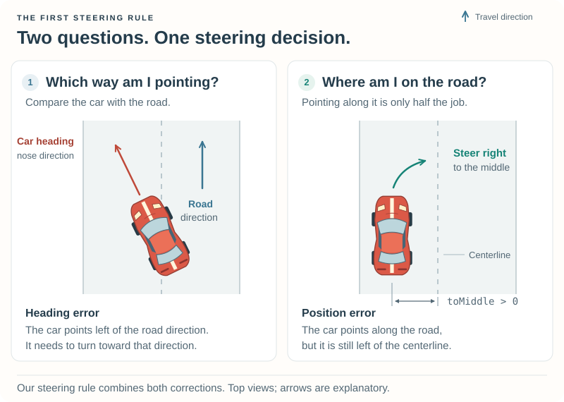

# 1\. Make It Drive {#robot_tutorial_chapter_1}

You have seen your robot sit still in Practice. Now let us make it drive!
If you have not reached that first checkpoint yet, follow
[Getting Ready](setup.md) for your platform, then return here.

We will keep the same robot and replace its stationary behaviour with a simple
steering rule and a little throttle. Edit your working copy in
`src/drivers/tutorial1/`.

## 1.1 Meet your robot {#robot_tutorial_1_prepare}

TORCS repeatedly calls your driving function. The function reads information
about the car and sets the steering, throttle, and brakes. The starter already
contains the code that connects this function to TORCS.

**For this chapter, you will work in `driving.cpp`. You can leave the other files
as supplied.** Open `src/drivers/tutorial1/driving.cpp` in a text editor so you can
follow along. The complete driving example is already there; the following
sections explain it a piece at a time.

By the end, you should be able to explain why the car steers toward the middle
of the road and change one setting to see how its behaviour changes.

## 1.2 Why it stays still {#robot_tutorial_1_build}

The skeleton's entire driving decision is:

```cpp
void
driveCar(tCarElt* car)
{
    car->ctrl = tCarCtrl{};
    car->ctrl.brakeCmd = 1.0f;
}
```

The line `car->ctrl = tCarCtrl{};` resets the driving commands to zero.
Full brakes hold the car still;
neutral gear and zero throttle are intentional. Finding this stationary car
in a practice session is the first success.

## 1.3 Make it drive {#robot_tutorial_1_drive}

### The track and the car {#robot_tutorial_1_state}

TORCS divides the road into connected pieces called **segments**: straights,
left turns, and right turns. A visible corner may span many segments.
`car->_trkPos.seg` identifies the car's current segment; `car->_trkPos` describes
its position relative to the track. `tCarElt` also supplies speed, orientation,
and many other properties.

Our steering rule answers two questions: **which way does the road point, and
how far is the car from the middle?**



In both views, travel is upward. Left and right are measured in the direction
of travel. The first view compares headings; in the second, the car is left
of the centerline and needs a correction to the right. Heading and position
are separate things: a car can point along the road while still being off-center.

The road's **tangent** is the direction the road points at that position.
**Yaw** is the direction the car points when viewed from above. TORCS measures
these angles in **radians**: pi radians is half a turn (180 degrees).

Useful values for our first controller:

| Expression | Meaning |
| --- | --- |
| `RtTrackSideTgAngleL(&car->_trkPos)` | Track tangent direction at the car's position, in radians. |
| `car->_yaw` | Car heading in world coordinates, in radians. |
| `car->_trkPos.toMiddle` | Lateral displacement from the centerline, in meters: positive left, negative right. |
| `car->_trkPos.seg->width` | Segment width in meters, used here to scale the correction. |
| `car->_steerLock` | Front-wheel steering angle corresponding to full steering input, in radians. |

This is a simple constant-width-track example. More advanced control should
account for local road geometry and look ahead rather than reacting only at
the current position. See the [Track Manual](../track_manual.md) for the
underlying track model and `RtTrackSideTgAngleL` in the API reference for the
track-tangent helper.

### Match the track heading {#robot_tutorial_1_heading}

Subtract the car's heading from the track tangent:

```cpp
double angle = RtTrackSideTgAngleL(&car->_trkPos) - car->_yaw;
NORM_PI_PI(angle);
```

`NORM_PI_PI` wraps the difference into the range from minus pi to pi. Without
this, crossing the angle representation's boundary could make a small heading
error look like almost a complete revolution.

For example, a road heading of -179 degrees and a car heading of +179 degrees
give a raw difference of -358 degrees. Those directions are actually only
2 degrees apart. Wrapping the angle gives +2 degrees, the small correction we
want. The code does this same calculation in radians.

### Correct the lateral position {#robot_tutorial_1_lateral}

Matching the tangent is not enough: the car could remain parallel to the track
while driving beside it. Add a correction toward the centerline:

```cpp
const double correction = 1.0;
angle -= correction * car->_trkPos.toMiddle / car->_trkPos.seg->width;
```

When the car is left of center, `toMiddle` is positive and we subtract a positive
correction, steering right. Right of center, the sign reverses. Dividing by
width expresses the displacement as a fraction of the track width. The gain
`correction` sets how strongly the car tries to return to the middle. This
multiplier is often called a **gain**. We choose it by trying the controller
and observing the result.

### Return the controls {#robot_tutorial_1_controls}

Steering input uses a scale from **-1 to 1**: -1 is full right, 0 is straight,
and +1 is full left. This scaled value is called a **normalized** input.
Throttle and brake commands are in **[0, 1]**. An accelerator value of `0.3`
requests 30% throttle, not 30% speed.

Divide our desired steering angle by the steering lock, clamp it to the allowed
range (so it cannot request more than full steering), engage first gear, and
apply a little throttle. Here is the complete
body used by the driving checkpoint. The source file includes the headers
needed to use the car data and track helpers:

```cpp
void
driveCar(tCarElt* car)
{
    car->ctrl = tCarCtrl{};

    const double correction = 1.0;
    double angle = RtTrackSideTgAngleL(&car->_trkPos) - car->_yaw;
    NORM_PI_PI(angle);
    angle -= correction * car->_trkPos.toMiddle / car->_trkPos.seg->width;

    const double steer = angle / car->_steerLock;
    car->ctrl.steer = static_cast<tdble>(std::max(-1.0, std::min(1.0, steer)));
    car->ctrl.gear = 1;
    car->ctrl.accelCmd = 0.3f;
}
```

Brake input remains zero from initialization. We assume a normal TORCS car and
valid track data with positive steering lock and track width. This first driver
does not yet select gears, plan braking, or recover after a spin.

### Build the driving checkpoint {#robot_tutorial_1_driving_build}

The complete code is already in `driving.cpp`. To try it, leave the Practice
session and return to the menu, then follow the short rebuild step for your
platform. You can keep TORCS open:

- [Rebuild on Linux](@ref robot_tutorial_linux_rebuild)
- [Rebuild on Windows](@ref robot_tutorial_windows_rebuild)

This selects `driving.cpp` rather than `skeleton.cpp`. Start a new **Practice** session, using
**Tutorial 1** on **CG Speedway number 1**, as you did during setup.

**The car should now accelerate and follow the course.** Watch it through a
straight and a corner. You can edit `driving.cpp` to try your own changes, then
repeat that same rebuild-and-Practice loop.

## 1.4 Make your first change {#robot_tutorial_1_experiment}

Once you have watched the supplied driver complete a lap, try this small edit:

1. Open `src/drivers/tutorial1/driving.cpp` in your text editor.
2. Find `car->ctrl.accelCmd = 0.3f;` and change `0.3f` to `0.2f`.
3. **Save the file.** Before rebuilding, predict what will happen. Will it
   accelerate differently? Will it take longer to complete a lap?
4. Leave the Practice session and return to the menu.
5. Rebuild using your [Linux](@ref robot_tutorial_linux_rebuild) or
   [Windows](@ref robot_tutorial_windows_rebuild) instructions.
6. Start a new Practice session with the same driver and track. Compare what
   happens with your prediction.

Write down what you changed, what you expected, and what you observed. You have
now used the loop that drives the rest of the tutorial:
**edit → save → build → observe**.

### Try another experiment {#robot_tutorial_1_more_experiments}

Restore the throttle to `0.3f`, then change only one thing at a time:

- Change `const double correction = 1.0;` to use `0.5`. Does the car return
  toward the middle more slowly?
- Try `1.5` instead. Does it correct more sharply or start weaving?
- Restore `correction` to `1.0` and try a tighter track. Does the car still
  get through the corners? What might it need to do before a tight bend?

Do not judge only by lap time. Watch for excursions, oscillation, damage, and
failure to complete the lap. This driver has no recovery logic and can remain
stuck after an accident. Restore the original settings whenever you want to
return to your starting point.

## Troubleshooting {#robot_tutorial_1_troubleshooting}

| Symptom | What to check |
| --- | --- |
| Tutorial 1 is absent from driver selection | Return to your platform's setup page and check that the build succeeded and you launched the game from that setup. |
| The build reports an error | Check your last edit against the example, including punctuation. Save and try again. If it still fails, copy the error text when asking for help. |
| The car stays still | Did you use the **driving** rebuild command and select **Tutorial 1**? Leave the old Practice session and start a new one after building. |
| Edits seem to do nothing | Did you save the file? Check that it is the copy in `src/drivers/tutorial1/`, that the build succeeded, and that you started a new Practice session. |
| The car crashes after a change | Restore throttle to `0.3f` and `correction` to `1.0`, save, rebuild, and try the original track again. |

Still stuck? [Ask for help](@ref robot_tutorial_feedback). You do not need to
identify the technical cause before asking.

## What comes next? {#robot_tutorial_1_next}

You now have a complete loadable robot and can explain its first steering rule.
Continue with [Chapter 2 — Get Back on Track](chapter_2.md) to recover when stuck.
Later improvements include choosing gears,
braking before corners, and steering toward a point ahead of the car. Opponents,
car setup, and pit strategy can then build on that foundation.

For implementation details, see the [Robot Module Interface](@ref robotmodint) (`tRobotItf`),
`tCarElt`, `tTrackSeg`, and `RtTrackSideTgAngleL` in the API reference.

Have a question, a suggestion, or an experiment to share? Visit
[Questions and feedback](@ref robot_tutorial_feedback).

## Optional: how the starter connects to TORCS {#robot_tutorial_1_internals}

You can return to this section when you are curious about the surrounding
files. Understanding these details is not required for the driving exercises.

### What the files do {#robot_tutorial_1_files}

| File | Purpose |
| --- | --- |
| `tutorial1.cpp` | Module entry point and TORCS callbacks shared by both checkpoints. |
| `driver.h` | Declares the driving function used by the module. |
| `skeleton.cpp` | First checkpoint: reset the controls and hold the brakes. |
| `driving.cpp` | Second checkpoint: steer toward the centerline and accelerate. |
| `tutorial1.xml` | Driver name, car, category, and instance index. |
| `Makefile` | Linux build and installation using the configured TORCS build. |
| `tutorial1.vcxproj`, `tutorial1.def` | Visual Studio project and DLL export definition. |

The header describes which function is available; the `.cpp` file contains how
it works. Both checkpoints implement `driveCar`, and the build selects one of
them. You only need to edit `driving.cpp` for the driving experiments.

The driver XML selects `car1-stock1` in category `stock1`. Its instance index is
**1**, matching `modInfo[0].index`. Array slot **0** is the first slot in the
module's list of interfaces; driver index **1** identifies the driver instance.

### How TORCS calls the robot {#robot_tutorial_1_callbacks}

A **callback** is a function you provide for TORCS to call at the appropriate
time. The entry point `tutorial1(tModInfo*)` describes the driver to the module
loader. Its `extern "C"` linkage exposes the expected symbol name. The Windows
`.def` file exports that symbol from the DLL.

TORCS then calls `initInterface`, which fills a `tRobotItf` with callbacks:

| Callback | Our first robot's responsibility |
| --- | --- |
| `rbNewTrack` | Receive track/setup information; return `nullptr` for optional custom car settings to retain the standard setup. |
| `rbNewRace` | Initialize per-race state. |
| `rbDrive` | Read the car state and set control commands on each driving update. |
| `rbShutdown` | Release driver-owned resources before unloading; our first driver has none. |

We leave optional callbacks null. Current TORCS does not call `rbEndRace`;
resource cleanup belongs in `rbShutdown`. Pit commands become relevant when
the driver supports pit stops.

The interface is documented in `src/interfaces/robot.h`; car state and commands
are in `src/interfaces/car.h`. Exported headers are copies for builds; consult
the originals when investigating their definitions.

The starter uses initialized objects (`tCarCtrl{}`), `nullptr`, explicit casts
where needed, and locally scoped variables. The module loader owns and frees
the descriptor strings, so those still use C-allocated `strdup` strings rather
than pointers into a temporary C++ string.

## Reference files {#robot_tutorial_1_reference}

The complete starter is in `src/doc/robot_tutorial/examples/chapter_1/` in the
source tree. The generated HTML also supplies individual downloadable copies:

\htmlonly
<ul>
<li><a href="tutorial1.cpp" download>Module source</a></li>
<li><a href="driver.h" download>Driving function declaration</a></li>
<li><a href="skeleton.cpp" download>Stationary checkpoint</a></li>
<li><a href="driving.cpp" download>Driving checkpoint</a></li>
<li><a href="tutorial1.xml" download>Driver description</a></li>
<li><a href="Makefile" download>Linux Makefile</a></li>
<li><a href="tutorial1.vcxproj" download>Visual Studio project</a></li>
<li><a href="tutorial1.def" download>Windows exports</a></li>
</ul>
\endhtmlonly

Return to the [Robot Tutorial](index.md).
