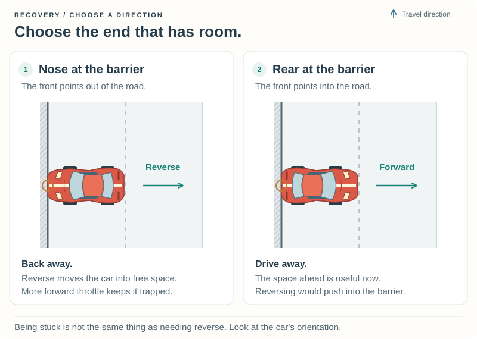
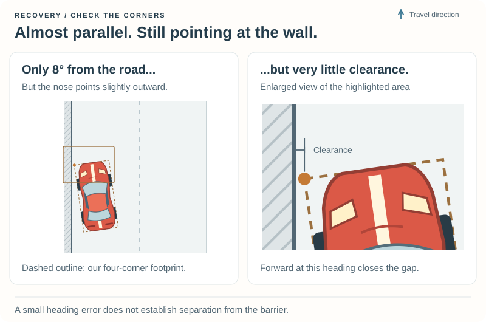
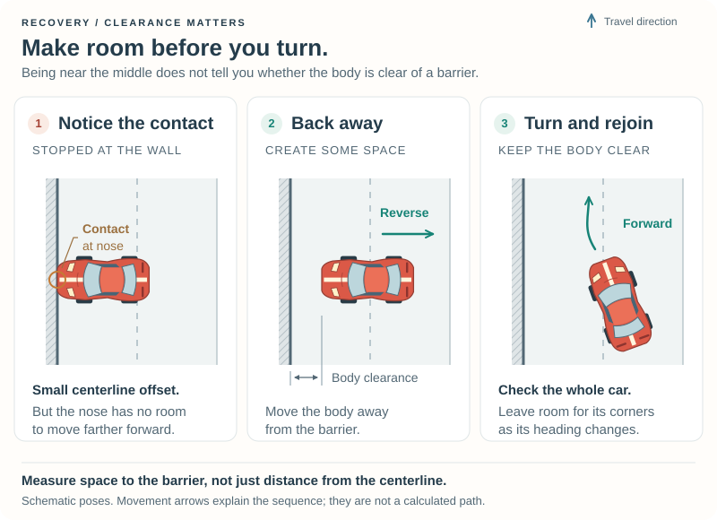

# 2\. Get Back on Track {#robot_tutorial_chapter_2}

Your robot can follow the road, but what happens after an accident? If its nose
is against a barrier, pressing the accelerator may just keep it there.

In this chapter you will teach one car to **notice that it is stuck, make room,
and return to driving**. You will also meet a useful programming idea: a robot
can remember what it was doing on the previous update.

## 2.1 Watch a mistake {#robot_tutorial_2_start}

First build the new **Tutorial 2** example using your platform page:

- [Prepare Chapter 2 on Linux](@ref robot_tutorial_linux_chapter_2)
- [Prepare Chapter 2 on Windows](@ref robot_tutorial_windows_chapter_2)

It has a separate working folder, `src/drivers/tutorial2/`, so your Chapter 1
experiments remain available. In TORCS, select **Tutorial 2** in **Practice** on
**CG Speedway number 1**.

**The first mistake is deliberate.** A small helper steers the car slowly into
the left barrier, once at the beginning of the session. This gives you a
repeatable problem to watch instead of waiting for an accidental crash.

Watch for three things:

1. The car meets the barrier and cannot continue normally.
2. After a short delay, it backs away and changes its heading.
3. It stops reversing, then continues around the track.

Some damage from that first contact is expected. A clean lap time is not the
goal of this exercise. The helper arranges the mistake; **the recovery code
has to decide how to get out of it**.

## 2.2 What counts as stuck? {#robot_tutorial_2_detect}

A large heading error alone is not enough. A car might be sliding and still
moving quickly. A low speed alone is not enough either: the car starts from
rest at the beginning of a session.

Our first useful rule combines three observations:

- The car is moving slowly.
- It points substantially away from the road direction **or** its body is very
  close to a barrier.
- That situation lasts for a short time.

The barrier check catches cases that a heading test misses, such as a car
nearly parallel to a wall. There is no minimum distance from the centerline:
on a narrow road, a car can be near the middle and still touch a barrier.

### Remember seconds, not update counts {#robot_tutorial_2_time}

Open `src/drivers/tutorial2/recovery.cpp`. The `Recovery` object keeps a few
values between driving updates. One is `stuckTime`, the number of seconds for
which the stuck conditions have continued.

TORCS supplies simulation time. Subtract the previous value to find how much
time passed since the last update:

```cpp
const double elapsed = std::max(0.0, situation->currentTime - previousTime);
previousTime = situation->currentTime;
```

Using simulation time means that pausing the game does not add to the delay.
It also avoids assuming that a particular number of updates always means two
seconds. At the start of each new session, `reset` clears our remembered state.

The detection code is:

```cpp
const bool misplaced = std::fabs(angle) > ENTRY_ANGLE * PI / 180.0 ||
    clearance.minimum() < NEAR_BARRIER;
if (situation->currentTime >= 0.0 && speed < SLOW_SPEED && misplaced) {
    stuckTime += elapsed;
} else {
    stuckTime = 0.0;
}
```

Here `angle` is the track heading minus the car heading, as in Chapter 1.
The speed includes both forward and sideways motion. `clearance.minimum()` is
the smallest space measured between a car corner and either side barrier.

We start with a delay of **2 seconds**, a slow-speed threshold of **1 m/s**, a
heading threshold of **15 degrees**, and a near-barrier threshold of **0.25 m**.
These are settings to experiment with, not universal rules.

**Predict:** if the car starts moving again after one second, should the timer
keep its old value? Our rule resets it, so a later stop gets a fresh delay.

## 2.3 Which way should it move? {#robot_tutorial_2_direction}

Reversing is useful when the nose is against a barrier. It is exactly the wrong
response if the rear is against the barrier and the nose points toward open road.



We reuse the heading difference to decide whether the car points toward or
away from the nearer barrier. The sign changes on the opposite side of the
track, so the same rule must work on both sides.

The driver remembers one of three **modes**, meaning what it is currently trying
to do:

| Mode | What the car does |
| --- | --- |
| `Driving` | Follow the centerline using Chapter 1's rule; watch for persistent trouble. |
| `Backing` | Move slowly in reverse to make space and improve the heading. |
| `MovingForward` | Move slowly forward to make space or finish the recovery. |

This is a small **state machine**: the current mode determines the behaviour,
and observations determine when to switch modes. Remembering the mode prevents
the robot from forgetting its recovery plan on the next update.

### Steering while reversing {#robot_tutorial_2_reverse}

At low speed, reversing with the same steering input rotates the car in the
opposite direction from driving forward. Our alignment correction therefore
changes sign:

```cpp
int direction = mode == Mode::Backing ? -1 : 1;
double steer = direction * angle / car->_steerLock;
```

The helper `moveSlowly` limits the steering request to the allowed range,
selects reverse or first gear, and uses the pedals to keep the manoeuvre slow.
It brakes with straight wheels if the car is still moving in the opposite
direction before changing gear. This is a modest recovery-speed control, not yet the corner-speed
planning we will build in Chapter 3.

## 2.4 Make room before turning {#robot_tutorial_2_clearance}

Heading and distance from the middle are useful, but **a small heading error
does not establish separation from a barrier**.



Here the car is nearly parallel to the road, but its nose still points slightly
toward the wall. Continuing forward at that heading reduces the front corner's
clearance. A forward steering correction might free it; the drawing does not
show that reversing is necessary. If the car remains slow and blocked, however,
the small angle alone should not prevent the robot from recognizing trouble.

When the barrier is directly at the main road edge, even the car's distance
from the centerline can be small during contact. Measuring the body corners
gives us additional information for detection and recovery.

For the nose-first recovery below, backing away creates space. For a rear-first
contact with the nose facing inward, moving forward is the useful response.



### Measure the body, not just its center {#robot_tutorial_2_corners}

TORCS exposes four car-corner positions. For each one, the helper
`measureClearance` asks for its position relative to the outer edges of the
track, including the verges or other side strips:

```cpp
tTrkLocPos corner{};
RtTrackGlobal2Local(car->_trkPos.seg, car->_corner_x(i),
    car->_corner_y(i), &corner, TR_LPOS_TRACK);
```

The important choice is `TR_LPOS_TRACK`. The normal main-road coordinates stop
at the road edges; these coordinates extend to the outer side boundaries used
for barrier collisions. On a track with a verge, the wall is farther away than
the main road edge.

The helper keeps the smallest `toLeft` and `toRight` values from the four
corners, and also records the minima for the front and rear pairs. Values near
zero mean a corner is at the boundary; a small negative value can occur during
contact. The illustration's dashed rectangle represents this simplified
four-corner footprint.

**You can use this helper as supplied.** For the driving decision, the useful
question is simply: “Does every corner have some space?”

### Separate first, then align {#robot_tutorial_2_separate}

The example uses a conservative **0.8 m** margin before applying its stronger
alignment correction. This is a chosen recovery strategy, not a claim that
every car near a barrier must separate before it can steer. During recovery:

1. Choose a direction that moves away from the nearer barrier.
2. While clearance is small, usually keep the steering straight to separate
   the body from the barrier.
3. Once there is room, apply the heading correction.
4. If the chosen end is blocked and the other end has more room, change direction.

For a nearly parallel car, the direction of movement matters:

- If the nose points slightly outward and reversing already increases the gap,
  keep the wheels straight while backing away. Applying the alignment correction
  too soon can clear the nose but bring the rear back toward the wall.
- If the car is effectively parallel, or its nose already points inward, use
  a gentle forward turn away from the nearer side. Brake first if it is still
  reversing.

Here "forward" means toward the car's nose, not necessarily the racing
direction. The wheel-angle choice also accounts for a car facing the wrong way.

The gentle forward steering input is deliberately small (`0.1` on the steering
scale). We do not obtain it by blindly reversing a steering sign: the front and
rear corners move differently during a turn. These remain simple manoeuvres,
not a guarantee of a collision-free path in every space.

### When is recovery finished? {#robot_tutorial_2_finish}

We ask for **both** adequate clearance and a heading error below **10 degrees**.
If the car is still reversing, it brakes before returning to normal driving.
The exit angle is smaller than the entry angle so that a small wobble around
one threshold does not keep starting and stopping recovery.

The margin is a practical teaching approximation. Four lateral corner checks
do not predict the whole path swept by a turning car. Sharp barrier changes,
very tight spaces, other cars, and pit buildings can need more sophisticated
planning. Increasing the margin indefinitely is not a solution: there might
not be that much room on a narrow track.

## 2.5 Try your own experiments {#robot_tutorial_2_experiments}

Keep the same car and track initially. Change one setting, save, leave Practice,
rebuild, and start a new session. Record **change / prediction / observation**.

### Change the waiting time

In `recovery.cpp`, change `STUCK_DELAY` from `2.0` to `1.0`. Predict when the robot
will begin backing away. Then try `3.0`. Does a shorter delay always seem better,
or could it mistake a brief interruption for being stuck?

### Put the other end against the wall

In `practice.cpp`, change `REVERSE_INTO_BARRIER` from `false` to `true`. The helper
now arranges rear-first contact. Predict the useful direction before starting.
The car should leave forwards; if ordinary driving already gets it moving,
there is no reason to enter a special recovery mode at all.

Set `BARRIER_ON_LEFT` to `false` to mirror the exercise on the right. The car
should make the same kind of decision with left and right exchanged.

### Change the room allowed for turning

Restore the nose-first exercise. Change `TURNING_SPACE` from `0.8` to `1.2`.
Watch whether the car separates farther before turning. Restore it afterwards.
When you try a different track, consider whether its verges and barriers leave
more or less room for the car.

### Let it drive normally

Set `START_WITH_MISTAKE` to `false` in `practice.cpp`. The helper no longer steers
into the barrier. Recovery still remains available if the robot becomes stuck
during your own experiments.

## If something goes wrong {#robot_tutorial_2_help}

| What you see | What to try |
| --- | --- |
| The car deliberately heads toward a wall | That is the starting exercise. Set `START_WITH_MISTAKE` to `false` when you want normal driving. |
| Your change has no effect | Save the file in `src/drivers/tutorial2/`, check the build succeeded, and select **Tutorial 2** in a new Practice session. |
| The helper does not reach the wall | Return to CG Speedway number 1 and the supplied settings. It stops arranging the exercise after 20 simulated seconds rather than steering indefinitely. |
| The car keeps switching direction or cannot get clear | Restore `TURNING_SPACE = 0.8` and the supplied car/track. Note which end is blocked and ask for help if the reference exercise still fails. |
| The car recovers without reversing | Its nose may already face open road. Moving forward is a useful outcome, not a failure. |

[Questions and feedback](@ref robot_tutorial_feedback) is the place to ask for
help or share an interesting recovery. Tell us which practice settings you used.

## What you have learned {#robot_tutorial_2_summary}

You have combined observations over time, remembered a mode between updates,
and distinguished heading, centerline position, and body clearance. These ideas
help a robot cope with mistakes instead of repeating the same command forever.

Continue with [Chapter 3: Choose Your Speed](chapter_3.md)—helping the car approach corners at
a suitable speed so it needs recovery less often. [Appendix C](appendix_c.md)
explains how multiple robots in one module keep their recovery state independent.

## Reference files {#robot_tutorial_2_reference}

The complete example is in `src/doc/robot_tutorial/examples/chapter_2/`.
The short module connects one `Recovery` object to TORCS and resets it at each
new session. `practice.cpp` arranges the initial mistake using ordinary controls;
it does not teleport the car or supply the recovery decision.

The headers describe the available functions and remembered state; the `.cpp`
files contain how they work. Edit `recovery.cpp` for recovery experiments and
`practice.cpp` for the initial exercise. The normal driving rule is in the small
`driveNormally` function in `recovery.cpp`, ready for the next chapter.

\htmlonly
<ul>
<li><a href="tutorial2.cpp" download>Module source</a></li>
<li><a href="recovery.h" download>Recovery declarations and state</a></li>
<li><a href="recovery.cpp" download>Recovery decisions and clearance helper</a></li>
<li><a href="practice.h" download>Practice helper declaration</a></li>
<li><a href="practice.cpp" download>Practice exercise settings and implementation</a></li>
<li><a href="tutorial2.xml" download>Driver description</a></li>
<li><a href="tutorial2.mk" download>Linux build rules</a></li>
<li><a href="tutorial2.vcxproj" download>Visual Studio project</a></li>
<li><a href="tutorial2.def" download>Windows exports</a></li>
</ul>
\endhtmlonly

For individual downloads, the Linux `Makefile` contains just
`include tutorial2.mk`. Copying the complete source directory supplies that
file too. Build instructions remain on the platform pages.

Return to the [Robot Tutorial](index.md).
