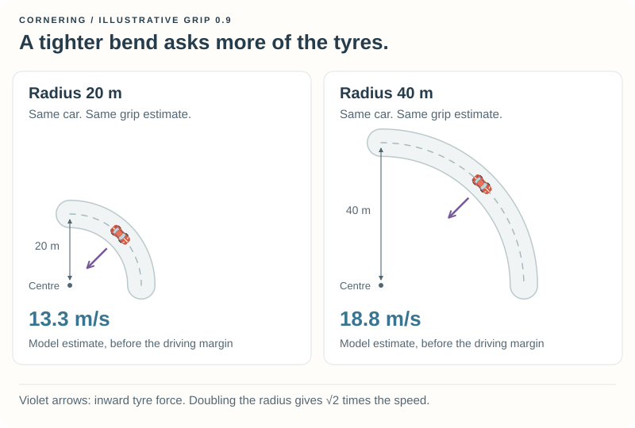
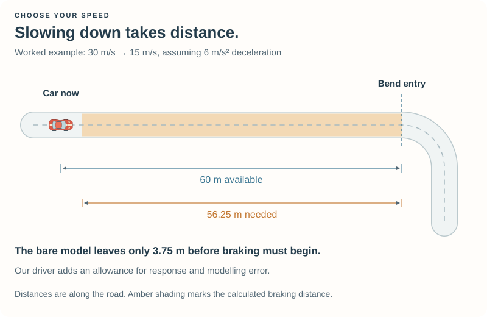
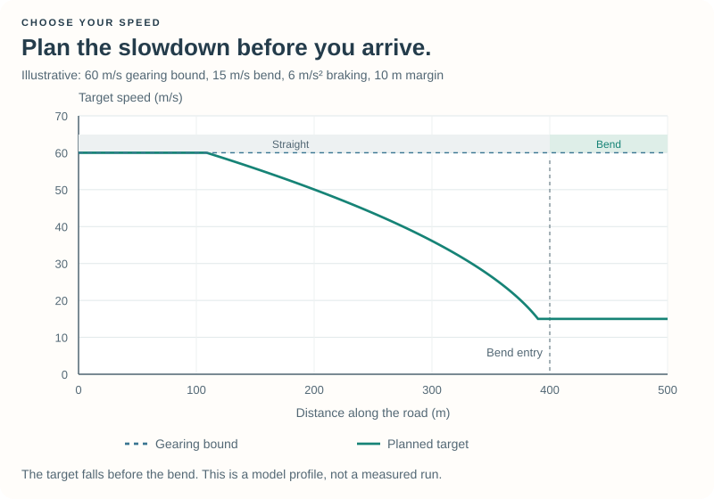
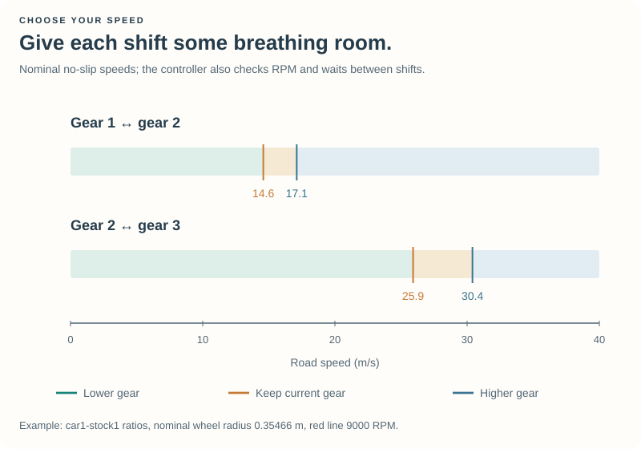

# 3\. Choose Your Speed {#robot_tutorial_chapter_3}

Your robot can follow the road and recover after a mistake. Now let us help it
avoid a common mistake in the first place: arriving at a bend too fast.

The new idea is to choose a **target speed**, then use the pedals and gears to
approach it. We will introduce the formulas as tools for making those decisions.
The full aerodynamic derivation and the details of wheel slip are available as
optional reading at the end.

## 3.1 Watch the car choose {#robot_tutorial_3_start}

Build **Tutorial 3** using your platform's instructions:

- [Prepare Chapter 3 on Linux](@ref robot_tutorial_linux_chapter_3)
- [Prepare Chapter 3 on Windows](@ref robot_tutorial_windows_chapter_3)

Select **Tutorial 3** in **Practice** on **CG Speedway number 1**. This version
does not deliberately drive into a wall. Chapter 2's recovery is still present
if the car becomes stuck.

Watch a straight, the approach to a bend, and the bend itself. Notice the speed,
listen to the engine, and watch the gear indicator. The car should accelerate,
change gears, and reduce its speed before a tighter section.

**For the main experiments, edit `src/drivers/tutorial3/speed.cpp`.** The supplied
driver already contains all the pieces. You can follow the explanation first
and then change one setting at a time.

## 3.2 A target is not a pedal position {#robot_tutorial_3_target}

In Chapter 1, the accelerator stayed at `0.3`. That meant 30% throttle, not 30%
of maximum speed. The same throttle position can produce different speeds in
different gears, on a slope, or against different resistance.

Our controller compares the speed it wants with the speed it has:

\htmlonly
<div class="formula-card"><div class="formula-label">Speed error</div>
\endhtmlonly

\f[ e = v_{\mathrm{target}} - v_{\mathrm{car}}. \f]

Positive error: accelerate. Negative error: slow down. Speeds and error are in m/s.
\htmlonly
</div>
\endhtmlonly

The driver accelerates when it is clearly below the target and brakes when it
is clearly above. In a small band around the target, it coasts. Larger errors
produce stronger pedal requests, up to the chosen limits. This is **feedback**:
each update uses the result of the previous decisions.

The commands remain between 0 and 1, and the controller does not request
throttle and braking together. The provided wheel-slip filters can reduce a
request further; you can read about them later.

Large, repeated swings between braking and accelerating can mean the controller
reacts too strongly or its braking estimate does not match the car. At higher
speeds, drag and downforce can make the car slow more strongly than a no-aero
estimate predicts. The small tolerance band helps avoid chatter; the optional
aerodynamic models improve the estimate itself.

## 3.3 How fast through a bend? {#robot_tutorial_3_corner}

Following a curved path requires an inward force. The tyres provide it. A
tighter bend asks for more force at the same speed, so we need a lower target.



For a first model, imagine a level road, steady cornering, and a constant grip
estimate. The required inward force is \f$mv^2/R\f$ and the available tyre force
is approximated by \f$\mu mg\f$. Requiring the former not to exceed the latter
gives:

\htmlonly
<div class="formula-card"><div class="formula-label">A simple cornering estimate</div>
\endhtmlonly

\f[ \frac{mv^2}{R} \leq \mu mg
\quad\Longrightarrow\quad v_{\mathrm{corner}} = \sqrt{\mu gR}. \f]

The mass cancels in this simple model.
\htmlonly
</div>
\endhtmlonly

| Symbol | Meaning | Unit |
| --- | --- | --- |
| \f$v\f$ | Speed | m/s |
| \f$R\f$ | Radius of the path through the bend | m |
| \f$\mu\f$ | Effective grip estimate | Dimensionless |
| \f$g\f$ | Gravitational acceleration, about 9.81 | m/s² |
| \f$m\f$ | Car mass | kg |

For example, \f$R=50\,\mathrm{m}\f$ and \f$\mu=0.9\f$ give approximately
\f$21.0\,\mathrm{m/s}\f$, or 75.6 km/h. These are illustrative numbers, not a
measurement of the selected track.

The completed example uses `CORNER_MARGIN = 0.90` and `GRIP_RESERVE = 0.85`
to allow for errors in the estimated path and tyre model. It has no fixed
teaching speed ceiling or reduced pedal authority: on a clear straight it can
request full throttle, while upcoming bends determine when to slow down.
The highest gearing/redline speed supplies a finite upper bound for the search;
it is not an imposed cruising speed. The actual car may be power- or drag-limited
well below it. Current speed is included if the car exceeds that gearing bound.

The supplied checkpoint includes downforce in cornering and selects
`BrakingModel::AeroAnalytical`. We first derive the simpler gravity-only model
here; the [braking companion](braking_math.md) develops the aerodynamic extension.

**Predict:** doubling the radius does not double the model speed. What does the
square root tell you about the increase?

Our car still tries to follow the centerline, so the segment radius is our first
path-radius estimate. A racing line or a car oscillating across the road can
have a different curvature. Better steering comes in Chapter 4.

## 3.4 Slow down before you arrive {#robot_tutorial_3_braking}

Suppose we are travelling at \f$v_{\mathrm{in}}\f$ and want to reach a lower
\f$v_{\mathrm{out}}\f$ before a bend. Slowing down takes distance.

The kinetic energy to remove is \f$\tfrac12m(v_{\mathrm{in}}^2-v_{\mathrm{out}}^2)\f$.
With a constant braking force of magnitude \f$ma_b\f$, the work over distance
\f$d\f$ is \f$ma_b d\f$. Equating these and cancelling mass gives:

\htmlonly
<div class="formula-card"><div class="formula-label">Constant-deceleration braking distance</div>
\endhtmlonly

\f[ d_{\mathrm{brake}} =
\frac{v_{\mathrm{in}}^2-v_{\mathrm{out}}^2}{2a_b}. \f]

Here \f$a_b>0\f$ is the magnitude of deceleration, in m/s². Both speeds are in m/s.
\htmlonly
</div>
\endhtmlonly

If the car is already at or below the target speed, no braking distance is
required. Otherwise the basic calculation in `braking.cpp` is equivalent to
the following expression, where `a0` is the constant deceleration:

```cpp
double distance = (initialSpeed * initialSpeed - finalSpeed * finalSpeed)
    / (2.0 * a0);
```

### A worked example {#robot_tutorial_3_worked}

From 30 m/s to 15 m/s, assuming a deceleration of 6 m/s²:

\f[ d = \frac{30^2-15^2}{2\cdot6}=56.25\,\mathrm{m}. \f]



If the bend is 60 m away, the bare model leaves only 3.75 m before braking must
begin. Our robot starts earlier: `BRAKE_MARGIN` adds a fixed allowance, and
`RESPONSE_TIME` adds an allowance proportional to current speed. These cover
updates, brake response, and some modelling error.

Setting the final speed to zero gives the stopping-distance model
\f$d_{\mathrm{stop}}=v^2/(2a_b)\f$. Under this constant-deceleration assumption,
doubling the starting speed quadruples the stopping distance.

## 3.5 Look ahead along the road {#robot_tutorial_3_lookahead}

Checking only the current segment is too late: a straight can end in a tight
bend. We walk through the segments ahead, accumulating **distance along the
road**, and ask what each upcoming speed target permits us to do now.

Rearrange the same braking equation:

\htmlonly
<div class="formula-card"><div class="formula-label">Speed permitted by an upcoming bend</div>
\endhtmlonly

\f[ v_{\mathrm{allowed}} =
\sqrt{v_{\mathrm{bend}}^2+2a_b d_{\mathrm{usable}}}. \f]

Usable distance is the distance to the bend after subtracting the braking margin,
never less than zero.
\htmlonly
</div>
\endhtmlonly



The smallest permitted speed found ahead becomes the current target, also
limited by the current segment and the gearing bound. A gentle bend must not hide
a tighter bend immediately after it.

The example uses the lowest main-track surface grip found on the lap for its
braking estimate. This is intentionally conservative when surfaces vary. Using
only the present high-grip surface could make the lookahead too short for a
low-grip section ahead.

### The distance helper {#robot_tutorial_3_distance}

On a straight, `toStart` is a distance in metres. On a curve, it is an angle in
radians. Let \f$L\f$ be the segment length in metres and \f$\theta\f$ the curve's
total arc angle in radians. With radius \f$R\f$ in metres, the distance remaining is:

\f[
d_{\mathrm{remaining}} =
\begin{cases}
L-\texttt{toStart}, & \text{straight},\\
R(\theta-\texttt{toStart}), & \text{curve}.
\end{cases}
\f]

`distanceToSegmentEnd` in `speed.cpp` performs this conversion. After that,
each following segment contributes its length in metres. The search wraps
across the start line and is bounded by both a lookahead distance and the
number of segments, so it cannot follow the circular list forever.

## 3.6 Let the gearbox help {#robot_tutorial_3_gears}

First gear eventually limits useful acceleration. A higher gear lets the car
travel faster without turning the engine as quickly; a lower gear is useful
again when speed falls.

For rolling wheels with negligible slip:

\f[ \omega_{\mathrm{wheel}}=\frac{v}{r_w},
\qquad \omega_{\mathrm{engine}}\approx G_k\frac{v}{r_w}. \f]

Here \f$r_w\f$ is wheel radius and \f$G_k\f$ is the overall ratio for gear
\f$k\f$, including the final drive. Angular speeds are in radians per second.

The driver shifts up before the engine red line and checks the predicted engine
speed before shifting down. It uses different up/down thresholds and waits
briefly between requests. Otherwise a small speed fluctuation could produce
repeated upshift/downshift changes, called **gear hunting**.



The code respects the available gear range. It also checks road speed before
upshifting, so spinning wheels alone do not immediately cause a higher gear.
Chapter 2's recovery owns the controls while it is active; normal gear selection
must not replace its reverse request.

## 3.7 Make a prediction, then try it {#robot_tutorial_3_experiments}

Use the same car and track at first. Edit `speed.cpp`, save, leave Practice,
rebuild, and start a new session. Change just one setting:

1. Set `BRAKING_MODEL = BrakingModel::Basic` to compare the simpler braking model.
2. Increase `BRAKE_MARGIN` from `5.0` to `10.0`. Does braking begin earlier?
3. Reduce `CORNER_MARGIN` from `0.90` to `0.85`. Watch the tighter bends.
4. Change `SHIFT_UP` from `0.88` to `0.82`. Listen for the earlier upshift.

Record **change / prediction / observation**. Restore the defaults before moving
to a different track. **E-Track 2** offers a longer, tighter comparison once the
introductory example works.

The formulas specify targets, not exact measured speeds. Some lag and
overshoot are normal. Judge whether braking begins before the bend, gear changes
are sensible, and the car completes the lap consistently.

## Go deeper when you are curious {#robot_tutorial_3_optional}

Air resistance and downforce change the model, particularly at higher speeds.
The first optional reading develops a simple approximation, a numerical approach,
and the complete analytical solution. The second explains the
provided ABS and traction-control filters and goes further into gearing.

- @subpage robot_tutorial_braking_math
- @subpage robot_tutorial_wheel_control

You do not need to derive those results to use the example. The analytical
aerodynamic model and slip filters are supplied and enabled. The basic model
remains available for comparison; optional mathematics does not mean disabled
systems in the completed driver.

## If something goes wrong {#robot_tutorial_3_help}

| What you see | What to try |
| --- | --- |
| The car still behaves like Chapter 2 | Select **Tutorial 3**, edit the copy in `src/drivers/tutorial3/`, and check that the build succeeded before starting a new session. |
| The car misses corners after a change | Restore the supplied modelling margins and braking model. The steering is still deliberately simple. |
| The gearbox changes too often | Restore `SHIFT_UP = 0.88` and `SHIFT_DELAY = 0.7`; review the two different shift thresholds. |
| A faster setting gives a worse lap | Watch where time is lost. Wheel slip, late braking, or poor cornering can outweigh extra speed on a straight. |
| You see a build error | Check the edited value and punctuation, save, and rebuild. Include the error text when asking for help. |

[Questions and feedback](@ref robot_tutorial_feedback) is the place to share an
experiment or ask about a confusing step.

## Reference files and next steps {#robot_tutorial_3_reference}

The complete example is in `src/doc/robot_tutorial/examples/chapter_3/`.
`speed.cpp` contains normal driving and the main settings; `braking.cpp` contains
the distance models. Recovery remains in its own source file and takes priority.

\htmlonly
<ul>
<li><a href="tutorial3.cpp" download>Module and callback wiring</a></li>
<li><a href="speed.cpp" download>Speed planning, pedals, gears and slip filters</a> / <a href="speed.h" download>declarations</a></li>
<li><a href="braking.cpp" download>Braking and cornering models</a> / <a href="braking.h" download>declarations</a></li>
<li><a href="recovery3.cpp" download>Recovery override</a> / <a href="recovery3.h" download>declarations</a></li>
<li><a href="tutorial3.xml" download>Driver description</a></li>
<li><a href="tutorial3.mk" download>Linux build rules</a></li>
<li><a href="tutorial3.vcxproj" download>Visual Studio project</a> / <a href="tutorial3.def" download>Windows exports</a></li>
</ul>
\endhtmlonly

For individual downloads, the Linux `Makefile` contains `include tutorial3.mk`.
Copying the source directory supplies it automatically. Build instructions stay
on the platform pages.

Continue with [Chapter 4 — Steering and Trajectory](chapter_4.md) to improve
steering and explore the path through a bend. [Appendix C](appendix_c.md) explains
how multiple robots in one module own separate speed and gear-change state.

Return to the [Robot Tutorial](index.md).
