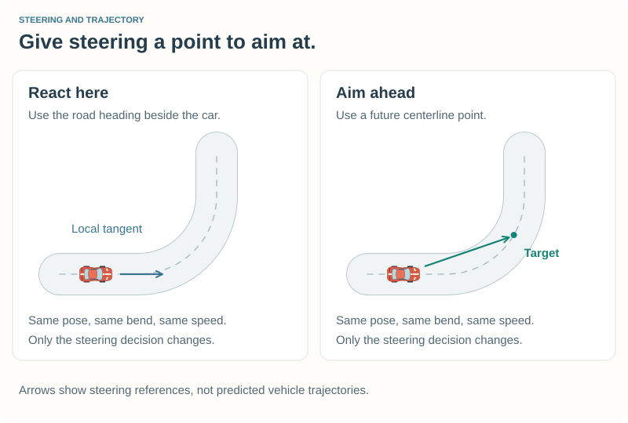
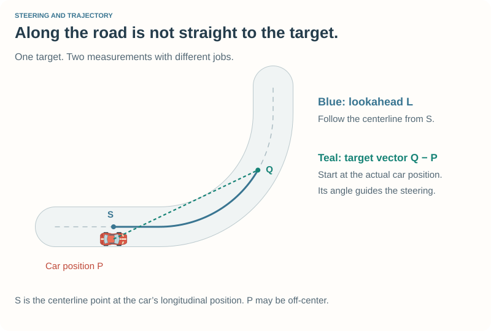
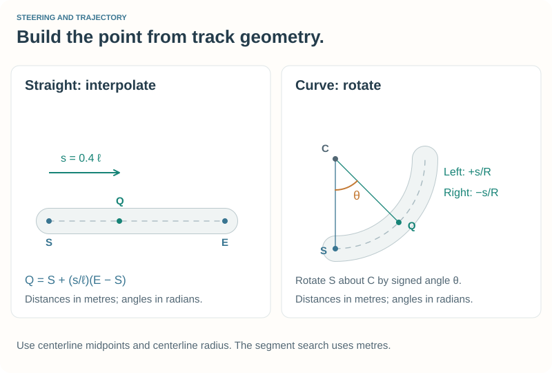
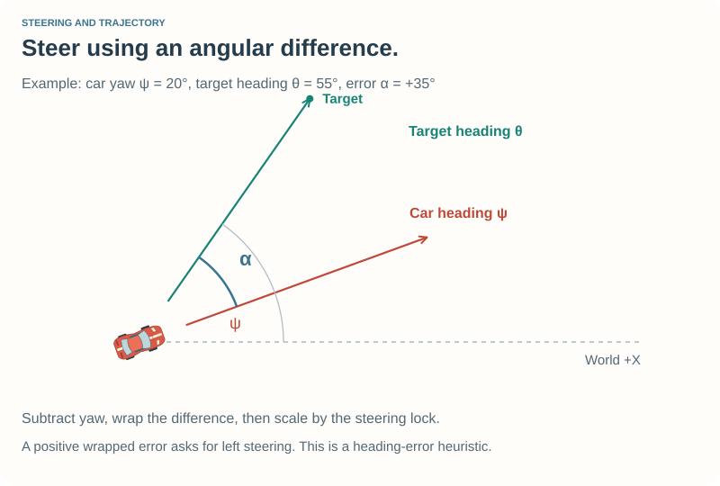
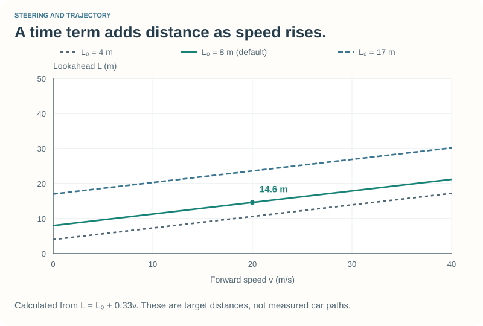
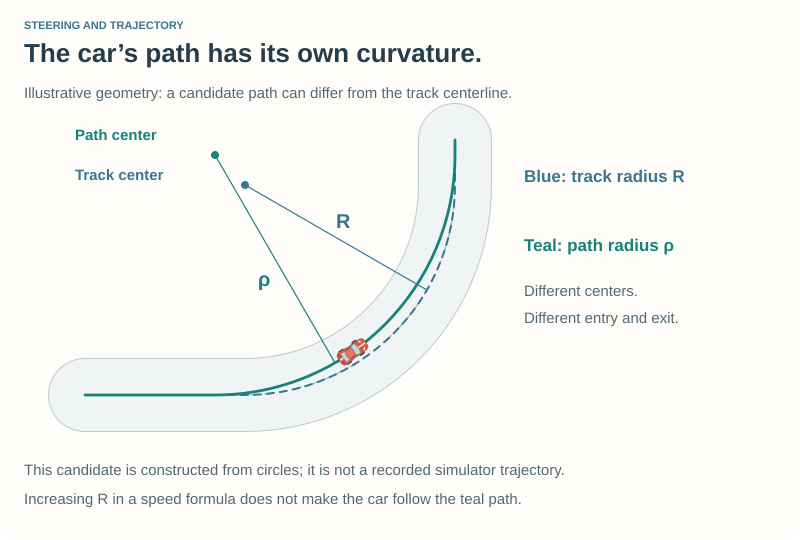
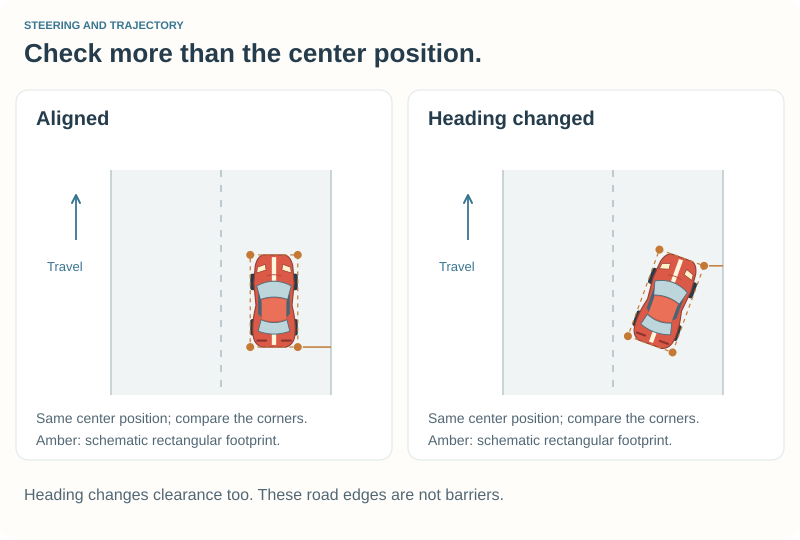

# 4\. Steering and Trajectory {#robot_tutorial_chapter_4}

Your robot now chooses a speed for the road ahead. Let us give its steering
the same ability to anticipate: **choose a point ahead, then steer toward it**.

This simple change raises an interesting question. If the target lies on the
centerline, will the car follow the centerline too? Try the example, watch a
bend, and keep that question in mind.

## 4.1 Compare before tuning {#robot_tutorial_4_start}

Prepare the independent **Tutorial 4** example:

- [Prepare Chapter 4 on Linux](@ref robot_tutorial_linux_chapter_4)
- [Prepare Chapter 4 on Windows](@ref robot_tutorial_windows_chapter_4)

Select **Tutorial 4** on **CG Speedway number 1** in **Practice**. It uses the
same car and initial speed settings as Tutorial 3. Watch the approach to a
bend, the middle of it, and the exit. Compare with Tutorial 3, especially
where the car begins to turn and how close it stays to the middle.

**For the steering experiments, edit `src/drivers/tutorial4/steering4.cpp`.**
The complete implementation is supplied. The small vector helpers are already
included, so you can use them now and explore their mathematics later.

For a direct comparison within this example, set `ENABLE_EDGE_FEEDBACK = false`
and compare `USE_LOOKAHEAD = false` with `USE_LOOKAHEAD = true`. Leave the speed
settings alone. These switches isolate Chapter 3's steering and the lookahead rule. Restore
both switches to `true` after the comparison.

After each edit: **save → leave Practice → rebuild → start a new Practice**.
Pausing the session does not unload the robot. Watch a few laps; the first lap
includes acceleration from the starting position.

## 4.2 Look where you want to go {#robot_tutorial_4_target}

Our earlier steering combines the road's direction at the car with a correction
for being left or right of the centerline. This is useful feedback, but it does
not explicitly choose a future destination.

The new rule chooses a target on the centerline a little farther along the road.
As the car moves, the target moves too. It is a moving guide, not a destination
where we intend to stop.



There are **two different distances** in this picture:

- The **lookahead distance** follows the centerline from the car's current
  longitudinal track position to the target.
- The **target vector** goes straight from the car's actual world position to
  that target. Its direction tells us where to steer.

When the car is off-center, the centerline starting point is beside the car.
We do not begin measuring lookahead at the car's nose, and we do not measure
it along the straight target vector.



## 4.3 Find the target on the track {#robot_tutorial_4_segments}

The track is a circular list of segments. We first express our progress in the
current segment in metres. As in Chapter 3, `toStart` is in **metres on a
straight** but **radians on a curve**:

```cpp
const double distance = segment->type == TR_STR ? position.toStart :
    position.toStart * segment->radius;
```

Add the lookahead distance. If the result goes beyond this segment's length,
subtract that length and advance to the next segment. Repeat until the target
falls within a segment. This also works across the start/finish line.

`targetAhead` bounds the search using the track's segment count and skips
zero-length segments. The caller limits lookahead to half a lap; if a target
cannot be found, it falls back to the earlier steering rule. These details
prevent a malformed search from trapping a driving update in an endless loop.

Once we know the segment and distance into it, `centerlinePoint` does the geometry:

| Segment | Construction |
| --- | --- |
| Straight | Start at the midpoint between its left and right start vertices and interpolate toward the corresponding end midpoint. |
| Left curve | Rotate the start midpoint around the curve center by distance / radius. |
| Right curve | Use the same rotation with a negative angle. |

The result is a point in the track's world X–Y coordinates, in metres. Our
horizontal steering approximation does not use height. Slopes, banking, and
the car's dynamics still influence what happens when it drives.



The [geometry companion](geometry.md) derives these constructions with numbers
you can check on paper.

## 4.4 Turn the direction into steering {#robot_tutorial_4_heading}

Subtract the car's world position from the target to obtain a direction vector.
`atan2(y, x)` finds its world heading, including the correct quadrant. Subtract
the car's yaw to obtain a heading error:

\htmlonly
<div class="formula-card"><div class="formula-label">Heading error toward the target</div>
\endhtmlonly

\f[ \alpha=\operatorname{wrap}_{[-\pi,\pi]}
\left(\operatorname{atan2}(y_t-y_c,x_t-x_c)-\psi\right). \f]

The target is \f$(x_t,y_t)\f$, the car is at \f$(x_c,y_c)\f$, and \f$\psi\f$
is its yaw. Angles are in radians.
\htmlonly
</div>
\endhtmlonly

Wrapping picks the short angular difference across the −π/π boundary. A target
at −179° and a car heading of +179° differ by +2°, not −358°.



The implementation then scales by the nominal steering lock and limits the
command to the interval −1 to +1:

```cpp
double angle = std::atan2(direction.y, direction.x) - car->_yaw;
NORM_PI_PI(angle);
return std::max(-1.0, std::min(1.0, angle / car->_steerLock));
```

This is a **heading-error steering heuristic**. It does not solve the vehicle's
motion equations. Positive error requests left steering; negative error requests
right steering. A negligible direction vector or unavailable steering lock
produces a zero request rather than an undefined calculation.

Do not confuse this with a complete *pure-pursuit* controller. That controller
uses wheelbase and target geometry to calculate a desired curvature. We discuss
the distinction in [other trajectory approaches](trajectories.md).

## 4.5 How far ahead? {#robot_tutorial_4_lookahead}

At higher speed, the car covers more ground between successive corrections.
We therefore let lookahead increase with speed:

\htmlonly
<div class="formula-card"><div class="formula-label">Speed-dependent lookahead</div>
\endhtmlonly

\f[ L=L_0+Tv. \f]

\f$L_0\f$ is a base distance in metres, \f$T\f$ is a time in seconds, and
\f$v\f$ is forward speed in m/s. Thus \f$Tv\f$ is also a distance.
\htmlonly
</div>
\endhtmlonly

Our initial settings are:

```cpp
static constexpr double LOOKAHEAD_BASE = 8.0;     // metres
static constexpr double LOOKAHEAD_TIME = 0.33;    // seconds
```

At 20 m/s, that gives \f$8+0.33\times20=14.6\,\mathrm{m}\f$. The implementation
uses zero rather than negative forward speed in this calculation. Chapter 2's
recovery remains responsible for deliberate reversing.



**Experiment: change the base distance.** Keep `LOOKAHEAD_TIME = 0.33` and try
`LOOKAHEAD_BASE` values of 4, 8, and 17. Use a fresh Practice session for each.
Predict when steering will begin and where the car will pass through the bend.
Then restore 8.

**Experiment: change the time.** Keep the base at 8 and compare time values of
0.33 and 0.66. Which parts of the lap change most? Explain why changing the time
has a larger effect at high speed than at low speed. Restore 0.33 afterward.

A short lookahead tends to demand more immediate corrections. A longer one
anticipates more of the bend but can cut its inside or overlook a short change
of direction. Neither extreme is universally better. A curved target path does
not mean that the car will travel along the same curve.

## 4.6 Keep the whole car on the road {#robot_tutorial_4_edges}

A target on the centerline is not proof that the car stays on the road. In a
bend, the straight direction toward that target points across the inside. The
car follows a changing curved trajectory as its steering and speed respond.



We measure the car's four corners against the **main road's edges**. The smallest
signed clearance, `roadClearance`, is positive when all four sampled corners
are inside and negative when at least one is outside. This differs from
Chapter 2's barrier clearance: a grass verge can leave plenty of room before a
barrier while the car has already left the racing road.



`RtTrackGlobal2Local` with `TR_LPOS_MAIN` gives those road-relative coordinates.
`TR_LPOS_TRACK`, used by recovery, extends the lateral distances through the side
strips. Both searches start from the car's nearby main segment.

With `ENABLE_EDGE_FEEDBACK = true`, the new `edgeSpeedLimit` smoothly reduces the
speed target as the minimum corner clearance falls below `EDGE_MARGIN = 1.0` m.
At zero clearance it asks for at most `REJOIN_SPEED = 5.0` m/s. It never raises
the speed target already chosen by the braking planner.

This uses Chapter 3's existing feedback: a lower target makes the robot lift
and, when necessary, brake. Once slow enough, it can accelerate gently to rejoin;
permanently cutting all throttle could leave it stranded. Recovery still takes
priority if the car is stuck.

**Experiment: compare edge feedback.** On **E-Track 2**, try the 17 m base
lookahead with edge feedback off and on, changing only that switch between runs.
Watch the inside of the tight bends. Then restore the 8 m base and compare again.
Slowing down helps, but choosing a target too far around a tight bend can still
pull the car across the edge.

Four current corner measurements are a useful warning signal. They do not test
every point of the body against a curved edge, nor predict the entire swept
path. The default uses a shorter lookahead because road-edge feedback alone
did not eliminate cutting with the longer setting.

## 4.7 Make speed experiments separately {#robot_tutorial_4_faster}

Now that you have compared steering at Chapter 3's speed settings, edit
`src/drivers/tutorial4/speed4.cpp`. Try `CORNER_MARGIN = 0.95` instead of 0.90,
keeping the steering settings fixed. Does a faster corner target improve the
complete lap without leaving the road? Restore 0.90 before the next experiment.

Next, try `USE_SHORT_TURN_HEURISTIC = true`. This selects a bounded
effective-radius estimate for short bends. It can
increase the corner-speed target without changing the steering algorithm.
The [trajectory companion](trajectories.md) explains the formula and its limits.
Restore `false` to return to the reference configuration.

Judge each change using **lap time, road position, stability, and damage**.
The following comparison used `car1-stock1`, the same starting
conditions, and six laps per setting. Times are the best recorded lap in
seconds; they are examples, not targets you must reproduce exactly.

| Configuration | CG Speedway number 1 | E-Track 2 |
| --- | ---: | ---: |
| Earlier steering, Chapter 3 speed settings | 51.81 | 159.46 |
| Lookahead, 8 m base, same speed settings | 51.09 | 156.15 |

Both configurations recorded zero damage. Still inspect road position: a faster
lap obtained by cutting across the road edge does not establish better driving.

For your notes, use **setting / prediction / observed path / lap time / damage**.
A useful result can be discovering why an apparently faster setting fails.

## Optional reading {#robot_tutorial_4_optional}

- @subpage robot_tutorial_geometry
- @subpage robot_tutorial_trajectories

These pages develop the vector and line mathematics used to construct targets,
then explore how paths and speed interact. You can read them without changing
the working driver.

## If something goes wrong {#robot_tutorial_4_help}

| What you see | What to try |
| --- | --- |
| The change has no effect | Select Tutorial 4, save the working copy under `src/drivers/tutorial4/`, leave Practice, and check the rebuild result. |
| The car cuts the inside | Restore the 8 m base and 0.33 s time; watch the whole footprint, not just the center. |
| Steering oscillates or saturates | Restore the reference settings and speed before changing one lookahead parameter. |
| The car slows beside an edge | This is the edge-speed feedback. Check whether it is reacting to an overly long lookahead. |
| A speed increase causes trouble | Restore `CORNER_MARGIN = 0.90` and the short-turn switch to `false`. |

Ask at [Questions and feedback](@ref robot_tutorial_feedback) if a step remains
unclear. Include your settings and the track you used.

## Reference files {#robot_tutorial_4_reference}

The complete example lives in `src/doc/robot_tutorial/examples/chapter_4/`.
`steering4.cpp` contains the new target, steering, and edge logic;
`geometry4.cpp` implements the small mathematical helpers. `speed4.cpp` carries
forward Chapter 3's controls and adds the two integration points:

```cpp
car->ctrl.steer = static_cast<tdble>(chooseSteering(car, segmentCount, trackLength));
applySpeedTarget(car, edgeSpeedLimit(car, chooseTargetSpeed(car)));
```

\htmlonly
<ul>
<li><a href="tutorial4.cpp" download>Module and callback wiring</a></li>
<li><a href="steering4.cpp" download>Target, steering and edge feedback</a> / <a href="steering4.h" download>declarations</a></li>
<li><a href="geometry4.cpp" download>Vector and line operations</a> / <a href="geometry4.h" download>declarations</a></li>
<li><a href="speed4.cpp" download>Speed planning and controls</a> / <a href="speed4.h" download>declarations</a></li>
<li><a href="braking4.cpp" download>Braking models</a> / <a href="braking4.h" download>declarations</a></li>
<li><a href="recovery4.cpp" download>Recovery override</a> / <a href="recovery4.h" download>declarations</a></li>
<li><a href="tutorial4.xml" download>Driver description</a></li>
<li><a href="tutorial4.mk" download>Linux build rules</a></li>
<li><a href="tutorial4.vcxproj" download>Visual Studio project</a> / <a href="tutorial4.def" download>Windows exports</a></li>
</ul>
\endhtmlonly

For individual downloads, create a Linux `Makefile` containing `include tutorial4.mk`.
Copying the example directory supplies it automatically.

You now have separate ideas for **where to aim**, **how to steer**, and **how fast
to travel**. Their interaction is what makes driving experiments interesting.

Continue with [Chapter 5 — Collision Avoidance and Overtaking](chapter_5.md)
to share the track with other cars.

Return to [Chapter 3](chapter_3.md) or the [Robot Tutorial](index.md).
