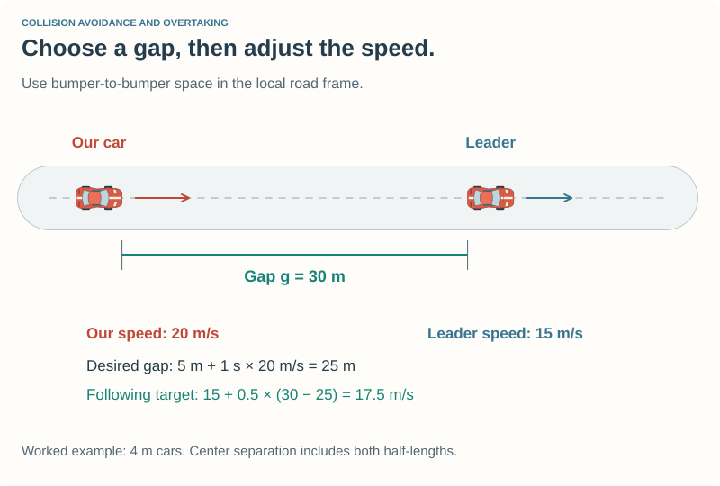
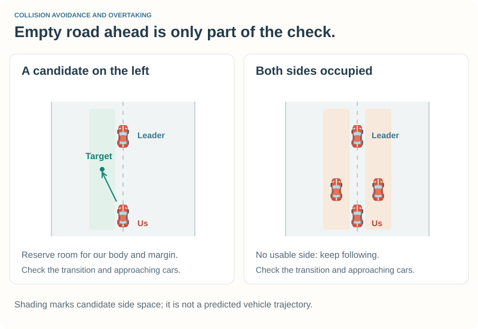
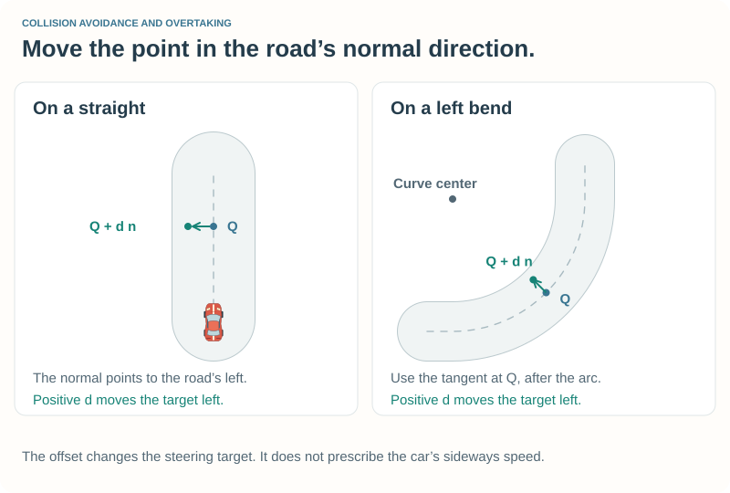
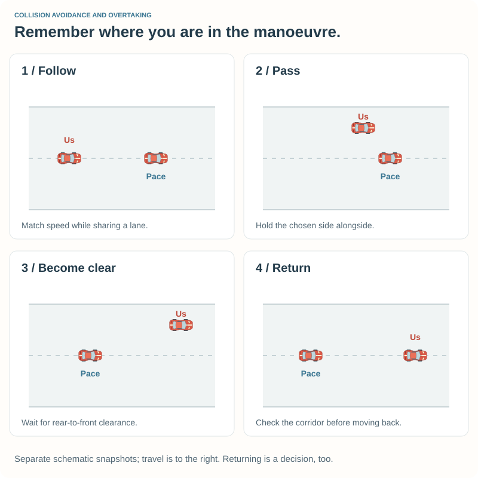
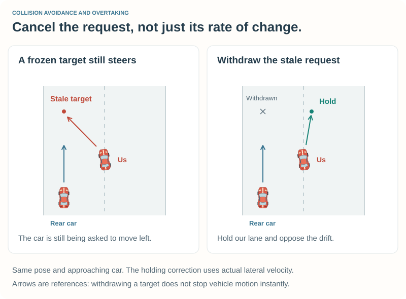

# 5\. Collision Avoidance and Overtaking {#robot_tutorial_chapter_5}

Your robot can drive a lap on its own. Put another car in front of it, and the
problem changes: the road may permit a speed that the traffic does not.

We will first teach the robot to **follow**, then to **choose space for a pass**.
The same speed controller and target-point steering remain underneath these
decisions. The new layer observes other cars, restricts speed, and moves the
steering target sideways when there is room.

## 5.1 Set up a small race {#robot_tutorial_5_start}

Prepare the example using your platform page:

- [Prepare Chapter 5 on Linux](@ref robot_tutorial_linux_chapter_5)
- [Prepare Chapter 5 on Windows](@ref robot_tutorial_windows_chapter_5)

This builds **Tutorial 5** and a separate reference driver, **Tutorial Pace**.
Both use `car1-stock1`. The pace driver follows Chapter 4's centerline targets
with an 18 m/s target-speed cap, approximately 65 km/h. It supplies a repeatable slower
opponent. It does not try to avoid our car or cooperate in a pass.

**Start with following only.** In `src/drivers/tutorial5/traffic5.cpp`, change
`ENABLE_PASSING` from `true` to `false`, save, and rebuild.

1. Choose **Quick Race**, then **Configure Race**.
2. Select **CG Speedway number 1** in the road tracks.
3. In the driver selection screen, leave only these two drivers in **Selected**:
   **Tutorial Pace** first, **Tutorial 5** second. Use **Move Up** and **Move Down**
   to arrange them. The driver list determines the starting order.
4. Set the race length to **3 laps** and the distance to **0** if a nonzero
   distance is already configured. Keep the standard Quick Race starting grid.
5. Start **New Race**. Use **Page Up / Page Down** to select the car you watch;
   identify it by the displayed driver name.

The two cars start in staggered grid positions, then approach the centerline
when the transition is clear. A car may briefly hold its grid lane first.
Watch Tutorial 5 settle behind Tutorial Pace. It should reduce speed rather
than keep trying to reach the clear-road target from Chapter 3.

After each experiment: **save → leave the race → rebuild → start a new race**.
Pausing keeps the module loaded. Restore the same track, driver order, and
settings when comparing runs.

## 5.2 Describe the traffic {#robot_tutorial_5_observe}

TORCS supplies the participating cars through `situation->cars` and their count
through `situation->_ncars`. `TrafficPlanner::observe` visits them each update,
skips our own car, and skips cars marked as no longer simulated.

For each relevant opponent, we need:

| Observation | Meaning |
| --- | --- |
| Signed distance along the road | Positive ahead, negative behind; wrap across the start line. |
| Lateral position | Metres from the centerline, positive to the left of travel. |
| Speed along the road | The world velocity projected onto the local track tangent. |
| Lateral speed | World velocity projected onto the road's left normal; useful for detecting continuing sideways drift. |
| Projected half-length and half-width | How much road space the oriented body occupies. |

The observer keeps the whole simulated field. A fixed low-speed observation
window could hide a stopped leader inside our braking distance, or a fast rear
car that reaches a merging corridor within the prediction time. A car behind
matters because it could approach the lane we intend to enter. Race position and lap number are
different questions: a lapped car physically alongside still occupies space.

The planner stores a fresh vector of observations each update. Those observations
are relative to this driver. The selected passing car is remembered across
updates, but the list and decision state are reset for every new race.

The [traffic geometry companion](traffic_geometry.md) explains coordinate frames,
lap wraparound, footprint projections, and closing-speed calculations.

## 5.3 Follow with room to slow down {#robot_tutorial_5_follow}

The distance between two car centers is not the available gap. Subtract both
projected half-lengths to estimate the space between the front of our car and
the rear of the leader. We consider a leader relevant when its lateral footprint
overlaps ours, including a margin.

At higher speed, we want more space. The reference rule asks for a fixed gap
plus a time allowance:

\htmlonly

Desired following gap

\endhtmlonly

\f[ g_{\mathrm{desired}}=g_0+T_f\max(0,v). \f]

The gap \f$g_0\f$ is 5 m, the following time \f$T_f\f$ is 1 s, and our
road-direction speed \f$v\f$ is in m/s. At 20 m/s we ask for 25 m.
\htmlonly

\endhtmlonly

If the actual gap g is smaller than desired, ask for less than the leader's
speed. If it is larger, allow some closing speed:

\f[ v_{\mathrm{follow}}=\max\left(0,
v_{\mathrm{leader}}+k(g-g_{\mathrm{desired}})\right),
\qquad k=0.5\,\mathrm{s}^{-1}. \f]

For a leader at 15 m/s, our speed of 20 m/s, and a 30 m gap, this gives a
17.5 m/s following target. This is a feedback rule: the gap changes as the
cars move, so the next update recomputes the request.

We also limit the target using a simple braking-distance estimate:

\f[ v_{\mathrm{braking}}=
\sqrt{\max(0,v_{\mathrm{leader}})^2+2a\max(0,g-g_0)},
\qquad a=3\,\mathrm{m/s^2}. \f]

For a stopped leader, this is a stopping-speed bound for the remaining distance
after reserving the fixed gap. For a moving leader, it estimates slowing to its
current speed over that distance. If the leader brakes, the target must be
recomputed. The estimate does not cover every possible change before our next
decision; it is an approximate model with an assumed deceleration.

Take the minimum of these restrictions and the existing track/road-edge target.
Traffic can lower the target but cannot authorize a speed above the track plan.
The pedal controller then chooses acceleration, coasting, or braking. If the
gap falls below the fixed margin, the driver requests emergency braking and
zero throttle. ABS still filters the brake request.

When the target is zero and the car is nearly stopped, a holding brake prevents
the small speed-error tolerance from encouraging a crawl into the leader.

**Experiment:** with passing disabled, compare `FOLLOW_TIME = 1.0` and `1.5`.
Predict the gap at 18 m/s: 23 m and 32 m. Watch the following distance once the
cars settle, rather than during the initial grid launch. Restore 1.0 afterward.

## 5.4 Decide whether a pass is useful {#robot_tutorial_5_decide}

Set `ENABLE_PASSING = true`, rebuild, and repeat the reference race.
Watch for three distinct events: moving away from the centerline, drawing
alongside, and returning after becoming clear.

The planner considers a pass when a relevant leader is more than 18 m ahead
and the **clear-road target** exceeds its speed by more than 1.5 m/s. Its approach
window starts at 70 m and grows with closing speed times the estimated lateral
manoeuvre duration, plus the gap margin. This allows preparation at racing speed
instead of waiting until a rapidly closing car is almost alongside.
Why not use our current speed for that decision? A well-behaved follower has
already slowed to the leader's speed. It can still benefit from passing.

The passing calculation proposes a center position to either side of the leader:
add or subtract both projected half-widths, the side margin, and an extra 0.5 m.
The driver tries the left candidate first, then the right. This is a simple
tie-break, not a racing-line optimization.

Before accepting a candidate, check both the road and the other cars:

- Reserve our projected half-width and a 1.2 m road margin. Use the narrowest
  segment width found over at least 80 m or six seconds of travel, whichever is
  longer, bounded by one lap.
- Check the corridor from our current lateral position to the candidate.
- Look at cars alongside and behind as well as cars ahead. A constant-speed
  prediction over at least 3 s, extended to cover the estimated lateral manoeuvre,
  helps reject a corridor an approaching car may occupy.

The selected leader is treated separately from other corridor occupants: our
speed remains restricted while its footprint overlaps our actual lane. Merely
choosing an offset does not mean the car has already moved out of the way.

If neither candidate fits, continue following. Apply the road and alongside
limits before accepting a manoeuvre, then check both its destination and the
next rate-limited target. Adjusting a target to fit the road can put it into
another car's corridor; the adjusted value must be checked too.

The destination must fit the upcoming road. Intermediate targets can use the
present road width while moving inward, but the speed restriction must account
for the narrowing ahead. A car cannot move sideways instantaneously.

## 5.5 Move the steering target {#robot_tutorial_5_offset}

Chapter 4 aims at a point on the centerline. Now add an offset d in the **left
normal direction at the target segment**:

\htmlonly

An offset target

\endhtmlonly

\f[\mathbf n=(-\sin\theta,\cos\theta),\qquad
\mathbf Q_{\mathrm{target}}=\mathbf Q_{\mathrm{center}}+d\mathbf n.\f]

\f$\theta\f$ is the road tangent at the target. Positive d moves left;
negative d moves right. Positions and d are in metres.
\htmlonly

\endhtmlonly

On a curve, compute the tangent after travelling the required arc. Using the
car's current road tangent could move the target in the wrong direction when
it lies in another segment. `offsetTarget` keeps the 8 m + 0.33 s × speed
lookahead from the Chapter 4 reference configuration.

Do not jump the offset from zero to a full passing lane in one update. The
helper `approach` limits each change:

\f[ d_{\mathrm{next}}=d+
\operatorname{clamp}(d_{\mathrm{wanted}}-d,-r\Delta t,+r\Delta t),
\qquad r=0.8\,\mathrm{m/s}.\f]

At a 0.02 s update interval, the target offset changes by at most 0.016 m.
Using elapsed time gives the same intended rate at different update frequencies.
The code bounds a single elapsed interval to 0.1 s to avoid a large jump after
an unusual time discontinuity.

This limits the motion of the **target offset**, not the actual sideways speed
of the car. The steering controller and vehicle dynamics determine the driven
trajectory. Chapter 4's road-edge speed feedback remains active.

The rate limit applies to an accepted manoeuvre. If it becomes invalid, the
driver withdraws the old target immediately. Slowly moving an unsafe target
back could keep asking the car to steer toward the occupied space. Withdrawing
a target does not instantly cancel the car's motion; the holding response below
also considers its current lateral velocity.

## 5.6 Remember the manoeuvre {#robot_tutorial_5_modes}

The planner remembers five modes:

| Mode | Decision |
| --- | --- |
| Cruising | Use the road plan; no relevant car ahead in our lane. |
| Following | Respect the leader's gap; look for a passing opportunity. |
| Passing | Keep the selected opponent and side while moving alongside. |
| Returning | Move back toward the centerline when the corridor permits it. |
| Holding | Cancel an invalid lateral manoeuvre, oppose drift, and wait for a checked return. |

The diagram shows the normal passing sequence. Remembering the side prevents
a small measurement change from switching the target left, then right, then
left again. A newly blocked corridor takes a different route: **Holding**.

### Cancel the request, not just its rate of change

Suppose the car is 0.4 m left of the centerline, but its target has already moved
3 m left. A faster car approaching from behind now occupies the left-side
corridor. Freezing the target at 3 m would still ask our car to continue left.

On entering Holding, record the car's current lateral position as the hold
reference. Correct that reference against the measured lateral velocity:

\f[d_{\mathrm{hold}}=y_{\mathrm{entry}}-T_d v_y,
\qquad T_d=0.6\,\mathrm{s}.\f]

Here \f$v_y\f$ is road-normal velocity in m/s, positive left. Leftward drift
therefore shifts the target rightward. The existing heading-error controller
also responds to the car's yaw. This is a simple damping heuristic, not an
instantaneous stop or a full vehicle-motion prediction.

The hold reference stays anchored to the entry position; recomputing it from
each new position could follow the drift into the very lane we want to avoid.
The corrected target is constrained and checked again. If no correction passes
the corridor check, the planner marks that space as unresolved and uses a
best-effort, road-bounded correction opposing drift in its present lane. When
adjacent-car bounds leave a feasible interval, the fallback must stay inside it
too: cancelling a manoeuvre must not undo the spacing constraint. It does not
treat that fallback as proof of a clear corridor.

After at least one second, once lateral speed is below 0.3 m/s in magnitude,
the planner can begin a checked return. It clears the previous passing-car
selection when cancelling, so that car is included in the return checks too.

### Coordinate speed with the lateral response

A rear-approaching car alone does not make us brake in front of it. Cars ahead
can still lower the speed target. Those checks cover the current-to-target
corridor and a short allowance for remaining lateral drift, not just the
footprint at this instant.

If a road narrowing and an alongside car leave no usable transition, hold the
present lane and reduce speed before the narrowing. Keep that restriction while
returning until the car's **actual position** fits the reserved width. Where
the return corridor is clear and the body already fits the upcoming road with
a small 0.3 m margin, the example permits at most 2 m/s to finish centering;
this prevents a cleared return from remaining stopped just outside its preferred
1.2 m margin. Conflicting alongside limits still require waiting.

Our center being ahead of the other center is not enough to finish. The planner
waits until the other car's estimated front is at least 8 m behind our estimated
rear before beginning the return. The return corridor is checked too, including
traffic approaching from behind.

A pass can also lose its purpose. If the leader remains well ahead but becomes
faster than our clear-road target, or the reserved road becomes too narrow,
the driver returns when the corridor is free. If the constrained manoeuvre is
invalid and there is no checked return, it enters Holding rather than retaining
the stale passing target.

## 5.7 Waiting is different from being stuck {#robot_tutorial_5_recovery}

A stopped car behind a stopped leader may be doing exactly the right thing.
Starting Chapter 2's recovery timer there could lead to an unwanted reverse
manoeuvre.

`observe` also marks nearby traffic: within 18 m longitudinally and within the
combined projected half-widths plus 3 m laterally. Nearby traffic resets the
ordinary stuck timer. If a recovery manoeuvre is already active, or a nearly
stationary car is badly misaligned, the module holds the brakes and waits for
space before continuing that recovery.

This is deliberately cautious. A traffic jam is not solved by reversing blindly,
and this example does not negotiate deadlocks. With clear space, the existing
recovery override takes control, then hands back to a reset traffic planner.

## 5.8 Judge the whole interaction {#robot_tutorial_5_experiments}

Keep notes using **setting / following gap / passing side / return / contact /
road position**. A faster lap is useful only if the interaction also works.

Try these in order:

1. Follow the pace driver with passing off. Compare the two following-time
   settings, then restore the default.
2. Enable passing with all other settings fixed. Watch until the car is fully
   clear and has returned, not just until its nose is ahead.
3. Repeat both modes on **E-Track 2**. Watch how the tighter road changes the
   available space and the moment at which the robot attempts a pass.

The pace driver can be lapped; compare Tutorial 5's completed laps and both
cars' damage when reading the results.

Other cars can turn or brake unexpectedly. Local footprint projections, a finite
prediction horizon, and a target corridor do not establish a collision-free swept trajectory.
Keep the conservative reference speeds while experimenting with traffic logic.

## Optional geometry and reasoning {#robot_tutorial_5_optional}

- @subpage robot_tutorial_traffic_geometry

The companion explains the measurements, catch estimates, and model assumptions
in more detail, including why zero speed must not break footprint calculations.

## If something goes wrong {#robot_tutorial_5_help}

| What you see | What to check |
| --- | --- |
| Only one car appears | Configure Quick Race with both Tutorial Pace and Tutorial 5 selected. Practice is the solo workflow. |
| The robot follows but never passes | Check `ENABLE_PASSING`, rebuild, and start a new race. On a narrow road, following may be the correct decision. |
| Both cars drive at nearly the same unrestricted speed | Select Tutorial Pace as the reference opponent and restore its 18 m/s cap. |
| The wrong car is in front at the start | Put Tutorial Pace first in the selected-driver list and use the standard Quick Race grid. |
| Braking or side changes become abrupt | Restore the following time, side margins, offset rate, and Chapter 4 speed settings. |
| The build cannot find a `*4.h` file | Complete the helper-copy step on your platform page. Copy from the supplied examples, not an experimental working folder. |

[Questions and feedback](@ref robot_tutorial_feedback) is the place to share a
scenario or ask about a decision. Include the driver order, track, and settings.

## Reference files and next steps {#robot_tutorial_5_reference}

The new files are in `src/doc/robot_tutorial/examples/chapter_5/`. The platform
instructions assemble a complete working folder with the unchanged geometry,
steering, speed, braking, and recovery helpers from `examples/chapter_4/`.
Both drivers build as separate, single-entry modules from that folder.

\htmlonly
<ul>
<li><a href="tutorial5.cpp" download>Traffic-driver module and recovery arbitration</a></li>
<li><a href="traffic5.cpp" download>Observation, following and passing</a> / <a href="traffic5.h" download>declarations</a></li>
<li><a href="tutorial5pace.cpp" download>Reference pace-driver module</a></li>
<li><a href="tutorial5.xml" download>Tutorial 5 description</a> / <a href="tutorial5pace.xml" download>pace-driver description</a></li>
<li><a href="tutorial5.mk" download>Linux build rules</a> / <a href="tutorial5.vcxproj" download>Visual Studio project</a></li>
<li><a href="tutorial5.def" download>Tutorial 5 Windows exports</a> / <a href="tutorial5pace.def" download>pace-driver Windows exports</a></li>
<li>Required helpers: <a href="geometry4.cpp" download>geometry4.cpp</a> / <a href="geometry4.h" download>geometry4.h</a>;
<a href="steering4.cpp" download>steering4.cpp</a> / <a href="steering4.h" download>steering4.h</a>;
<a href="speed4.cpp" download>speed4.cpp</a> / <a href="speed4.h" download>speed4.h</a>;
<a href="braking4.cpp" download>braking4.cpp</a> / <a href="braking4.h" download>braking4.h</a>;
<a href="recovery4.cpp" download>recovery4.cpp</a> / <a href="recovery4.h" download>recovery4.h</a>.</li>
</ul>
\endhtmlonly

For individual downloads, create a Linux `Makefile` containing `include tutorial5.mk`.
All helper files listed above belong beside it. They are compiled into each
module; the Chapter 4 driver does not have to be installed to load Tutorial 5.

Continue with [Chapter 6 — Pit Stops and Race Strategy](chapter_6.md) to complete
the integrated driver. [Appendix A](appendix_a.md) covers car setup and parameters;
[Appendix B](appendix_b.md) covers textures and pit logos.
[Appendix C](appendix_c.md) gives multiple robots in one module their own state.

Return to [Chapter 4](chapter_4.md) or the [Robot Tutorial](index.md).
