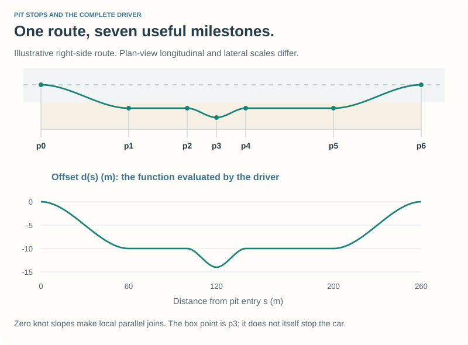
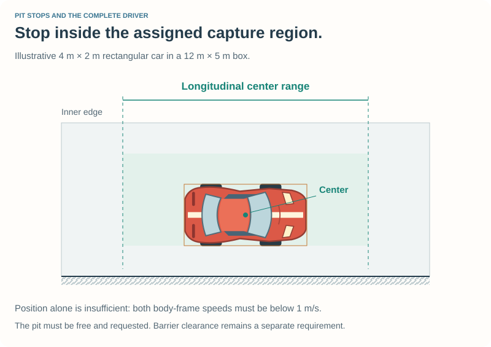
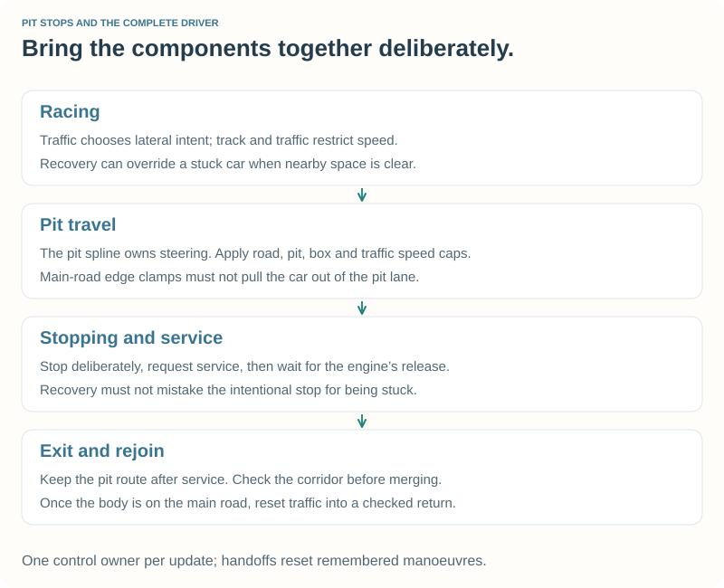

# 6\. Pit Stops and Race Strategy {#robot_tutorial_chapter_6}

This chapter completes your tutorial driver. It brings together steering,
speed control, traffic, recovery, and a new task: leave the racing line, receive
service, and return to the race.

We will first request one deliberate stop so you can observe the complete
sequence. Then we will let fuel and damage determine when to visit the pits.
The optional [spline mathematics](spline_math.md) derives the smooth pit route
in full; you can use the supplied implementation before studying that derivation.

## 6.1 Watch a complete stop {#robot_tutorial_6_start}

Build the complete **Tutorial 6** checkpoint:

- [Prepare Chapter 6 on Linux](@ref robot_tutorial_linux_chapter_6)
- [Prepare Chapter 6 on Windows](@ref robot_tutorial_windows_chapter_6)

The directory includes all its helper sources. It builds independently of the
earlier example directories and installed tutorial drivers.

Configure **Quick Race** on **CG Speedway number 1**, select only **Tutorial 6**,
and choose **6 laps** with race distance **0**. Use the standard starting grid.
The supplied racing defaults stop only for fuel or damage. To observe the route
in this short exercise, set `DEMONSTRATION_STOP = true` in `pit.cpp` and rebuild.
Start **New Race** and watch the pit approach after the first completed lap.

With this exercise setting, the car should:

1. Slow down before turning toward the pit lane.
2. Follow the lane to its assigned box.
3. Stop and remain there while TORCS performs service.
4. Leave the box and continue along the pit lane.
5. Check the rejoining corridor, return to the main road, and resume racing.

The reference car starts with a full 60-litre tank, so that first demonstration
stop normally needs **no extra fuel or repair**. The callback still runs and
requests a tyre change. A service stop supplies what the strategy asks for;
it need not always fill the tank. We will make refuelling necessary in §6.7.

The engine displays pit-status messages while a stop is requested and serviced.
Use **Page Up / Page Down** to select the car you watch when adding opponents.

Keep the familiar loop: **edit → save → leave the race → rebuild → start a new
race → observe**. Main settings are in `tutorial6.cpp` and `pit.cpp` inside
your working folder, `src/drivers/tutorial6/`.

## 6.2 A pit is more than one position {#robot_tutorial_6_pit_data}

TORCS supplies the lane information in `track->pits` and our assigned box through
`car->_pit`. The box may be unavailable: some tracks have no pits, and a field
can contain more cars than assignable places. Pits may also be shared.

| Information | Purpose |
| --- | --- |
| Pit entry | Where the route begins to leave the racing line. |
| Pit start and end | Bound the speed-limited pit segments. |
| Assigned box | Supplies its position, longitudinal capture interval, and occupancy. |
| Pit exit | Guides the route back toward the main road. |
| Pit side | Determines the sign of the lateral offset. |

`PitDriver::configure` checks that a supported assigned side pit exists and that
these positions can form an ordered route. It uses the assigned box's capture
bounds, not a formula based on our index in the driver list. The current example
does not support separately routed pit paths.

If no supported route can be built, the driver continues ordinary driving.
For experiments on another track, first check the geometry and keep sufficient
starting fuel; a driver without a usable pit cannot refuel. Start with the
reference track before adapting the route to another layout.

### Use continuous distance through the lane

Track position wraps from the end of a lap to zero at the start line. A spline
needs increasing coordinates. We therefore express its knots as distance from
pit entry, unwrapping a start-line crossing if necessary.

Once a visit begins, accumulate the car's signed progress from successive track
positions. Crossing the start line must not make the route jump back to its
beginning. Chapter 5's wrapped-distance helper supplies that small signed change.

## 6.3 Describe the route with offsets {#robot_tutorial_6_route}

Let s be distance along the track from pit entry, and d(s) the desired lateral
offset. As before, positive d means left of the track's direction of travel.
The steering target is the centerline point plus d times the local left normal.

The route uses seven semantic milestones:

| Point | Role | Typical offset |
| --- | --- | --- |
| p0 | Begin the entry transition | Centerline |
| p1 | Reach the pit-lane travel line | Lane offset |
| p2 | Begin moving into our box | Lane offset |
| p3 | Assigned stopping position | Box offset |
| p4 | Return from the box to the travel line | Lane offset |
| p5 | Begin the checked merge | Lane offset |
| p6 | Finish the route toward the main road | Centerline |

The figure uses illustrative coordinates. The driver obtains its actual points
from the loaded track and assigned pit. On the reference layout, the travel
line is one pit-box width inward from the box center.

For a first box, p1 and p2 can coincide. If their values and slopes agree, keep
one knot rather than a zero-length interval. For a last box, extend the
lane-following portion far enough to finish leaving the box before merging.
Every interpolation interval must have positive length.

We give the knots zero offset slope. Locally, that makes the route join the
track direction without a sudden sideways trend. **Zero offset slope does not
mean zero vehicle speed.** The stopping controller, not the spline, stops the car.

`HermiteSpline` connects the knots using piecewise cubic polynomials. Matching
endpoint values and slopes makes the offset function and its first derivative
continuous. This is cubic Hermite interpolation; it does not automatically give
continuous second derivatives or prove that a car fits the entire driven path.

**Optional experiment:** study the worked curve in the companion, change an
endpoint slope on paper, and predict the change in approach direction. Keep the
supplied pit-route knots for your initial driving experiments.

## 6.4 Approach the box at the right speed {#robot_tutorial_6_braking}

The example commits to a requested visit when the assigned pit is free and entry
is within its approach distance: at least 100 m, extended at high speed by the
distance needed to reach lane speed at 4 m/s² plus a 20 m allowance.
If the box is occupied before commitment, it keeps
racing and can try the next lap.

Before committing, it also checks the entry-side corridor for alongside and
rear-approaching cars. This check considers the whole field and the planned
slower pit speed over an estimated entry time. If traffic blocks the transition,
keep racing rather than cut across it. This remains a constant-motion estimate;
it does not predict an opponent's unexpected lane change.

During pit travel, use the smaller of the ordinary track-speed plan and the
pit-travel target: **1 m/s below the track's legal pit limit**. During approach,
a distance-based speed bound brings the car down to this target before entry.
A speed limit is a condition to satisfy at its boundary, not a signal to begin
braking there. The pit controller uses the same full-authority pedal controller
as ordinary racing; stopping and traffic can require a lower speed.

Near the box, let r be remaining distance to a stopping target 0.5 m before the
box center. A constant-deceleration bound gives:

\f[v_{\mathrm{stop}}=\sqrt{2a\max(0,r)},\qquad a=3\,\mathrm{m/s^2}.\f]

Within 5 m of the target, the example additionally caps speed at 4 m/s and at
\f$0.7r\f$, where 0.7 has units 1/s. This progressively lowers the request near
the stopping point. The existing pedal feedback and ABS apply the controls.

Traffic ahead can reduce the request further. If the assigned pit becomes
occupied after entry, stop before its capture region and wait for it to become
free. Intentional stopping and waiting are excluded from ordinary stuck recovery.

If the car overshoots the capture interval, the example continues out and
requests another attempt. It does not reverse blindly down the pit lane.

## 6.5 Ask the engine to perform service {#robot_tutorial_6_service}

Following the route into the box is only part of the process. The robot also
sets `RM_CMD_PIT_ASKED`. The engine checks that:

- The assigned pit is free and the service request is present.
- The car is strictly inside the longitudinal capture interval.
- It has reached the required lateral position on the pit side.
- Both body-frame velocity components have magnitude below **1 m/s**.

Those are service-capture conditions, not a substitute for collision clearance.
A car still needs room for its body and a feasible approach trajectory.

When it captures the car, TORCS calls `rbPitCmd`. Our `pitCommand` callback
delegates to `PitDriver::service`, which sets:

| Request | Meaning |
| --- | --- |
| `_pitFuel` | Fuel to add, not the desired total fuel in the tank. |
| `_pitRepair` | Damage points to repair. |
| `_pitStopType` | An ordinary repair/refuel stop in this example. |
| `pitcmd.tireChange` | Request replacement of all tyres. |

Returning `ROB_PIT_IM` lets the engine proceed without opening an interactive
pit menu. The engine normalizes fuel and repair amounts and determines service
time from the active race rules. The robot waits for the pit-state flag to clear;
it does not guess a release time.

The service request is cleared during the stop. **That does not mean the car
has left the lane.** The separate Exit state preserves the route after service.

## 6.6 Leave the pits and rejoin {#robot_tutorial_6_exit}

After release, the car moves back from the box to the lane travel line. It stays
on the pit side through the pit-end transition before attempting to merge.
Ordinary main-road edge feedback is inappropriate here: it would treat valid
pit-lane travel as a road departure and pull the car toward the racing line.

The pit controller therefore owns the route during approach, stopping, service,
and exit. It retains track-speed and front-traffic restrictions while using
its own lateral target.

Before merging, check the corridor toward the main road, including traffic
approaching from behind. The supplied check uses a six-second constant-speed
estimate and the traffic observations from Chapter 5.

If the corridor becomes occupied, anchor a hold to the car's actual lateral
position and oppose its measured lateral drift. Do not freeze a distant target
that still asks for a lane change. Slow before running out of the exit's staging
space. When the corridor clears and enough route remains, build a fresh merge
interval from the current position to the route end.

Once the body is on the main road with clearance, the pit controller hands back
to traffic control. It resets the traffic planner, initializes its offset from
the car's actual position, and selects Returning. A stale passing target from
before the pit visit must not suddenly take control.

**Experiment:** repeat the six-lap race with **Tutorial Pace** first and
**Tutorial 6** second in the selected-driver list. Watch both the approach and
the return, using their displayed names to identify the cars. Then try an
ordinary opponent such as **bt 2** with the same reference car class. That driver
can be much faster; being lapped is a normal race outcome, not a failed pit stop.

## 6.7 Let strategy request the stop {#robot_tutorial_6_strategy}

The demonstration is a one-time extra request after the first completed lap.
Fuel and damage decisions run alongside it. To observe strategy on its own:

1. In `pit.cpp`, set `DEMONSTRATION_STOP = false` and rebuild. With a full tank,
   a short race may need no stop.
2. In `tutorial6.cpp`, change `STARTING_FUEL` from 60.0 to **4.0 litres**, rebuild,
   and run **12 laps** on the reference track with only Tutorial 6 selected.
3. Watch it request service, add enough fuel for the remaining race, and leave.
   For a repeated-stop exercise, set `STINT_LAPS = 3.0`; restore `0.0` afterward.

The starting-fuel override is a small in-memory parameter set returned from
`initTrack`; [Appendix A](appendix_a.md) explains the full car-setup workflow. Keep the value within
the reference car's permitted range, 1–60 litres. Restore the settings when
returning to the first demonstration exercise.

### Measure complete laps

Initialize fuel observations on the first valid driving update, not from a
possibly unpopulated fuel field in `newRace`. Accumulate actual fuel decreases.
A positive jump is refuelling, not negative consumption.

The corresponding accounting identity is:

\htmlonly

Fuel consumed over a lap

\endhtmlonly

\f[F_{\mathrm{used}}=F_{\mathrm{start}}+F_{\mathrm{added}}-F_{\mathrm{end}}.\f]

Use observed additions, not the amount requested by the callback: the engine
can limit a request to the available tank capacity.
\htmlonly

\endhtmlonly

Detect lap transitions using the lap counter rather than particular segment
numbers. TORCS counts the initial start-line crossing before the first timed
lap, so the example excludes that partial initial interval from its estimate.

Keep the largest measured full-lap consumption, with a 15% allowance. Before a
full lap is available, use an initial estimate of 1.5 litres/lap for the reference
car and track. Re-estimate that value before a low-fuel start on a different layout.
Traffic, damage, and driving changes can increase consumption; a measurement
is an estimate, not a guarantee about the next lap.

### Request fuel and repair deliberately

Request a stop when fuel falls below 1.6 estimated laps plus a 0.5-litre reserve,
and the current amount is also insufficient for the estimated remaining race
distance plus reserve. The remaining distance includes the unfinished part of
the current lap. It conservatively plans our own remaining distance rather
than assuming when a faster leader will finish.

At service, the requested addition is:

\f[F_{\mathrm{add}}=\operatorname{clamp}
(F_{\mathrm{desired}}-F_{\mathrm{current}},0,F_{\mathrm{tank}}-F_{\mathrm{current}}).\f]

`STINT_LAPS = 0.0` means fuel for the remaining race plus allowances, bounded
by tank capacity. A positive value explicitly selects a shorter planned stint
for experiments. The desired total may already be below the current fuel
amount, yielding a zero request.

Damage above 3000 points requests a repair stop when more than a lap remains.
The supplied policy repairs all damage at service. Later experiments can weigh
the expected driving loss against service time and remaining distance. More
fuel is not always better either: it changes mass and time spent refuelling.

Compare the fuel-to-finish and three-lap-stint settings using the same 12-lap
race. Record service visits, fuel remaining and total time. The shorter stint
exercise also lets you observe refuelling accounting and route reset on later
visits; more stops are not automatically a better strategy.

## 6.8 One driver, coordinated decisions {#robot_tutorial_6_integration}

The final update has a clear order:

1. Observe traffic. During pit travel, allow recovery only where it is not an
   intentional stop or wait and nearby space is clear.
2. Update fuel/strategy and let the pit state machine act if a visit is active.
3. While stopping, servicing, or deliberately waiting to merge, inhibit ordinary
   stuck recovery.
4. Otherwise use the traffic-aware recovery arbitration from Chapter 5.
5. Let traffic and the track plan determine normal steering and speed. Apply
   gearing, mutually exclusive pedals, and the wheel-slip filters.

The pit modes are Racing, Approach, Lane, Stopping, Service, Exit, and Merging.
They describe a pit visit's lifecycle. Chapter 5's traffic modes still describe
following, passing, returning, and holding during ordinary racing. Keeping the
two responsibilities distinct makes their handoff explicit.

| Source | Responsibility |
| --- | --- |
| `tutorial6.cpp` | TORCS callbacks, starting fuel, and control ownership. |
| `pit.cpp/.h` | Pit geometry, visit state, strategy, service, and rejoining. |
| `spline.cpp/.h` | Validated knots, interval lookup, and Hermite evaluation. |
| `traffic.cpp/.h` | Opponent observations and racing manoeuvres. |
| `speed.cpp/.h`, `braking.cpp/.h` | Track speed, pedals, gears, braking models and slip filters. |
| `steering.cpp/.h`, `geometry.cpp/.h` | Target construction and planar geometry. |
| `recovery.cpp/.h` | Low-speed recovery using barrier clearance. |

The helper implementations carry forward the preceding chapters. All are
included in the final directory, with local include names and one build project.

## 6.9 Run the complete driver {#robot_tutorial_6_final_race}

Use the 12-lap, 4-litre, strategy-only configuration as the final solo exercise.
Then add the pace driver, and finally try an ordinary opponent. Compare:

- Completed laps and classification.
- Service visits and fuel added.
- Entry speed, stopping position, and release.
- Rejoining behaviour, contact, and damage.
- Whether racing decisions resume normally after every visit.

This is a complete **tutorial** driver, with understandable conservative choices.
Its local traffic predictions are not a collision-free trajectory solver. The
route builder rejects invalid ordering and insufficient transition lengths;
other layouts still need physical-clearance and driving checks. The current
engine's assigned capture interval must itself
be ordered without wrapping, even though the overall route can cross the line.
The example does not negotiate persistent traffic deadlocks or implement a
drive-through/stop-and-go penalty-serving strategy.

## Optional: the full spline derivation {#robot_tutorial_6_optional}

- @subpage robot_tutorial_spline_math

This companion develops the endpoint equations, normalized coordinate, derivative
scaling, coefficient solution, basis functions, and efficient evaluation. It also
explains what smooth interpolation does and does not establish about a pit path.

## If something goes wrong {#robot_tutorial_6_help}

| What you see | What to check |
| --- | --- |
| No pit visit | Racing defaults stop only when needed. For the route exercise, enable the demonstration switch and run enough laps. Check whether an assigned supported pit is available. |
| Service adds no fuel | The tank may already contain enough. Use the strategy-only 4-litre experiment to observe refuelling. |
| The car waits before its box | An occupied assigned pit cannot capture another car. Watch whether it becomes free. |
| The car continues out without service | It may have missed the capture region. Restore the route/speed settings and check the assigned-pit geometry. |
| It slows or waits near the exit | The merge corridor may be occupied or the remaining transition space insufficient. |
| A later experiment runs out of fuel | Restore the reference configuration; check consumption measurement, available pits, and the chosen starting fuel. |

[Questions and feedback](@ref robot_tutorial_feedback) is the place to share your
results. Include the track, selected-driver order, fuel settings, and which phase
behaved unexpectedly.

## Complete source and further experiments {#robot_tutorial_6_reference}

The self-contained checkpoint is in `src/doc/robot_tutorial/examples/chapter_6/`.

\htmlonly

<a href="tutorial6.zip" download>Download the complete Tutorial 6 source directory</a>

\endhtmlonly

The archive contains the driver, every helper, Linux and Visual Studio build
files, its XML description, and the GPL license. Extract its `tutorial6` folder
under `src/drivers/` in your development checkout, or use the platform page's
copy command. No files from another checkpoint are needed to build it.

You now have a driver that can race, interact with opponents, recover, manage a
pit visit, and continue racing afterward. Useful next experiments include
comparing stint lengths, refining repair decisions, and checking the route on
another track with side pits. Record both successful runs and the limits you
discover.

Continue with [Appendix A — Custom Car Setups and Driver Parameters](appendix_a.md).
[Appendix B](appendix_b.md) covers textures and pit logos, and
[Appendix C](appendix_c.md) puts independently owned robots into one module.

Return to [Chapter 5](chapter_5.md) or the [Robot Tutorial](index.md).
