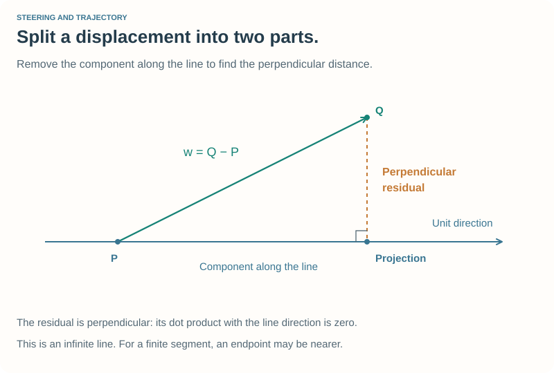

# Vectors, Lines and Track Geometry {#robot_tutorial_geometry}

This optional companion to [Chapter 4](chapter_4.md) explains the mathematics
behind the supplied `geometry4.h/.cpp` helpers. Work through it with a sketch
and a few coordinates. You do not need a graphics program to check the examples.

## Points and vectors {#robot_tutorial_geometry_vectors}

A point describes a location. A vector describes a displacement or direction.
Both can be represented by two numbers, but their roles differ:

\f[ \mathbf d=\mathbf Q-\mathbf P,\qquad
\mathbf Q=\mathbf P+\mathbf d. \f]

If the car is at \f$\mathbf P=(2,3)\f$ m and the target is at
\f$\mathbf Q=(8,11)\f$ m, then \f$\mathbf d=(6,8)\f$ m. It says “6 m in X,
8 m in Y.” Its length is 10 m, which is the straight-line distance between
the points, not the distance along a curved road.

The example represents both with `Vector2`, keeping their meaning clear through
variable names. It is a small teaching type, not a replacement for TORCS's
general-purpose mathematical library.

```cpp
Vector2 carPosition{2.0, 3.0};
Vector2 target{8.0, 11.0};
Vector2 direction = target - carPosition;
```

The two fields default to zero. Brace initialization supplies coordinates;
ordinary C++ copy construction and assignment copy both fields. There is no
need to write a special copy constructor or assignment operator for this type.

### Arithmetic and length

For \f$\mathbf a=(a_x,a_y)\f$ and \f$\mathbf b=(b_x,b_y)\f$:

\f[\begin{aligned}
\mathbf a+\mathbf b&=(a_x+b_x,a_y+b_y),\\
\mathbf a-\mathbf b&=(a_x-b_x,a_y-b_y),\\
-\mathbf a&=(-a_x,-a_y),\\
k\mathbf a&=(ka_x,ka_y),\\
\lVert\mathbf a\rVert&=\sqrt{a_x^2+a_y^2}.
\end{aligned}\f]

The overloaded `+`, binary `-`, unary `-`, and scalar `*` implement these
operations. Both `vector * scale` and `scale * vector` work. `length()` uses
`std::hypot`, and `distance(other)` computes the length of the difference.

For a nonzero vector, divide by its length to obtain a **unit direction**:

\f[\widehat{\mathbf d}=\frac{\mathbf d}{\lVert\mathbf d\rVert}.
\qquad (6,8)/10=(0.6,0.8).\f]

`normalize()` modifies the vector and returns success. A zero or extremely
small vector has no usable direction; the method returns `false` and leaves it
alone. It also rejects a non-finite length. Always check that result before
using a vector as a unit direction.

### Dot product, angles, and projection

The dot product produces a scalar:

\f[\mathbf a\mathbin{\cdot}\mathbf b=a_xb_x+a_yb_y
=\lVert\mathbf a\rVert\lVert\mathbf b\rVert\cos\theta.\f]

It is positive for an acute angle, zero for perpendicular nonzero vectors, and
negative for an obtuse angle. We spell it `a.dot(b)` so scalar multiplication
and dot product are easy to distinguish when reading a formula in C++.

For points P and Q viewed from center C, the cosine of the angle is:

\f[\cos\theta=
\frac{(\mathbf P-\mathbf C)\cdot(\mathbf Q-\mathbf C)}
{\lVert\mathbf P-\mathbf C\rVert\lVert\mathbf Q-\mathbf C\rVert}.\f]

`cosineAt` normalizes both differences, takes their dot product, and clamps the
answer to [−1, 1] to absorb roundoff. It returns `false` if either direction is
unusable; the output argument is then unchanged. A cosine alone does not tell
left from right. Steering uses `atan2` and a signed angular difference instead.

For a unit direction \f$\widehat{\mathbf d}\f$, the scalar projection of a
displacement \f$\mathbf w\f$ is \f$\mathbf w\cdot\widehat{\mathbf d}\f$.
Multiplying that number by the unit direction gives the projected vector.



## A line is a point and a direction {#robot_tutorial_geometry_lines}

An infinite line can be described by an anchor P and nonzero direction d:

\f[\mathbf X(t)=\mathbf P+t\widehat{\mathbf d}.\f]

`Line2` normalizes its direction in the constructor. With coordinates in metres,
the parameter \f$t\f$ then measures a signed distance in metres. Positive and
negative values extend the line in both directions.

### Distance from a point to the line

Subtract the anchor from the point Q, project onto the line, then remove that
projection:

\htmlonly
<div class="formula-card"><div class="formula-label">Perpendicular distance</div>
\endhtmlonly

\f[\begin{aligned}
\mathbf w&=\mathbf Q-\mathbf P,\\
\mathbf w_\perp&=\mathbf w-(\mathbf w\cdot\widehat{\mathbf d})\widehat{\mathbf d},\\
d_\perp&=\lVert\mathbf w_\perp\rVert.
\end{aligned}\f]

The projected point is \f$\mathbf P+(\mathbf w\cdot\widehat{\mathbf d})\widehat{\mathbf d}\f$.
\htmlonly
</div>
\endhtmlonly

For anchor (1, 2), direction (1, 0), and point (4, 5), the projection is (4, 2)
and the distance is 3 m. `Line2::distance` implements this calculation. An
invalid zero-direction line returns infinity to signal that no distance was
computed.

This is distance to an **infinite line**. For a finite segment, the closest
point might instead be an endpoint. You would clamp its projection parameter
to that segment's parameter interval before measuring the distance.

### Intersection of two lines

The two-dimensional cross product used here is a scalar:

\f[\mathbf a\times\mathbf b=a_xb_y-a_yb_x.\f]

For lines \f$\mathbf P+t\mathbf d\f$ and \f$\mathbf Q+u\mathbf e\f$,
take the cross product with e to eliminate u:

\f[\begin{aligned}
t\mathbf d-u\mathbf e&=\mathbf Q-\mathbf P,\\
t(\mathbf d\times\mathbf e)&=(\mathbf Q-\mathbf P)\times\mathbf e,\\
t&=\frac{(\mathbf Q-\mathbf P)\times\mathbf e}{\mathbf d\times\mathbf e}.
\end{aligned}\f]

Substitute t into the first line to find the intersection. For the horizontal
line through (1, 2) and the vertical line through (4, 5), it is (4, 2).

If the denominator is zero, the directions are parallel. The lines may be
distinct or coincident; neither case has one unique intersection. `intersect`
returns `false` for invalid directions and for near-parallel unit directions
whose cross product has magnitude below `1e-10`. Its output point is unchanged
on failure. Near-parallel intersections are sensitive to small coordinate
errors, so callers should not treat this numerical threshold as a physical
clearance margin.

The current steering needs vector subtraction and rotation. The line helper
is included for these exercises and later geometric reasoning, rather than
being a hidden part of the controller.

## Rotate around a center {#robot_tutorial_geometry_rotation}

First subtract the center C, then apply the rotation, then add C back:

\htmlonly
<div class="formula-card"><div class="formula-label">Signed planar rotation</div>
\endhtmlonly

\f[\begin{aligned}
\mathbf d&=\mathbf P-\mathbf C,\\
\mathbf P'&=\mathbf C+
\begin{pmatrix}d_x\cos\theta-d_y\sin\theta\\
d_x\sin\theta+d_y\cos\theta\end{pmatrix}.
\end{aligned}\f]

Positive angles rotate counterclockwise in world X–Y coordinates; angles are
in radians.
\htmlonly
</div>
\endhtmlonly

Rotating P = (4, 2) about C = (2, 2) by π/2 gives (2, 4). Distance from the
center remains 2 m. Negating the angle rotates in the opposite direction.

The SVG diagrams place world-up toward the top of the page; an SVG's own Y axis
points down. The illustrations account for that difference. Do not reverse the
C++ rotation sign to imitate screen coordinates.

## Apply the geometry to TORCS {#robot_tutorial_geometry_track}

Let S and E be the midpoints of a straight segment's start and end vertices.
At distance \f$s\f$ into a segment of length \f$\ell\f$:

\f[\mathbf Q=\mathbf S+\frac{s}{\ell}(\mathbf E-\mathbf S),
\qquad 0\le s\le\ell.\f]

For S = (0, 0), E = (20, 0), and s = 5 m, the target is (5, 0).
`centerlinePoint` handles a zero-length straight by returning S.

For a circular segment with center C and centerline radius R:

\f[\theta=\sigma\frac{s}{R},\qquad
\sigma=\begin{cases}+1&\text{left curve},\\-1&\text{right curve}.\end{cases}\f]

Rotate S about C by this angle. For a left bend starting at (20, 0), centered
at (20, 20), with R = 20 m, travelling \f$10\pi\f$ m produces a quarter-turn
and the target (40, 20). After \f$5\pi\f$ m the target is approximately
(34.14, 5.86). Reflect the bend about the X axis and use a negative rotation
for the corresponding right bend.

Use the **centerline radius**, not an inside or outside edge radius, for this
distance-to-angle conversion. `segmentProgress` converts `toStart` radians to
metres on curves; `targetAhead` then performs its entire segment search in
metres. Only target construction converts metres back to a rotation angle.

## Try it on paper {#robot_tutorial_geometry_exercises}

1. Find the unit direction from (−1, 2) to (2, 6). What happens if both points
   are equal?
2. Project (4, 6) onto the line through (1, 2) in direction (1, 1). Check that
   the residual is perpendicular to the direction using a dot product.
3. Intersect that diagonal line with the horizontal line y = 4.
4. Start 15 m into a 20 m straight followed by the quarter-turn above. Where
   is a target 5 m ahead? Where is one \f$5+10\pi\f$ m ahead?

Checks: (1) (0.6, 0.8), with no unit direction for coincident points;
(2) the projection is (4.5, 5.5), with residual (−0.5, 0.5);
(3) (3, 4); (4) (20, 0), then (40, 20).

Return to [Chapter 4](chapter_4.md), or explore [trajectories](trajectories.md).
You can also [ask a question or share an experiment](@ref robot_tutorial_feedback).
