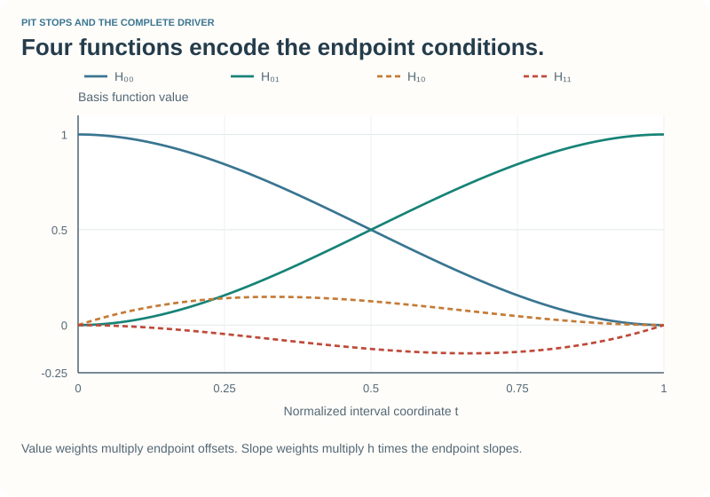
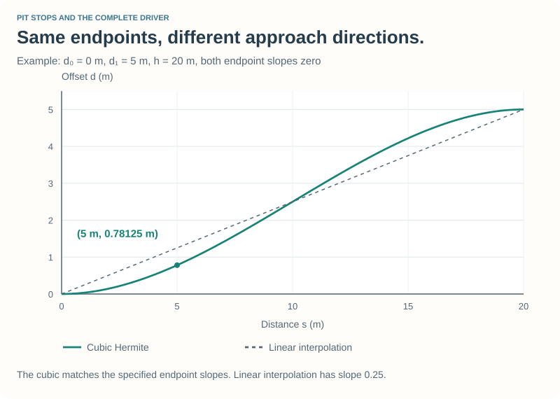
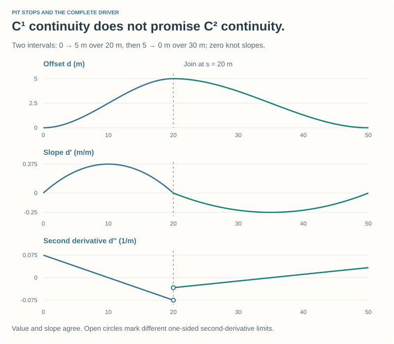

# The Mathematics of the Pit Spline {#robot_tutorial_spline_math}

This optional companion to [Chapter 6](chapter_6.md) derives the interpolation
used by the pit route. Work through the equations, check the numerical example,
then compare them with `spline.cpp` in the final checkpoint.

## 1. State the interpolation problem {#robot_tutorial_spline_problem}

At each knot we know a longitudinal distance s, an offset d, and its slope
\f$m=dd/ds\f$. Between two consecutive knots, we want a function that matches
both values and both slopes.

Distances and offsets are in metres. Slopes are metres per metre, hence
dimensionless. Here s is distance along the track, not world X, and d is a
lateral offset, not world Y.

Choose a cubic on one interval:

\f[P(s)=a s^3+b s^2+c s+e.\f]

Four coefficients let us impose four conditions:

\f[\begin{aligned}
P(s_i)&=d_i,&P(s_{i+1})&=d_{i+1},\\
P'(s_i)&=m_i,&P'(s_{i+1})&=m_{i+1}.
\end{aligned}\f]

We could solve that system directly, but a local normalized coordinate makes
the algebra simpler and avoids carrying large absolute track distances through
the polynomial.

## 2. Normalize the interval {#robot_tutorial_spline_normalize}

Define:

\f[h=s_{i+1}-s_i>0,\qquad t=\frac{s-s_i}{h},\qquad s=s_i+ht.\f]

Now t runs from 0 to 1. Set \f$Q(t)=P(s_i+ht)\f$ and write:

\f[Q(t)=At^3+Bt^2+Ct+D.\f]

The value conditions become \f$Q(0)=d_i\f$ and \f$Q(1)=d_{i+1}\f$.
The derivative conditions need the chain rule:

\htmlonly

Do not lose the interval length

\endhtmlonly

\f[\frac{dQ}{dt}=\frac{dP}{ds}\frac{ds}{dt}=h\frac{dP}{ds}.\f]

Therefore \f$Q'(0)=hm_i\f$ and \f$Q'(1)=hm_{i+1}\f$. The supplied slopes
describe change per metre; derivatives in t describe change over the normalized
interval. Their units and numerical values differ.
\htmlonly

\endhtmlonly

## 3. Solve all four coefficients {#robot_tutorial_spline_coefficients}

Differentiate the normalized cubic:

\f[Q'(t)=3At^2+2Bt+C.\f]

At t = 0, two coefficients follow immediately:

\f[D=d_i,\qquad C=hm_i.\f]

At t = 1:

\f[\begin{aligned}
A+B+C+D&=d_{i+1},\\
3A+2B+C&=hm_{i+1}.
\end{aligned}\f]

Let \f$\Delta=d_{i+1}-d_i\f$. Substitute C and D:

\f[\begin{aligned}
A+B&=\Delta-hm_i,\\
3A+2B&=h(m_{i+1}-m_i).
\end{aligned}\f]

Subtract twice the first equation from the second to obtain A, then substitute
back to obtain B:

\htmlonly

The interval polynomial

\endhtmlonly

\f[\begin{aligned}
A&=-2\Delta+h(m_i+m_{i+1}),\\
B&=3\Delta-h(2m_i+m_{i+1}),\\
C&=hm_i,\\
D&=d_i.
\end{aligned}\f]

All four normalized coefficients have offset units, metres. The parameter t is
dimensionless.
\htmlonly

\endhtmlonly

Check the solution by substituting t = 0 and t = 1 into Q and Q′. All four
endpoint conditions should reappear.

## 4. The equivalent Hermite basis {#robot_tutorial_spline_basis}

Collect terms multiplying the two values and the two normalized slopes:

\f[\begin{aligned}
Q(t)={}&H_{00}(t)d_i+H_{10}(t)h m_i\\
       &+H_{01}(t)d_{i+1}+H_{11}(t)h m_{i+1},
\end{aligned}\f]

where:

\f[\begin{aligned}
H_{00}(t)&=2t^3-3t^2+1,\\
H_{10}(t)&=t^3-2t^2+t,\\
H_{01}(t)&=-2t^3+3t^2,\\
H_{11}(t)&=t^3-t^2.
\end{aligned}\f]

Each basis function supplies one endpoint condition while contributing zero
to the other three. For example, H₀₀ has value 1 at t = 0, value 0 at t = 1,
and zero derivative at both endpoints. H₁₀ has zero endpoint values, derivative
1 at t = 0, and derivative 0 at t = 1. Verify the other two in the same way.

The basis and coefficient forms are the same polynomial. The former makes
the endpoint roles clear; the latter is convenient for evaluation.

## 5. Work a numerical example {#robot_tutorial_spline_example}

Take \f$s_i=0\f$, \f$s_{i+1}=20\,\mathrm{m}\f$, offsets 0 and 5 m, and
zero slopes at both ends. Then h = 20 m and:

\f[A=-10\,\mathrm{m},\quad B=15\,\mathrm{m},\quad C=D=0.\f]

Thus \f$Q(t)=5(3t^2-2t^3)\,\mathrm{m}\f$. At s = 5 m, t = 1/4:

\f[Q(1/4)=5\left(3\cdot\frac1{16}-2\cdot\frac1{64}\right)
=0.78125\,\mathrm{m}.\f]

At the midpoint, s = 10 m, the offset is 2.5 m. To recover the physical slope,
divide Q′ by h:

\f[\frac{dd}{ds}=\frac{Q'(t)}{h}
=\frac{30t(1-t)}{20}.\f]

The midpoint slope is 0.375 m/m, while both endpoint slopes are zero.
Linear interpolation through the same endpoints would have a constant slope
of 0.25 m/m.

The positive offsets in this example move toward the road's left. Negating
the offsets and slopes gives the mirrored right-side construction.

## 6. Find and evaluate the interval {#robot_tutorial_spline_implementation}

The knots are stored in increasing distance order. `interval` uses binary
search to find the adjacent pair surrounding the query. At an interior knot,
either adjoining interval supplies the same value and first derivative when
they share the same knot data; the implementation selects the interval to its right.
At the final knot it uses the last interval.

Horner's scheme evaluates Q with nested multiplication:

\f[Q(t)=((At+B)t+C)t+D.\f]

The first derivative with respect to track distance is:

\f[\frac{dd}{ds}=\frac{(3At+2B)t+C}{h}.\f]

These expressions correspond directly to `HermiteSpline::evaluate`. The code
computes the local interval coefficients, then selects the value or derivative.
It does not solve a global linear system on every driving update.

### Input and endpoint policy

- Require at least two finite knots, including finite slopes.
- Require adjacent distances to differ by at least 0.0001 m. Duplicate,
  reversed, and extremely short intervals are rejected.
- A failed `setKnots` clears the spline and returns `false`; the pit controller
  must honor that result instead of using an old route.
- Queries outside the knot range use a constant extension of the endpoint
  value, with derivative zero outside. Exactly at an endpoint, evaluation uses
  the supplied endpoint slope.
- An empty spline or non-finite query returns zero. This is a defined fallback,
  not evidence that a route has been configured successfully.

With nonzero endpoint slopes, a constant extension changes derivative at the
domain boundary. Our pit route uses zero endpoint slopes, so that boundary
policy is consistent with its centerline/lane joins.

## 7. What kind of smoothness do we get? {#robot_tutorial_spline_continuity}

Sharing the value and slope at each knot makes the piecewise offset function
\f$C^1\f$: its value and first derivative are continuous. It does not require
the second derivatives of adjoining intervals to agree.

For the normalized interval:

\f[\frac{d^2d}{ds^2}=\frac{6At+2B}{h^2}.\f]

Follow the worked interval with a second one from s = 20 to 50 m, bringing the
offset from 5 m back to zero, again with zero endpoint slopes. At the join,
both offsets are 5 m and both first derivatives are zero. The second-derivative
limits are −0.075 1/m from the left and −1/30 1/m from the right.

This is **piecewise cubic Hermite interpolation**, not a natural cubic spline
whose slopes are found by enforcing second-derivative continuity and boundary
conditions. Both are useful constructions, but they impose different conditions.

### Overshoot and containment

Arbitrary supplied slopes can produce values outside the endpoint range. With
zero slopes, each individual interval is a scaled smoothstep and is monotone
between its endpoint values. That prevents offset overshoot on that interval,
but it does not prove that a vehicle following the world-space route fits
through the road and pit geometry.

Check the path between knots, not only at the knots. Account for the footprint,
barriers, steering limits, and the speed at which the car attempts the turn.

## 8. From an offset graph to a world path {#robot_tutorial_spline_world}

The route uses the track centerline \f$\mathbf c(s)\f$ and its left unit normal:

\f[\mathbf r(s)=\mathbf c(s)+d(s)\mathbf n(s).\f]

For a smooth planar centerline parameterized by arc length, let κ be its signed
curvature and t its unit tangent. Differentiating gives:

\f[\mathbf r'(s)=(1-\kappa d)\mathbf t+d'(s)\mathbf n.\f]

This explains why a zero offset slope gives a locally parallel path when
\f$1-\kappa d>0\f$. It also shows why the offset graph alone does not describe
the world-space heading or curvature. Track curvature changes, large offsets,
and the vehicle's dynamic response matter. Smooth d(s) does not by itself
guarantee smooth world-space curvature—or safe passage.

The driver evaluates a point ahead on this route and steers toward it. The car
does not jump onto the mathematical curve or stop at p3 merely because a knot
exists there. Speed control, capture conditions, and traffic decisions complete
the behaviour.

## Try it yourself {#robot_tutorial_spline_exercises}

1. Verify all endpoint values and derivatives of the four basis functions.
2. Evaluate the worked interval at s = 15 m. Check the symmetry with s = 5 m.
3. Keep the endpoint values but choose slopes 0.2 and −0.1. Compute A, B, C, D
   and check that dividing Q′ by h recovers the supplied physical slopes.
4. Explain why two identical knot distances cannot be repaired by silently
   replacing h with an arbitrary small number.

Checks: (2) 4.21875 m; (3) A = −8 m, B = 9 m, C = 4 m, D = 0;
(4) the endpoint constraints may conflict, and changing h changes the problem.
Identical semantic milestones with the same value and slope can instead be
represented by one knot before constructing the spline.

Return to [Chapter 6](chapter_6.md), or [ask a question](@ref robot_tutorial_feedback).
