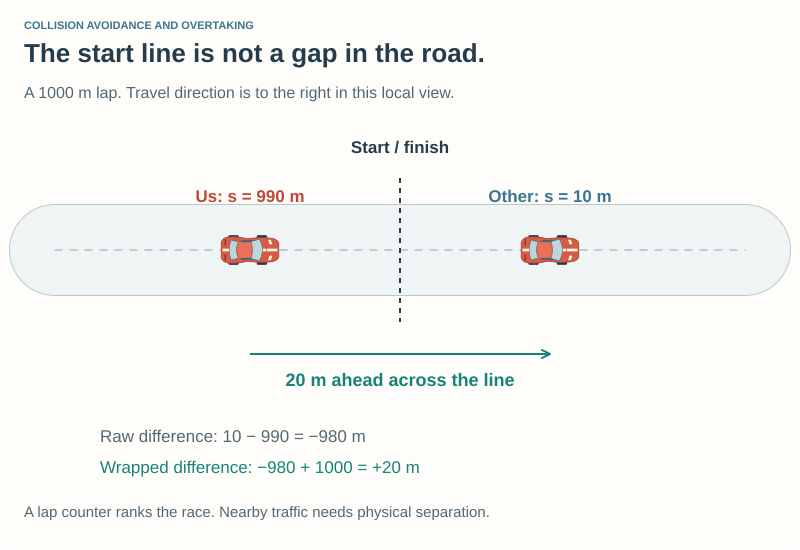
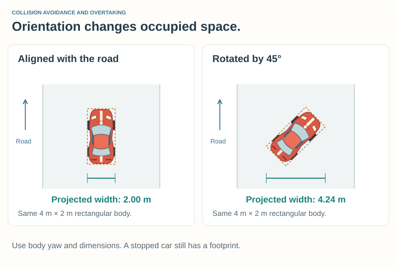
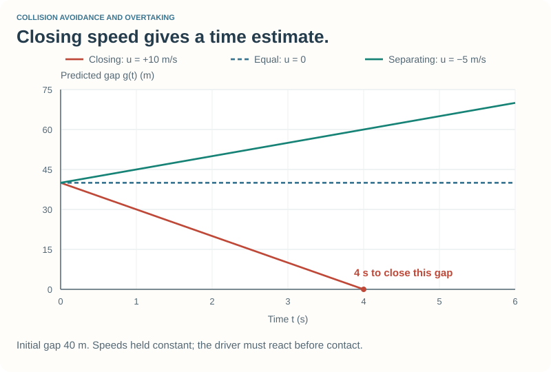

# Measuring Traffic and Predicting Gaps {#robot_tutorial_traffic_geometry}

This companion to [Chapter 5](chapter_5.md) develops the observations used by the
traffic planner. A useful measurement must have a clear coordinate frame,
sign, unit, and interpretation.

## Road position across the start line {#robot_tutorial_traffic_distance}

Each car has a segment and progress within that segment. Convert curve progress
from radians to metres, then add `segment->lgfromstart` to obtain a centerline
distance s from the start of the lap. This uses the public track position for
every car, without relying on an opponent's private race bookkeeping.

For our position s and an opponent's position \f$s_o\f$, start with
\f$\Delta s=s_o-s\f$. Wrap that difference to the nearest signed distance on
a track of length S. A car just beyond the start line can be a short distance
ahead even when its raw s value is much smaller than ours.

The implementation uses `std::remainder(distance, length)`, producing a value
between −S/2 and +S/2. Exactly half a lap has no unique nearest direction; our
short-range traffic decisions do not use that distant case on the reference
tracks. Invalid nonpositive track length bypasses the wrap.

This is **distance along the road**, not Euclidean separation and not race
position. A lapped car may be close; two cars on nearby but different stretches
of road may be far apart along the lap. Our fixed observation range is intended
for ordinary full-size circuits, not tiny loops shorter than that range.

## Project velocity into the road direction {#robot_tutorial_traffic_velocity}

For road heading θ, the unit tangent is:

\f[\mathbf t=(\cos\theta,\sin\theta).\f]

Use world velocity components `car->_speed_X` and `car->_speed_Y`:

\f[v_s=(v_X,v_Y)\cdot\mathbf t=v_X\cos\theta+v_Y\sin\theta.\f]

This gives signed speed along the local road, in m/s. Positive is forward with
the road; negative is against it. Lowercase `_speed_x` and `_speed_y` express
velocity in axes aligned with the car. They are not interchangeable with world
components when the car is angled or sliding.

The left-normal projection gives lateral speed:

\f[v_y=-v_X\sin\theta+v_Y\cos\theta.\f]

Positive means moving toward the road's left. A car can continue drifting even
after the planner stops changing its target; this projection supplies feedback
for cancelling that motion request. This road-frame \f$v_y\f$ is our computed
`lateralSpeed`, not `car->_speed_y` in the car-aligned frame.

Each car uses its own local road tangent. On a curved road, subtracting the two
projected speeds is an approximate rate of closing along the centerline, not
the relative Cartesian velocity vector.

## Measure a rotated footprint {#robot_tutorial_traffic_footprint}

We approximate each body by a rectangle centered at its reported position.
Let its length be L, width W, and the angle between its yaw
and the road tangent be φ. Its projected half-extents are:

\htmlonly

Projected body dimensions

\endhtmlonly

\f[\begin{aligned}
h_s&=\tfrac12(L|\cos\phi|+W|\sin\phi|),\\
h_y&=\tfrac12(L|\sin\phi|+W|\cos\phi|).
\end{aligned}\f]

\f$h_s\f$ is along the road; \f$h_y\f$ is across it. All lengths are in metres.
\htmlonly

\endhtmlonly

The absolute values make the result work on either side and for a car facing
backward. At 90°, length and width exchange roles. A stationary car still has
a yaw and dimensions, so its footprint remains well-defined.

Use body orientation for this calculation, not the velocity direction. A car
may slide sideways, and dividing by speed would fail for a stopped car.

For cars sharing a nearby road frame, the estimated front-to-rear gap is:

\f[g=\Delta s-h_{s,\mathrm{self}}-h_{s,\mathrm{other}}.\f]

The lateral separation between their projected rectangles is:

\f[g_y=|y_o-y|-h_{y,\mathrm{self}}-h_{y,\mathrm{other}}.\f]

Positive values indicate separation along the respective axis; a negative value
indicates projected overlap. Both axes matter. Two cars can overlap along the
road while being comfortably side by side.

These are local approximations on curves, because the two cars may use different
tangents and centerline positions. They are not an exact oriented-rectangle
intersection test in one shared world frame. Margins and observed driving
behaviour remain important.

## Closing speed and time to catch {#robot_tutorial_traffic_catch}

For a positive current gap g, assume constant road-direction speeds and set
\f$u=v-v_o\f$. Then:

\f[g(t)=g-ut.\f]

If u is positive, the estimated time to close the gap is \f$t_c=g/u\f$.
At nonnegative own speed v, the corresponding distance travelled by our car
is \f$d_c=vt_c\f$. Those are different quantities: the gap, time to catch,
and distance travelled before catching should not share an ambiguous variable.

If u is zero, there is no finite catch time under this model. If u is negative,
the gap grows. If g is already zero or negative, the case requires immediate
overlap handling; a negative catch time is not a useful prediction.

For a 40 m gap and closing speed of 10 m/s, the predicted catch time is 4 s.
At our speed of 25 m/s we would travel 100 m during those seconds, not 40 m.
The other car also moves.

A catch estimate helps explain urgency, but it assumes unchanged speeds.
Chapter 5's following controller uses a desired time gap and a braking bound;
it does not simply wait until a predicted collision time crosses a threshold.

## Predict occupied space {#robot_tutorial_traffic_corridor}

`corridorFree` makes another constant-speed estimate. For an opponent with
current signed separation \f$\Delta s\f$:

\f[\Delta s_{\mathrm{future}}=\Delta s+(v_o-v)T_p,
\qquad T_p=3\,\mathrm{s}.\f]

Consider the interval between its current and predicted separation, enlarged
by both car half-lengths and a margin. If that interval intersects our nearby
longitudinal region, test its lateral footprint against the whole proposed
sideways corridor, not just the final target point. The lateral interval also
includes our current position plus 0.6 s of our measured lateral velocity,
so existing drift is not hidden by choosing a nearer target.

This catches an important case: a car currently behind can become alongside
while we are moving into its lane. It also avoids treating empty space at the
destination as proof that the transition is clear.

The opponent prediction holds lateral position and speed constant. Our own
short drift allowance is also only a constant-velocity estimate. Neither models
an opponent turning into our lane or braking unexpectedly. The planner repeats
the checks each update, but repetition does not remove the prediction's limits.
Nor does checking centerline width over the speed-dependent lookahead validate the continuous swept path
of a turning car.

## Decision order and control ownership {#robot_tutorial_traffic_order}

The implementation follows this order:

1. Collect opponent observations and identify nearby traffic.
2. Pause an awkward recovery if nearby space is occupied; otherwise allow
   recovery its existing control override.
3. Compute Chapter 4's road-based controls and target speed.
4. Choose a manoeuvre and apply road/alongside bounds. Validate both the
   constrained goal and the next rate-limited target. The leader exemption for
   a pass applies only while the constrained goal still clears its footprint.
5. If the manoeuvre fails those checks, withdraw the stored target and enter
   Holding. Anchor the hold to the actual entry position, oppose measured drift,
   and check the corrected target. Record when no checked alternative exists.
6. Restrict speed for cars ahead in the current-to-target/drift corridor and
   for an upcoming narrowing. A rear car alone does not trigger braking.
7. Recompute pedals if traffic lowered the target; apply the wheel-slip filters.

Throttle and brake requests remain mutually exclusive. An emergency condition
forces throttle to zero. When traffic imposes no restriction, the existing
road-speed controls remain in place.

Use the present road width for the intermediate target and the upcoming width
for its destination. While the car is still outside the upcoming preferred
margin, keep the narrowing speed bound even if a return has begun. A verified
clear return can finish at walking speed when the body already fits, rather
than remain stranded outside that preferred margin. The road-edge rejoin on a
constant-width road retains Chapter 4's low-speed behaviour.

Two separate modules keep their own driver state in the reference race. Sharing
absolute observations among several robots in one module can later avoid
repeating calculations, but their relative observations and decisions still
belong to each robot. [Appendix C](appendix_c.md) develops that ownership explicitly.

## Questions to try {#robot_tutorial_traffic_questions}

1. On a 1000 m track, our s is 10 m and the other car's s is 990 m. Is the
   nearby car ahead or behind?
2. What are the projected dimensions of a 4 m by 2 m car at 90° to the road?
3. Two cars have equal forward speed and a 30 m gap. What does the constant-speed
   catch model predict? Could the following controller still ask for braking?
4. Why does a free point 4 m to the left not establish a free passing corridor?

Checks: (1) 20 m behind; (2) half-length 1 m and half-width 2 m; (3) no finite
catch time, but the gap may be smaller than the chosen following-time target;
(4) the transition, the vehicle footprint, and approaching traffic also matter.

Return to [Chapter 5](chapter_5.md), or [ask a question](@ref robot_tutorial_feedback).
