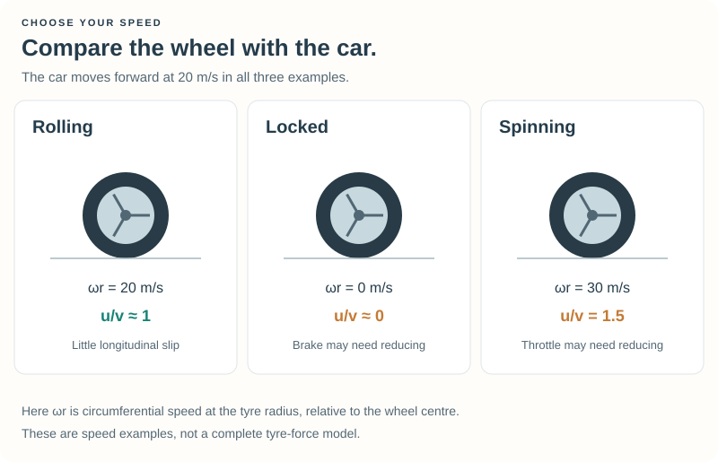

# Optional: Gears, Grip and Wheel Slip {#robot_tutorial_wheel_control}

This reading explains the gearbox and the simple ABS and traction-control
filters already supplied with Tutorial 3. You can leave them enabled and keep
working on the main speed-planning exercises.

## 1. Speed, wheel rotation and engine rotation {#robot_tutorial_3_rotation}

For a rolling wheel without slip, one revolution advances the car by one
circumference. In angular-speed notation:

\htmlonly
<div class="formula-card"><div class="formula-label">Rolling-wheel relation</div>
\endhtmlonly

\f[ v=\omega_w r_w,\qquad
\omega_e\approx G_k\omega_w=G_k\frac{v}{r_w}. \f]
\htmlonly
</div>
\endhtmlonly

| Symbol | Meaning | Unit |
| --- | --- | --- |
| \f$r_w\f$ | Wheel radius | m |
| \f$\omega_w\f$ | Wheel angular speed | rad/s |
| \f$\omega_e\f$ | Engine angular speed | rad/s |
| \f$G_k\f$ | Overall gear ratio, including the final drive | Dimensionless |

The engine relation assumes the clutch is engaged and the drivetrain is not
slipping significantly. To convert angular speed to the RPM shown on a gauge:

\f[ \mathrm{RPM}=\omega\frac{60}{2\pi}. \f]

Despite their names, `car->_enginerpm` and `car->_enginerpmRedLine` use internal
angular-speed units, radians per second. Ratios such as current speed divided
by red-line speed are unaffected by the conversion, provided both use the same
units.

## 2. Derive the shift thresholds {#robot_tutorial_3_shift_derivation}

With upshift fraction \f$q_{\mathrm{up}}\f$, the nominal road speed at the
upshift threshold in gear \f$k\f$ is:

\f[ v_{\mathrm{up},k}=q_{\mathrm{up}}
\frac{\omega_{\mathrm{red}}r_w}{G_k}. \f]

For a downshift, predict the engine speed in the lower gear first:

\f[ \omega_{\mathrm{lower}}\approx G_{k-1}\frac{v}{r_w}. \f]

The example requires this prediction to be below `SHIFT_DOWN` times the red line
and the current engine speed to be relatively low. The up/down thresholds leave
an overlap in which we keep the current gear. `SHIFT_DELAY` adds a minimum time
between requests. These prevent hunting for different reasons: the overlap
handles small speed fluctuations, while the time delay gives a shift time to
finish.

`gearRatio` validates the gear and array index before reading a ratio. TORCS
stores the ratio for gear `k` at `car->_gearRatio[k + car->_gearOffset]`; the
array includes non-forward entries. The current implementation reports its
highest forward gear as `car->_gearNb - 1`. We also require a positive ratio
before requesting the next gear, rather than blindly adding one at the top.

Wheel spin can make engine speed high while road speed is still low. The upshift
rule checks both engine speed and the road-speed estimate to avoid mistaking
that for a useful upshift opportunity. Recovery controls reverse separately.

### Why not use this as a throttle formula?

The relation between road speed and engine speed is useful for gearing, but
\f$\omega_{\mathrm{target}}/\omega_{\mathrm{red}}\f$ is not a general throttle
command. In the current engine model, throttle affects torque; it does not ask
the engine to hold a specified RPM. Load, drag, gear, and acceleration all matter.
The driver therefore uses speed feedback for the pedals. The relation between
road speed and engine speed helps it choose gears.

## 3. The tyres share a grip budget {#robot_tutorial_3_grip_budget}

A tyre has to transmit both longitudinal force (accelerating or braking) and
lateral force (turning). A simple illustration is the friction-circle model:

\f[ F_x^2+F_y^2\leq(\mu N)^2. \f]

Here \f$N\f$ is the normal force, in newtons. Using the full cornering limit and the full
straight-line braking limit simultaneously would exceed this budget. This is
why we plan most of the slowdown before the bend and retain conservative
cornering and braking factors.

Actual tyre forces are nonlinear functions of slip, load, temperature, and other
conditions. Some slip is needed to generate longitudinal force; excessive slip
can reduce useful grip. Treat the circle as an explanatory approximation, not
the complete TORCS tyre model.

## 4. Read wheel slip {#robot_tutorial_3_slip}

Compare forward car speed with the wheel's circumferential speed:

\f[ u_i=\omega_i r_i. \f]

This is rotation relative to the wheel centre. In pure rolling, its velocity
at the contact point cancels the car's translation, so that point is momentarily
at rest relative to the road.



The picture uses \f$u/v\f$. The traction-control filter below uses the inverse,
\f$v/\overline u\f$: in the spinning example that is \f$20/30\approx0.67\f$.

- During near-pure rolling, \f$u_i\approx v\f$.
- During braking, a wheel rotating too slowly has \f$u_i<v\f$; a locked wheel
  has \f$u_i\approx0\f$ even while the car moves.
- Under power, a driven wheel can spin too fast, giving \f$u_i>v\f$.

These ratios are practical indicators. They are not the full slip-vector
calculation used by the tyre model, particularly while cornering.

## 5. A simple anti-lock braking filter {#robot_tutorial_3_abs}

The supplied ABS helper takes the mean rolling ratio over all four wheels:

\f[ r_{\mathrm{roll}}=\frac14\sum_{i=1}^4\frac{\omega_i r_i}{v}. \f]

For forward speeds of at least 3 m/s, if this ratio is below 0.9 it reduces the
requested brake command:

\f[ B_{\mathrm{out}}=B_{\mathrm{in}}\,
\operatorname{clamp}(r_{\mathrm{roll}},0,1). \f]

Otherwise it leaves the request alone. The minimum-speed check avoids division
by a tiny speed and leaves low-speed stopping straightforward.

This deliberately small filter uses an average over all four wheels.
Averaging can hide one wheel's problem when other wheel speeds differ.
Possible extensions include examining individual wheels or weighting them by
load. TORCS's available control interface and brake distribution also constrain
what a more advanced controller can request.

A brake command is a normalized request, not a specified deceleration. The car's
brake pressure and front/rear balance determine the available brake torque.
Too little torque can invalidate a braking-distance estimate; too much can
lock wheels without suitable control. Estimating a useful brake-pressure setup
automatically is developed as an optional experiment in the
[Car Setup Workshop](@ref robot_tutorial_setup_brakes).

Try `ENABLE_ABS = false` in `speed.cpp` for a comparison, then restore it. Whether
you visibly lock wheels depends on how strongly the controller asks for braking;
a gentle run may show little difference.

## 6. A simple traction-control filter {#robot_tutorial_3_traction}

For traction control, only the **driven** wheels belong in the average:

\f[ \overline u_{\mathrm{driven}}=
\frac{1}{n}\sum_{i\in\mathrm{driven}}\omega_i r_i,
\qquad r_{\mathrm{traction}}=\frac{v}{\overline u_{\mathrm{driven}}}. \f]

The ratio is useful for interpreting slip, but division by road speed is awkward
at launch. The supplied filter instead uses excess wheel speed
\f$\Delta u=\overline u_{\mathrm{driven}}-v\f$ and subtracts
\f$\max(0,\Delta u-2\,\mathrm{m/s})/(10\,\mathrm{m/s})\f$ from the requested
throttle, clamping the result at zero. Below 2 m/s of excess speed it passes the
request unchanged, including full throttle. Above that threshold it reduces
power progressively rather than switching it fully off. This also works at
standstill without a separate reduced-throttle launch cap.

| Drivetrain | Wheels included |
| --- | --- |
| Front-wheel drive | Front pair |
| Rear-wheel drive | Rear pair |
| All-wheel drive | All four |

`configure` reads the drivetrain once. A small enum and loop select the wheels;
no member-function-pointer machinery or class hierarchy is needed here. Each
wheel uses its **own radius** before averaging, so unequal wheel sizes are not
silently treated as equal.

The mean is still a simplification. A spinning wheel and a slow wheel can partly
cancel in the average. The thresholds are controller tuning values, not a full
tyre model; wheel-specific control is an experiment for later.

Try `ENABLE_TRACTION_CONTROL = false`, observe the launch, then restore it.
The helpers reduce normal-driving commands; they do not override the recovery
controller's manoeuvres.

## 7. Keep the control order clear {#robot_tutorial_3_control_order}

Each normal update chooses a speed target, computes throttle or brake, chooses
a gear, and applies the appropriate slip filter. Steering still uses the
earlier centerline rule.

Recovery is checked first. When it supplies the controls, normal driving is
skipped completely. That prevents the gear selector or speed controller from
replacing a deliberate reverse manoeuvre.

```cpp
if (recovery.driveIfNeeded(car, situation)) {
    driver.resumeAfterRecovery(situation->currentTime);
    return;
}
driver.drive(car, situation);
```

## 8. What is worth precomputing? {#robot_tutorial_3_performance}

Get the behaviour right first, then optimize measured costs. The example caches
configured tyre coefficients, drivetrain selection, aerodynamic coefficients,
and the lowest main-track surface coefficient at session start. Fuel changes,
current position, speed, and the upcoming road are evaluated while driving.

The numerical braking model performs more work than the closed-form expression;
that is another reason the analytical solution is useful. More elaborate
precomputed speed profiles are possible, but must be updated when assumptions
such as grip or setup change. The simple implementation keeps those assumptions
visible while you learn.

Return to [Chapter 3](chapter_3.md), or visit
[Questions and feedback](@ref robot_tutorial_feedback).
