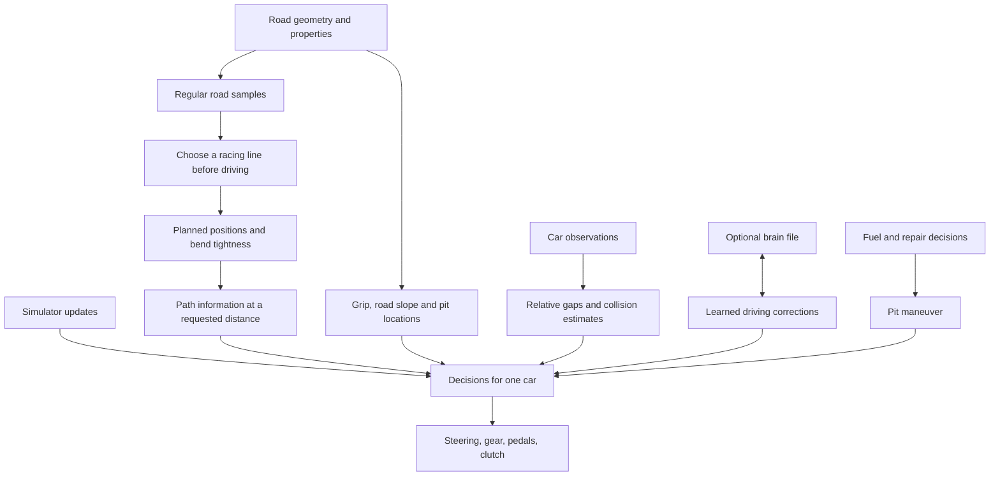
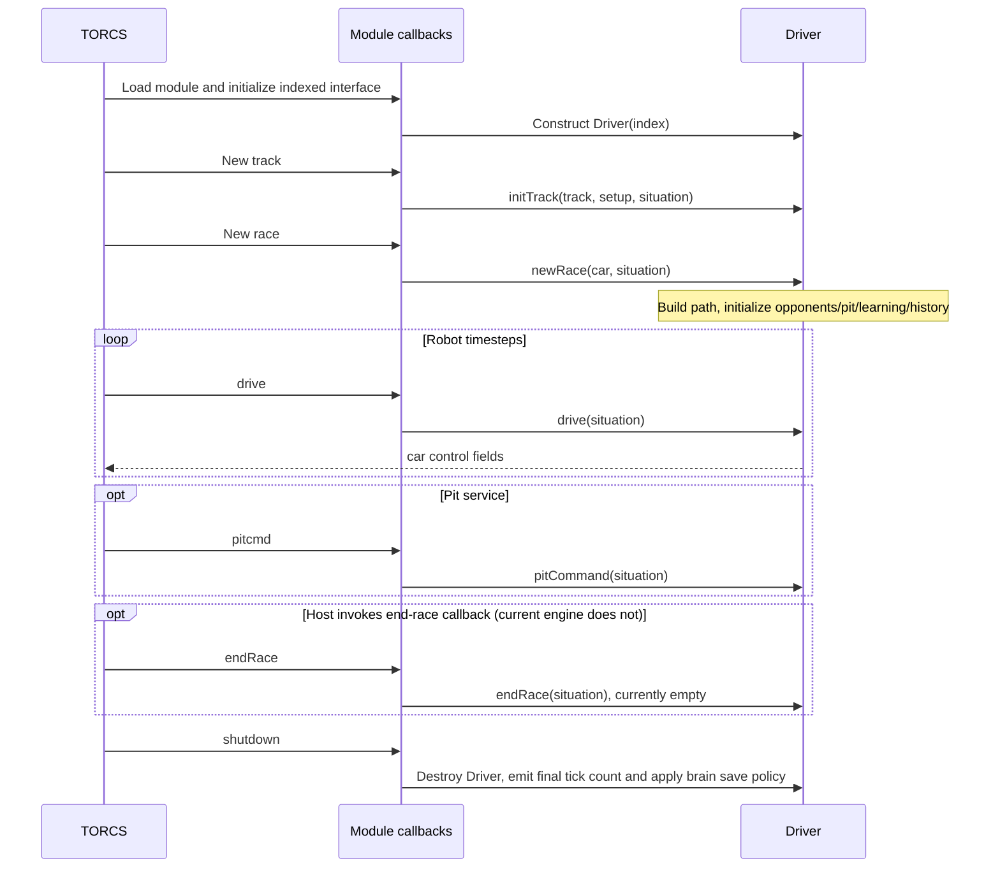
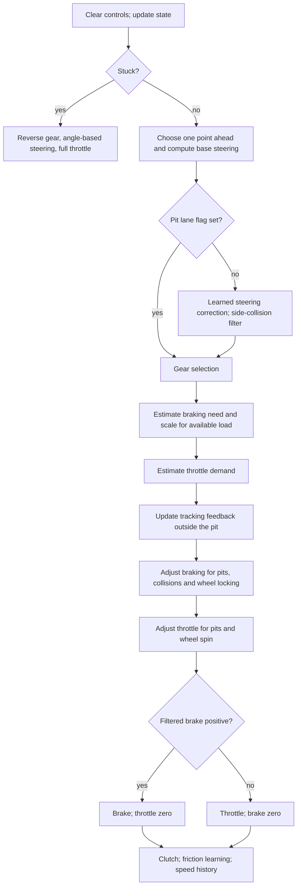
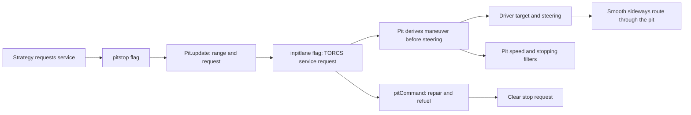

# Olethros: architecture and implementation

## In brief

**Olethros is an automated driver for TORCS, a racing simulator.** TORCS supplies
a digital description of the circuit and the current state of the cars. Olethros
responds with steering, throttle, brake, gear and clutch commands; the simulator
then calculates how the car moves. A **session** is one practice run, qualifying
time trial or race.

Its approach has three parts:

1. **Choose a path before driving.** Sample the road at roughly four-meter
   intervals and adjust a point across its width at each sample. The aim is a
   racing line with gentler bends, within car-sized road-edge clearances.
2. **Follow that path and plan speed ahead.** Repeatedly choose a point ahead of
   the car and steer toward it. Estimate how fast the car can negotiate the
   upcoming bends using grip, road shape and car properties, and brake in advance
   when necessary. Nearby cars and pit stops modify these decisions.
3. **Adapt from experience.** Learn corrections to steering and braking estimates
   and update a local speed history. Practice and qualifying also train corner-speed
   corrections. Some learned values are saved for later sessions in a small data
   file called a **brain**.

The planned racing line stays fixed during a session; the control commands and
learned corrections continue changing. The calculations are approximate,
so they do not guarantee the fastest possible lap or collision-free driving.

The sections below explain these ideas before naming their implementation in
the code. Function and variable names appear in `monospace` for reference.

## Contents

- [1. Origin and additions](#1-origin-and-additions)
- [2. Overview](#2-overview)
- [3. Module lifecycle and ownership](#3-module-lifecycle-and-ownership)
- [4. Coordinates, units and indexing](#4-coordinates-units-and-indexing)
- [5. Planning in detail](#5-planning-in-detail)
  - [Sampling the road](#51-sampling-the-road)
  - [Choosing points across the road](#52-choosing-points-across-the-road)
  - [Coarse and fine optimization](#53-coarse-and-fine-optimization)
  - [Updating the path weights](#54-updating-the-path-weights)
  - [Using the finished path](#55-using-the-finished-path)
- [6. Runtime control in detail](#6-runtime-control-in-detail)
  - [Steering](#steering)
  - [Allowed speed and braking](#allowed-speed-and-braking)
  - [Throttle, brakes, gears and clutch](#throttle-brakes-gears-and-clutch)
- [7. Learning and persistence](#7-learning-and-persistence)
  - [What changes while driving](#what-changes-while-driving)
  - [Radius corrections](#radius-corrections)
  - [Steering-error prediction](#steering-error-prediction)
  - [Friction adaptation](#friction-adaptation)
  - [Adaptive speed history](#adaptive-speed-history)
  - [Other adaptive and inactive state](#other-adaptive-and-inactive-state)
  - [Session policy](#session-policy)
- [8. Opponents, pits and strategy](#8-opponents-pits-and-strategy)
  - [Other cars](#other-cars)
  - [Fuel and repair decisions](#fuel-and-repair-decisions)
  - [Following the pit lane](#following-the-pit-lane)
- [9. Numerical assumptions and limits](#9-numerical-assumptions-and-limits)
- [10. Configuration and diagnostics](#10-configuration-and-diagnostics)
- [11. Source map](#11-source-map)
- [12. Build, test and documentation](#12-build-test-and-documentation)
- [13. Failure handling and maintenance](#13-failure-handling-and-maintenance)
- [API groups](#api-groups)

## 1. Origin and additions

Olethros is based on **BT by Bernhard Wymann**, another automated TORCS driver.
BT provides the foundation for steering, pedal control, opponents and pit stops.
Christos Dimitrakakis added Olethros's learning and trajectory-planning work.
Individual source files carry their authorship and copyright notices.

## 2. Overview

Driving requires answers to two different questions: **where should the car go?**
and **what commands should it receive now?** The planner answers the first before
the session starts. The controller answers the second on each update using that
plan and the latest observations.

TORCS represents a circuit as a sequence of road pieces, typically straights and
circular arcs. This guide calls them **native segments**, meaning the simulator's
own pieces. Each has geometry and road properties such as width, elevation and
friction. They can have very different lengths.

The **centerline** runs along the middle of the road. A **racing line** is the path
the bot intends the car to follow, which may move across the road's width. For
example, using more of the road can make a corner less sharp than following its
centerline. Olethros represents its planned line using regularly spaced samples;
this representation is called the **planning mesh**.

During driving, TORCS calls the bot nominally every 0.02 seconds of simulated
time, about 50 times per simulated second. Each call is a **tick**. The bot sees
positions, orientations, velocities, wheel speeds, damage and fuel, as well as
session information such as laps and race positions.

The implementation divides this work as follows:

| Part | Responsibility |
|---|---|
| `Driver` | Coordinates the decisions for one controlled car and writes its commands |
| `PlanningMesh` | Samples the road, stores the planned line and answers position-based path queries |
| `Trajectory` | Adjusts the sampled line during startup optimization |
| `SegLearn` | Updates and stores learned driving corrections |
| `Cardata` / `Opponents` | Summarize car observations and calculate other cars' positions relative to this driver |
| Strategy / `Pit` | Decide when to refuel or repair, and guide the car through the pit maneuver |



The diagram is a dependency overview, not the execution order. The precise
tick order appears in [section 6](#6-runtime-control-in-detail).
For what the bot learns over successive laps, start with
[What changes while driving](#what-changes-while-driving).

## 3. Module lifecycle and ownership

Olethros is loaded as a **plugin**: a library that adds automated drivers to the
simulator. TORCS calls functions supplied by the plugin when a track is loaded,
when driving starts, on each tick, and when the driver is shut down. Such a
function is called a **callback**.

The plugin offers ten named bots, Olethros 1 through 10. Their internal indices
count from 0 through 9, so **Olethros 7 is index 6**. The registration function
`olethros()` exposes these choices to TORCS. `InitFuncPt()` creates a `Driver`
for the selected index and connects its methods to the callbacks. Each car has
its own controller and learning state.

Startup has two stages. `initTrack()` selects the car setup and fuel strategy.
`newRace()` reads car properties, builds the planned line, prepares observations
and pit guidance, and initializes or loads learning. Despite its name,
`newRace()` is used for practice and qualifying too.



**Ownership** describes which part of the program releases an object when it is
finished with it. A **borrowed** object is used by the bot but remains owned by
TORCS or another helper. A C++ `unique_ptr` automatically releases its owned
object. This distinction matters because multiple bots share observations while
keeping independent decisions and learned values.
A shared **cache** stores one computed set of car observations for reuse by those
bots at the same simulation time.

| Object/data | Owner and lifetime |
|---|---|
| Track, road pieces, car and session data (`tTrack`, `tTrackSeg`, `tCarElt`, `tSituation`) | TORCS; borrowed by the driver and helpers |
| `PlanningMesh` | Driver-owned `unique_ptr`; its native pointers borrow the live track |
| Mesh sections, weights, path, curvature | Stored in the Driver-owned PlanningMesh for use during driving |
| `Opponents`, `Pit`, strategy, `SegLearn` | Created and destroyed by Driver |
| `opponent` pointer | Borrowed view into `Opponents`' array |
| Shared car observations (`Cardata`) | Used by all initialized Drivers and released during sequential shutdown |
| One car's observation entry (`SingleCardata*`) | Borrowed from shared Cardata |
| `radius` | Driver-owned native-segment radius table used by learning |
| `meshSpeedHistory` | Driver-owned regular-index vector; race-local, not serialized |
| Pit guidance curve | Pit-owned `Spline`, borrowing the seven reference points stored by Pit |

The plugin owns its Driver objects, including those whose car setup fails before
driving begins. Normal session cleanup stops driving before shutting down the bots
one at a time. Shared observation storage relies on this ordering. Planning
failures are logged and terminate the process.

## 4. Coordinates, units and indexing

The bot needs both a position on the map and a distance along the circuit. Map
coordinates locate the car in space. Distance along the centerline identifies
the road ahead even when it curves or crosses the start/finish line.
**Longitudinal** distances run along the road; **lateral** distances run across it.

The centerline distance is called a **station**, written `s`, in meters. Let `L`
be one lap's centerline length. Station 0 is the start line, and station `L` is
the same place after a lap. Queries wrap around this boundary: on a 1000 m circuit, asking for
station 1006 m means asking for the point 6 m after the start line. Distance along
the racing line can differ because it cuts across the road's width.

| Quantity | Meaning |
|---|---|
| Map coordinates `X`, `Y`, `Z` | Horizontal position (`X`, `Y`) and height (`Z`), in meters |
| Station `s` | Centerline distance in meters, **not racing-line arclength** |
| Regular index `i` | Number of a planning sample, counted from zero around the lap |
| Native traversal index | A road piece's position when walking the simulator's segments from the start line |
| Native ID | The simulator's identifier for a road piece (`tTrackSeg::id`), used to look up road properties and learning |
| Local `toStart` | Meters on straights; radians on curves, converted using radius |
| Weight `w` | Fraction across the road's width: 0 right edge, 0.5 center, 1 left edge |
| Lateral offset | Centerline displacement in meters; positive left |
| Curvature / radius | Bend tightness / equivalent circle size; defined in [planning](#55-using-the-finished-path) |
| Heading or yaw | Direction on the map, in radians; yaw refers to the car's orientation |
| Grade / banking | Road tilt along the direction of travel / across its width, in radians |
| `v_x`, `v_y` | Car velocity forward and sideways relative to the car, in m/s |
| `v_X`, `v_Y` | Velocity components along the fixed map axes, in m/s |
| Velocity / time | m/s / seconds |

Left and right are viewed in the circuit's normal driving direction. Angles in
the formulas use radians: a full turn is `2*pi`, and a right angle is `pi/2`,
where `pi` is approximately 3.14159. `sin` and `cos` are trigonometric functions
of those angles.
In mathematical expressions, `^2` means squared, `sqrt` means square root, and
`min`/`max` select the smaller/larger argument.

TORCS stores distance within a native segment in `toStart`. On straights this is
meters; on curves it is an angle. For example, 0.2 radians along a native arc of
50 m radius means 10 m of centerline travel. The bot converts this to meters and
adds that piece's start distance to obtain a station.

An ID is a table key, not a distance: native segment 12 need not start at 12 m or
coincide with planning sample 12. `PlanningMesh` keeps explicit mappings between
these representations. It sums native lengths in double precision, which reduces
rounding error, and converts back to TORCS's stored distances for pit queries.

## 5. Planning in detail

The planning problem is to choose **where across the road the car should aim at
each distance around the lap**. A path near the outside of a bend can have a
larger turning radius than the road's centerline, while moving across the road
can help prepare for the next bend. Olethros searches for a useful compromise
by moving sampled points sideways and evaluating how sharply their path bends.

The input is the circuit's left and right road borders. The output is a closed
sequence of lateral positions, plus estimates of bend tightness that the speed
controller will use. Planning works in the top-down map plane; road height and
banking enter the speed calculation during driving. It runs before driving
begins, and the resulting line is kept for the session.

### 5.1 Sampling the road

Using one planning point per native segment would give uneven numerical spacing:
one road piece may be a long straight, while another is only centimeters long.
Instead, `PlanningMesh` samples the circuit at approximately equal distances.

The quantities in the sampling calculation are:

| Symbol | Definition | Unit |
|---|---|---|
| `L` | Total centerline lap length, obtained by summing native segment lengths | m |
| `q` | Requested maximum sample spacing; the driver uses 4 m | m |
| `N` | Number of planning samples around the whole lap | Count |
| `h` | Actual distance between successive samples | m |
| `i` | Sample number, from 0 to `N-1` | Index |
| `s_i` | Distance of sample `i` from the start line | m |

```text
N   = ceil(L / q)
h   = L / N
s_i = i * h
```

`ceil` rounds upward to an integer, leaving integer inputs unchanged.
For example, a 1001 m lap with `q = 4 m` gets `N = 251` samples and `h`
approximately 3.988 m. The last sample is about
997.012 m from the start. The remaining distance to the start line is also
3.988 m: the lap closes with the same spacing as every other interval.

At each sample, the bot calculates the left and right border positions from the
native road geometry, including any change in width. It needs at least five
samples for its neighborhood calculations. Very large-radius curves are evaluated
as displacements from their starting point, which avoids losing small movements
by subtracting very large, nearly equal coordinates.

### 5.2 Choosing points across the road

Imagine laying a ruler across the road at each sample. This line from the right
border to the left border is a **cross-section**. The optimizer chooses one point
on each ruler, represented by a **weight** `w_i`:

- `w_i = 0` puts the point on the right border.
- `w_i = 0.5` puts it in the middle.
- `w_i = 1` puts it on the left border.

Thus, on a 10 m wide cross-section, `w_i = 0.2` is 2 m from the right border,
or 3 m to the right of the centerline. Changing the weight moves the point
sideways at a fixed station; it does not move that sample forward around the lap.

If `right_i` and `left_i` are the two border positions, the chosen map point
`P_i` is their weighted average:

```text
P_i = (1 - w_i) * right_i + w_i * left_i
```

The average is applied to both map coordinates. The collection of all `P_i`
points describes the racing line. Each point interacts with its neighbors, so
moving one point can change how sharply the path bends before and after it.

The driver reserves **half the car width plus 0.2 m** at each road edge. These
are hard bounds on the reference point, measured in meters rather than a fixed
percentage of road width. For a 1.8 m car, the reference point can span 2.8 m on
a 5 m road and 27.8 m on a 30 m road. The optimizer can use that whole interval;
there is no assumed 10 m road or centerline attraction. A cross-section narrower
than twice the margin has its reference point fixed at the center. The bounds
describe an aligned car; actual yaw and tracking error still require runtime
border avoidance.

### 5.3 Coarse and fine optimization

A coarse pass first establishes the general shape of the line. A fine pass then
adjusts it at the full sampling resolution. **Coarse anchors** are the selected
samples used by the first pass; their gaps are balanced around a nominal 10 m
scale, with exact distances determined by the regular sample spacing and rounding.

| Pass | Starting line | Samples used | Maximum iterations |
|---|---|---|---|
| Coarse | Road center, with weights 0.5 | Coarse anchors | 500 |
| Fine | Interpolated coarse result | All regular samples | 1000 |

An **iteration** proposes a coupled change to all lateral positions and searches
for a feasible step that decreases bending energy, as defined below.
The coarse weights are interpolated to supply the fine pass's starting values.
Here, interpolation means blending between neighboring anchor values according
to distance, including across the start/finish line.

The coarse seed matters: fine refinement started directly from centered weights
produced a weaker racing line. Broad shape changes are established on the coarse
representation before the smaller-scale adjustments. In code, `PlanningMesh::optimise()`
organizes the two passes and `Trajectory::optimise()` performs each search.

### 5.4 Updating the path weights

The optimization variables are **lateral offsets in meters**, positive left,
rather than width fractions. Weights are reconstructed after solving. This keeps
the numerical variables in the same units on narrow and wide roads.

For the chosen planar points `P_i`, let `d_i = P_(i+1) - P_i`, let `l_i` be
that chord's length, and let `u_i = d_i / l_i` be its unit direction. Indices wrap
around the lap. The discrete **bending energy** is:

```text
h_i = (l_(i-1) + l_i) / 2
E   = sum_i |u_i - u_(i-1)|^2 / h_i
```

This approximates the integral of squared curvature along the path. It penalizes
wiggles and sharp turns and is invariant under planar rotation and translation.
It is a geometric objective, not a lap-time objective: for a circular road, it
prefers the outer usable edge, even if a powerful car could lap faster inside.
The implementation multiplies `E` by the fixed input-centerline polygon length
to obtain a dimensionless cost; that does not change its minimizer.

`Trajectory::bendingEnergy()` computes the exact gradient, including derivatives
of chord normalization and changing chord lengths. Each corner contributes a
two-dimensional residual `(u_i-u_(i-1))/sqrt(h_i)`. Its analytic Jacobian gives a
**Gauss–Newton** approximation `2 J^T J` to the Hessian, the matrix describing how
the gradient changes. A small relative diagonal regularization protects near-null
modes. This regularizes the numerical solve, not the road width or the objective.

The cyclic matrix couples each point to its two neighbors on either side.
Reordering its indices produces a banded matrix, solved by Cholesky factorization
in linear time and storage. Variables already at a bound with an outward descent
direction are fixed for that solve. A projected negative-gradient direction is
available if the proposed direction is not a descent direction.

**Projected Armijo backtracking** clips a candidate to its physical bounds and
halves the proposed step until the measured cost decreases sufficiently relative
to the gradient. Invalid geometric trials are rejected. Every accepted step
strictly lowers the same objective; all samples participate, including the seam.
There are no exponentials, shuffled updates, pinned sample, or wall-clock cutoff.

The search stops at a small projected gradient, when no decreasing step can be
accepted within the line-search budget, or at the iteration limit. Diagnostics
report which condition stopped each pass and its initial/final costs. Feasible,
decreasing steps do not prove global optimality. Tests independently check the
gradient, analytic circle energy, monotone descent, width use, orientation,
native subdivision, and 2/4/8 m sampling on 5–30 m roads.

### 5.5 Using the finished path

The controller needs both a target position and an estimate of how tightly the
path turns. After optimization, `PlanningMesh::finish()` computes all chosen
points and estimates **curvature** at each one by the circle through that point
and its two neighbors. This circle is called a circumcircle.

Let `R` be that circle's radius in meters, and `k` its curvature in inverse meters:

```text
k = 1 / R
```

A 50 m radius gives `k = 0.02` per meter. Tighter bends have smaller radii and
larger curvature. Three distinct collinear points give zero curvature, represented
as an infinite radius. Curvature here is unsigned: the target's map position tells
the steering controller whether it should turn left or right.

During driving, a requested station usually falls between samples. The bot
interpolates the neighboring weights and evaluates the actual road cross-section
there. For example, halfway between weights 0.3 and 0.5, it uses weight 0.4.
On a 10 m wide cross-section, that places the target 4 m from the right edge.
This follows the road's shape between samples rather than just aiming along
straight connectors through a curved road.

Curvature is also interpolated, and radius is calculated from that interpolated
curvature. This is a sampled estimate; it is not the exact curvature of the
position interpolation between samples.

The bot also maps path values to native segment starts for tables used by
learning. It locates where the sampled line meets each road cross-section, or
projects the road-following position onto that section by finding the nearest
point along its across-road line. Runtime queries continue using actual station,
so a long native straight can have different estimated radii near its entrance
and in its interior.

Finally, speed lookahead visits **both regular samples and every native segment
boundary**. A short low-grip surface patch can lie between regular samples;
including its native boundaries ensures the controller examines that patch too.

## 6. Runtime control in detail

The planned line describes a route, but it does not directly specify steering or
pedal positions. On every tick, the controller compares the car's current state
with that route and calculates new commands. A **demand** is one such requested
command before all adjustments have been applied. A **filter** here is a function
that modifies a demand, for example reducing throttle when the driven wheels spin.

`drive()` first clears the previous commands. `update()` refreshes car and opponent
observations, fuel estimates and pit state. The elapsed robot interval, `dt`, is
measured in seconds and supplied by the simulator. All bots receive it, while
their shared `Cardata` observation cache is refreshed only once at that simulation
time.

A car that stays slow, misaligned with the road and sufficiently far from its
center can enter a stuck-recovery branch. That branch requests reverse gear and
steers according to the car's angle. Otherwise, normal driving follows this order:



`updateTargetPoint()` prepares lookahead and returns one frozen world target.
Outside the pit, it also advances avoidance state once. In the pit, the spline
supplies the sideways position and passing is inactive. `getSteer(target)`
calculates base steering without changing state. Outside the pit,
`updateTrackFeedback()` uses that same base steering for learning and emergency
steering. Traction control, called **TCL** in the code, advances once per normal
driving tick. These update counts matter because their stored state influences
the next tick. Outside the pit, side-collision changes to `myoffset` affect speed
queries and the next tick's target.

### Steering

Steering aims toward a **lookahead target**: a point farther along the planned
route than the car's current station. Looking ahead lets the bot begin turning
before it reaches the middle of a bend.

Normal lookahead combines a 17 m base distance with the distance covered in
0.33 seconds at the car's forward speed `v_x`:

```text
lookahead = 17 + 0.33 * v_x
```

Here `v_x` is in m/s and lookahead is in meters. At 30 m/s, the target is initially
26.9 m ahead along the centerline. The controller limits how quickly lookahead
can shorten during braking, avoiding an abrupt jump of the target toward the
car. In the pit lane it uses 6 m when at or below its pit speed target, with a
speed-dependent extension above that target.

The **target bearing** is the map angle from the car to the chosen point. **Yaw**
is the direction the car is facing, and **yaw rate** is how quickly that direction
is changing, in radians per second. The main steering term subtracts yaw and
0.1 seconds of yaw-rate prediction from the target bearing. It wraps the result
to the shortest signed turn and divides by **steering lock**, the configured
maximum steering angle. This produces a steering command on the car's control
scale.

The controller adds a small countersteering correction based on the **body-frame
slip angle**, `atan2(v_y, v_x)`, multiplied by -0.01. Here `v_x` and `v_y` are
the car-relative forward and sideways velocities. Straight, aligned motion has
zero slip regardless of compass heading. Using world velocities here formerly
introduced a steering jump of about 0.0628 whenever velocity heading crossed
between +pi and -pi, causing repeated weaving on A-Speedway's opposite straight.
Outside the pit, the controller also applies a road-border correction, subtracts learned
steering error and adjusts for cars alongside. While the pit lane flag is set,
normal steering follows the pit target without those road-specific corrections.
Passing and pit guidance choose the sideways position of the target, as explained
in [section 8](#8-opponents-pits-and-strategy).

### Allowed speed and braking

Tires must supply sideways force to negotiate a bend. At a given speed, a tighter
bend requires more of that force. A simple estimate without aerodynamic effects
is `v = sqrt(mu * G * R)`, where `v` is estimated cornering speed in m/s,
`mu` is a dimensionless friction factor, `G = 9.81 m/s^2` is gravitational
acceleration, and `R` is the turning radius in meters. With `mu = 1` and `R = 50 m`, this
gives about 22.1 m/s, or 80 km/h.

Olethros extends this idea with road slope, banking, car properties and learned
radius corrections. Its **allowed speed** is a local cornering estimate, not a
guarantee of safe handling or a speed the car must reach.

The full calculation in `getAllowedSpeed(s)` uses these quantities:

| Quantity | Meaning |
|---|---|
| `surfaceFriction` | Friction factor of the native road piece at the queried station |
| `tireFriction` | Minimum of the four configured tire friction factors |
| `setupMuFactor` | Driver setup multiplier, called `mufactor` in configuration |
| `R_eff` | Planned radius after the applicable learning and avoidance adjustments, in meters |
| `bank` | Average of the native segment's starting and ending sideways road-tilt angles, in radians |
| `gradeChange` | Change of `sin(grade)` per meter around the queried station |
| `v_x` | The car's current forward speed, in m/s |
| `m` | The driver's car-plus-fuel mass estimate, in kg |
| `CA` | Aerodynamic downforce coefficient, used so that downforce grows as `CA * speed^2` |
| `G` | Gravitational acceleration, 9.81 m/s² |

**Downforce** is the aerodynamic force pushing the car toward the road, increasing
available grip. **Grade** is the uphill/downhill angle. Its change is estimated
from road heights across intervals based on the regular spacing, so short native
segments do not make that estimate artificially large. The function `tanh` below
is the hyperbolic tangent, a smooth function bounded between -1 and 1. These
corrections are empirical, with numeric inputs in the units listed above.

```text
mu_base     = surfaceFriction * tireFriction * setupMuFactor
gradeFactor = 1 + tanh(0.1 * v_x * gradeChange)
bankFactor  = cos(bank)          on a native straight
            = 1 + tanh(-bank)    on a native left curve
            = 1 + tanh(bank)     on a native right curve
mu_eff      = mu_base * gradeFactor * bankFactor
k_eff       = 1 / R_eff
v_allowed   = sqrt(mu_eff * G / (k_eff - min(k_eff, CA * mu_eff / m)))
```

Here `gradeFactor` and `bankFactor` are multipliers for the uphill/downhill shape
and sideways bank. `mu_base` and `mu_eff` are the friction factors before and
after those corrections. `k_eff` is the effective curvature, and `v_allowed` is
in m/s.
An infinite radius gives zero curvature. The formula's denominator can then be
zero, representing no local cornering-speed cap. Aerodynamic grip can produce
the same result on sufficiently gentle bends. Future bends, speed history and
pit restrictions can still limit the demand, and the simulated car has finite
engine power and drag.

**Braking looks ahead because slowing down takes distance.** The scan extends up
to `v_x^2 / (2 * surfaceFriction * G)` meters, limited to one lap. For each upcoming
station whose allowed speed is below the current speed, the bot estimates the
distance needed to slow down and compares it with the distance available. It
keeps the strongest brake demand, rather than stopping at the first restrictive
sample. Overspeed at the car's current station also creates a brake demand.

The stopping-distance calculation includes drag and a learned correction:

```text
c = mu_brake * G + delta_brake
d = (CA * mu_brake + CW) / m
distance = -log((c + d * v_goal^2) / (c + d * v_now^2)) / (2 * d)
```

- `v_now` is current forward speed and `v_goal` is the speed to reach, both in m/s.
- `mu_brake` is the friction factor passed to the braking model. Normal track
  scans use the current surface friction; pit braking uses a pit-adjusted factor.
  It is distinct from `mu_eff` in the cornering estimate.
- `delta_brake` is the learned term added to the constant deceleration estimate,
  obtained from `GetFrictionDm()`. It is set to zero for pit braking.
- `CW` is the aerodynamic drag coefficient, with drag proportional to `CW * speed^2`.
- `c` is the model's constant deceleration term; `d` is its speed-squared
  coefficient. `CA`, `m` and `G` have the meanings above.
- `log` is the natural logarithm. The resulting distance is in meters. The
  expression assumes a nonzero `d` and a positive logarithm argument.

The throttle controller examines the same road ahead and can release the
accelerator before braking is necessary. Race strategy and overtaking state
adjust that release timing. Pit constraints, collision avoidance and anti-lock
braking can subsequently modify the requested brake value.

### Throttle, brakes, gears and clutch

For a forward gear, let `V` be the target speed after looking ahead and applying
the local speed-history cap. If `H(s)` is the interpolated adaptive speed history
at the current station, that cap is `1.2 * H(s)`. The history and its update rule
are explained in [section 7](#adaptive-speed-history).

The raw throttle demand uses a speed error `e_v`, in m/s. Forward and sideways
car velocities are `v_x` and `v_y`; their combined speed is
`sqrt(v_x^2 + v_y^2)`. The controller subtracts an additional 3 m/s margin:

```text
e_v = V - (sqrt(v_x^2 + v_y^2) + 3)

rawThrottle = 1                         if e_v >= 2
            = 0.5 + 0.25 * e_v          if 0 < e_v < 2
            = max(0, 0.5 * (1 + e_v/3))  if e_v <= 0
```

Throttle and brake commands use a scale where 0 means released and 1 means a
full request. For example, a target of 30 m/s and a current combined speed of
25 m/s gives `e_v = 2`, hence full raw throttle. At 30 m/s the raw throttle is zero.
Filters then account for pit restrictions and **wheel slip**, the mismatch
between wheel rolling speed and vehicle speed:

- **Anti-lock braking (ABS)** reduces brake demand when the wheels rotate too
  slowly for the vehicle's forward speed, indicating a tendency to lock.
- **Traction control (TCL)** reduces throttle when the driven wheels (those
  receiving engine power) rotate too fast, indicating wheel spin. It keeps a
  smoothed correction between ticks.
- If the final brake demand is positive, braking takes precedence and throttle
  is set to zero. Otherwise, the filtered throttle demand is used.

A gear changes the ratio between engine rotation and wheel rotation. Gear
selection uses the engine's rotational-speed limits and estimates of **torque**,
the turning effort available to drive the wheels, in adjacent gears. The clutch
controls the connection between engine and transmission, particularly during
launch. These calculations produce requests; TORCS applies them through its
vehicle simulation.

Only existing forward gears are considered for an upshift, and ratio lookups
stay within the transmission's array bounds. The highest gear can still downshift.

## 7. Learning and persistence

### What changes while driving

The geometric plan and speed models are approximations. The car can run wider
than intended in a corner, or slow down differently from the braking estimate.
**Online learning** means updating numerical corrections from those driving
observations so later decisions can account for the mismatch.

The racing-line weights are fixed after startup optimization. What changes during
driving is the response around that plan: steering-error predictions, braking-model
corrections and speed history. Practice and qualifying also train radius
corrections for the corner-speed estimate. Passing and pit maneuvers can move
the current target without changing the stored racing line.

Most learned values belong to particular road locations. `SegLearn` stores them
by native segment ID or by a learning bucket called a **quantum**. Currently,
quantum lookup uses one native segment per bucket (`segments_per_quantum = 1`).
The adaptive speed history instead uses regular planning samples and belongs to
Driver. This is why changing planning resolution does not change the dimensions
of a saved brain file.

| Mechanism | When it learns during driving | Effect on control | Included in a saved brain? |
|---|---|---|---|
| Radius corrections | Practice/qualifying, while sufficiently free of interference and close to the intended line, subject to turn and recent-accident checks | Adjust the effective radius in allowed-speed calculations | Yes |
| Steering-error prediction | Normal driving outside the pit, in all sessions; corrections update when entering a different learning bucket | Supplies location-dependent steering feedback outside the pit | Yes |
| Friction/longitudinal-response model | Normal driving in all sessions; coefficient learning has nonzero gain only when alone and no collision is reported for that tick | Adjusts braking-distance estimates | Friction corrections yes, internal input weights no |
| Regular speed history | Normal driving in practice/qualifying, and when alone in races | Caps the acceleration controller's target speed | No |
| Acceleration prediction | Updated alongside steering prediction | Currently none: its prediction functions return zero | Yes |

Here **normal driving** means the control branch outside stuck/reverse recovery.
The friction and speed-history updates have no separate pit exclusion. **Alone**
is the driver's flag for a period without immediate collision risk or a need to
yield to another car. It includes a roughly two-second waiting period, so a
single-car session does not imply that it is true from the first tick.
The brain column describes the payload; whether it is actually saved depends on
the [session policy](#session-policy) below. In particular, a race can learn in
memory without saving that learning for the next session.

### Radius corrections

This mechanism changes how optimistic the corner-speed estimate is at a location.
A positive correction allows the model to treat the path as a larger-radius bend;
a negative one can make the estimate more conservative. The road and planned
path themselves do not change.

`Driver::update()` calls `SegLearn::update()` outside race sessions. It compares
the car's lateral position with the planned weight and available road margins,
taking the last turn direction and recent opposite turns into account. Comfortable
margin can produce a positive radius adjustment; running close to or beyond a
border, or travelling backwards, can produce a negative adjustment.

`PropagateUpdateBackwards()` spreads the correction to earlier road locations,
with its influence decreasing exponentially with distance. This is useful because
running wide at a corner exit can be the consequence of entering too fast.
Straights associate their updates with the preceding turn through the `updateid`
lookup table.

`getAllowedSpeed()` uses accepted corrections as additive changes to the planned
radius. Their acceptance and strength depend on avoidance offset, alone state,
native geometry and pit occupancy, as described in [section 6](#allowed-speed-and-braking).
This changes the speed estimate, not the mesh geometry. Race sessions consume
loaded radius corrections but do not run this radius-training update.

### Steering-error prediction

The steering predictor learns a location-dependent correction to the steering
command. Its aim is to anticipate recurring tracking errors, such as needing
additional steering at a particular part of a bend.

On normal ticks outside the pit, `updateTrackFeedback()` forms an error signal
from the tick's uncorrected steering, planned-versus-actual lateral weight, the
existing prediction and border proximity. It passes this signal to
`SegLearn::updateAccel()`; despite that name, the function also trains the active
steering predictor.

An **eligibility trace** is a remembered weight for a recently visited learning
bucket. The weight fades with elapsed time. When the car enters a different
bucket, the predictor uses these weights to adjust both the preceding bucket
and other recent entries. An error noticed now can therefore influence the
steering correction at locations that led up to it.

The update combines the current error signal with the prediction for the entering
bucket, reduced according to elapsed time. Near-border conditions reduce the
learning factor and replace the error signal with a border-related one.
Backwards travel suppresses the steering update. This learning does not require
the `alone` flag to be true.

The learned `derror` entry is returned by `predictedError(car)`. During normal
driving outside the pit, steering subtracts `0.2 * predictedError(car)` before
side-collision filtering. Thus the bot can adjust its steering response at a
location on subsequent visits without changing the optimized path weights.
Pit steering skips this correction because the predictor describes following
the racing line, while the pit has its own route beside that line.

### Friction adaptation

This mechanism adapts the estimate of how the car accelerates and slows down.
**Longitudinal** means along the direction of travel, as opposed to sideways.
Track-direction speed is velocity projected onto the local road direction.

`AdjustFriction()` estimates the expected acceleration using the previous speed,
control input, surface friction and drag. It compares that estimate with the
observed speed change divided by its observation interval. The interval is
refreshed by the practice/qualifying learning update; in a race it uses a 0.02 s
fallback. The difference between expected and observed acceleration is its
**prediction error**.

That error updates a correction shared across the lap (`dm`), a correction for
the previous native segment (`segdm`), and internal weights that scale the model's
response to brake and throttle inputs (`W_brake` and `W_accel`). These input
weights are separate from the lateral path weights used by planning. They are
numerical model adjustments, not direct measurements of a physical tire coefficient.

The **learning gain** scales how much one observation can change the model.
Driver supplies a gain of `0.001` while alone without a reported
collision, and zero otherwise. A zero-gain call still records the latest
observation for the next comparison. This update also runs in race sessions.

Outside the pit, `brakedist()` consumes `GetFrictionDm()`, which returns
`dm + segdm[segmentID]`. The correction changes the estimated stopping distance;
it does not replace the track surface's friction value. The additional
`dm2`/`dm3` and segment arrays remain in the brain format, but their contributions
to braking are commented out. Friction corrections are serialized, whereas
`W_brake`, `W_accel` and the previous-observation state are initialized anew.

### Adaptive speed history

This is a local memory of the speeds the car has been achieving, with some
headroom added. It provides the acceleration controller with a speed cap that
can evolve over successive visits to the same road location.

Driver initializes `meshSpeedHistory` from the planned allowed speeds, replacing
NaN or values above 10000 m/s (including infinity) with 10000 m/s. Eligible driving
ticks update both regular entries surrounding the current station using:

```text
history += 0.1 * dt * (forwardSpeed + 5 - history)
```

Here `history` and `forwardSpeed` are in m/s, `dt` is this driver's tick interval
in seconds, and 5 m/s is the headroom. The multiplier `0.1 * dt` makes the entry
move gradually toward `forwardSpeed + 5`. For example, with history 40 m/s,
forward speed 20 m/s and `dt = 0.02 s`, one update changes the entry to 39.97 m/s.

`pathSpeedHistory()` interpolates those entries. `getAccel()` caps its lookahead
target at `1.2 * pathSpeedHistory(currentStation)`. This is a gradual local
speed-history adaptation, not a stored best-lap speed profile. It is reset for
each new race/session and never written into the brain file.

### Other adaptive and inactive state

- `SimpleStrategy` compares fuel readings as the car passes its start-of-lap
  measurement window (native IDs 0..4). It accounts for refueling and retains
  the largest observed lap consumption.
  The estimate informs refuel requests and amounts. It is session-local, not
  part of SegLearn or the brain file.
- Passing offsets, pit states, TCL memory and strategy pace decisions react to
  current observations. They are controller/strategy state, not an optimized
  racing line learned and stored between sessions.
- The acceleration-prediction array is updated and serialized, but both
  `updateAccel()` and `predictedAccel()` return zero. Updating that array does
  not currently provide an additional learned throttle/brake command.
- `SetSafetyThreshold()` currently writes a field that the learning updates do
  not read. The session-specific calls to it are not an active learning gate.

### Session policy

Saving learned values and using them during driving are separate decisions.
Practice, qualifying and race sessions attempt to load an existing valid brain.
Practice therefore continues the learning saved by earlier sessions. If no valid
brain can be loaded, the session uses fresh initialized learning. Only practice
and qualifying save learning when the session's Driver object is destroyed.

| Session | Initial learning state | Save on Driver destruction |
|---|---|---|
| Practice | Load existing brain if present | Yes |
| Qualifying | Load existing brain if present | Yes |
| Race | Load existing brain if present | No |

Loading/saving follows this session policy.
The integration runner isolates and restores the selected brain file when a
clean reference run is needed; in-run learning remains active.
`endRace()` is empty. The current engine calls shutdown without `rbEndRace`;
destruction emits the final diagnostic tick count and performs saving.

The brain filename is:

```text
<GetLocalDir()>drivers/olethros/<index>/<track-internal-name>.brain
```

`GetLocalDir()` is the per-user data directory chosen by TORCS. `index` is the
bot's zero-based number, and `track-internal-name` is the track filename without
its extension, for example `dirt-2`. Car model and session type are not part of
the filename.

The file stores named groups of numbers. The group labels are text terminated
by a zero byte, followed by binary floating-point values or integers in the host
machine's format. It is therefore not a portable, versioned exchange format.
Loading checks those labels, the expected array sizes for this track,
complete arrays, finite values (neither NaN nor infinity), and the final marker
and end of file before adopting any state.
A missing file is normal; a damaged/incompatible file produces a diagnostic and
leaves the prior learning state untouched. Buffer sizes come from the loaded
track, not file-supplied counts. The native format remains compatible with valid
existing files; it does not store a fingerprint of the track geometry or validate
physical bounds on arbitrary finite learned values.

`loadParameters()` returns `BRAIN_MISSING`, `BRAIN_LOADED`, `BRAIN_REJECTED` or
`BRAIN_IO_ERROR`. Driver diagnostics report that outcome with the bot index;
practice reports fresh state. Persisted regression runs require a positive loaded
outcome, while clean race runs require a missing-file outcome.

Saving writes a sibling `.tmp` file, checks write/close results and then replaces
the previous brain. Failed writes/replacements retain the prior file. This
protects against ordinary partial-write failures; it is not a guarantee against
filesystem corruption, concurrent unrelated writers or every power-loss case.
Regular speed history is not serialized into it. For comparisons, use fresh
processes and explicit brain-I/O isolation, and record the session type.

## 8. Opponents, pits and strategy

The planned line assumes the road is available. Other cars can occupy it, and
fuel or damage can make a pit stop more useful than continuing at full pace.
These decisions modify the target and control demands without rebuilding the
planned line.

### Other cars

`Cardata` stores facts such as each car's speed along the road and its orientation.
`Opponents` converts them into information relative to the controlled car:

- Is another car ahead and slower, behind and approaching, or alongside?
- How large are the gaps along and across the road?
- How soon could the controlled car catch a slower car?
- Is contact likely, or should a car that is lapping this one be allowed past?

These classifications are represented by flags such as `OPP_FRONT`, `OPP_BACK`
and `OPP_SIDE`. They influence sideways passing offsets, collision braking and
steering away from nearby cars. A **catch estimate** uses distance and relative
speed to predict when a gap will close. A **yielding** decision gives room to a
car that should be allowed to pass.

The bot also estimates how much width an angled car occupies across the road.
For a rectangular car, this **projected width** is:

```text
projectedWidth = carLength * abs(sin(angle)) + carWidth * abs(cos(angle))
```

Lengths are in meters. `angle` is the road direction minus the car's yaw, in
radians, and `abs` takes the absolute value. For example, a car sideways to the
road occupies its full length across it. The selected car's gap and width stay
paired for side avoidance; its own catch estimate determines passing urgency.

The position counts supplied to strategy include entries whose immediate
opponent classification is ignored. They can therefore include cars that the
avoidance logic is not currently considering.

### Fuel and repair decisions

Strategy answers **whether service is needed**, while pit guidance answers
**how to reach the assigned stopping place**. `SimpleStrategy`, used in practice
and qualifying, estimates fuel consumption per lap and requests service for low
fuel or sufficient damage. Refueling requests are additional amounts, limited
by tank capacity and estimated fuel needed for the remaining distance.

`ManagedStrategy`, used in races, also considers race position and time gaps to
other cars. Its repair decision weighs damage, remaining laps and the likely
time cost of losing positions. It uses smooth probability-like formulas based
on those gaps and whether another fuel stop would be needed. It also supplies
a pace factor that influences how early the controller releases the throttle.

### Following the pit lane

A **pit lane** is the service route beside the main racing road. Each eligible
car has an assigned stopping place, or **pit box**, for repair and refueling.
The bot keeps three distinct pieces of information about a pit maneuver:

| Information | Meaning |
|---|---|
| Stop request, `pitstop` | The bot wants service at its assigned box |
| Lane flag, `inpitlane` | A requested maneuver has entered the along-track interval from pit entry to exit |
| Maneuver state | Which part of the approach, service or exit the controller should follow |

The lane flag is based on along-track position and the request. It is not a
separate geometric test that the car is laterally inside the pit lane. It can
remain true after service clears the request, until the car passes the pit exit.



Pit derives the maneuver state before steering and when a request is cleared:

| State | Condition |
|---|---|
| `NONE` | No active lane maneuver and no nearby requested stop |
| `APPROACHING` | Service requested, still outside the pit interval, within 200 m of the assigned stop |
| `IN_LANE` | Lane flag set and service still requested |
| `PIT_EXIT` | Lane flag set after the service request has been cleared |

The sideways route is specified by seven reference points around entry, the
pit box and exit. Each point, called a **knot**, gives an along-track distance,
a desired sideways displacement and a slope describing how that displacement
changes with distance. The `Spline` helper joins adjacent knots with a cubic
Hermite curve, a smooth interpolation determined by the endpoint values and
slopes. The knot slopes are set to zero for this pit route.

Distances for this curve are measured from pit entry, including when the lane
crosses the start/finish line. While the lane flag is set, the target starts at
the road centerline (weight 0.5) and adds the exact signed pit displacement.
This applies to both `IN_LANE` and `PIT_EXIT`: clearing the service request does
not change the origin of the sideways measurement. The racing-line weight can
vary along the road without moving the pit target toward neighboring boxes.

The interpolation requires usable, ordered knot intervals. If lookahead reaches
or passes the final knot while the car is still in the pit interval, pit guidance
holds that knot's displacement, which is zero at the exit. It does not extend
the last cubic curve beyond its endpoint, where it could bend back toward the
pit row. Once the lane flag clears, target selection returns to the racing line.

During normal driving with the lane flag set, passing-offset updates are skipped
and the overtaking flag is cleared. Main-track learned steering, road-border
correction and lateral side-collision steering are also inactive. Collision
braking remains active so a blocking car can cause the bot to slow or stop while
retaining its pit target.

Pit control aims 0.5 m/s below the official speed limit and brakes to stop at
the box. If the car stays very slow near or beyond its box without the simulator
accepting the stop, a timeout can clear the request so it attempts to leave.
Cars without an assigned pit bypass this maneuver logic.

## 9. Numerical assumptions and limits

The plan and controller rely on a valid road description and use approximate
geometry and vehicle-response models. The following limits help explain why a
computed line or speed can still need correction during driving:

- Planning requires a cyclic track with positive native lengths, valid segment
  IDs and a zero-station start. Neighboring path points must be distinct.
- Native track coordinates limit input precision. Double-precision calculations
  reduce further rounding error but cannot recover detail lost in those inputs.
- The bending objective is rotation/translation invariant. Native-coordinate
  rounding and sampling still affect numerical results. Feasible descent and
  the stated stopping rules do not establish a globally optimal path or lap time.
- The native radius table used by learning is capped at 10000 m. Runtime mesh
  queries use position-dependent curvature and can return infinite radius for
  a straight path.
- Learning and brain dimensions depend on native segmentation, even though
  planning and speed-history resolution use the regular mesh.

## 10. Configuration and diagnostics

The bot reads **setup files**: XML text files containing named settings. For each
bot index it first looks for a setup matching the track filename in the session's
`practice`, `qualifying` or `race` subdirectory under `drivers/olethros/<index>/`.
If none is available, it uses `drivers/olethros/<index>/default.xml`. The index is
the zero-based bot number described in section 3.
Track filenames can include a directory or be bare filenames. An unknown session
type also selects the default setup.

Driver-specific settings are grouped under the XML section `olethros private`:

| Setting | Meaning |
|---|---|
| `mufactor` | Multiplier on estimated cornering friction, default 0.69; affects the driver's speed calculation |
| `fuel per lap` | Estimated liters required for one lap, used to choose initial fuel |
| `fuel consumption` | Estimated liters per meter, default 0.0008; multiplied by lap length when `fuel per lap` is not supplied |

The car's settings supply mass, engine limits, gear ratios, tire factors and
aerodynamic properties. The track description supplies geometry, road friction
and pit locations.

**Diagnostics** are observations written to a log to explain the bot's decisions:

| Environment variable | Effect when present |
|---|---|
| `OLETHROS_DIAGNOSTICS` | Read-only mesh, station, target, speed and control telemetry |

Setting this environment variable before starting TORCS enables the diagnostic
output. Each Driver and PlanningMesh caches whether it is present at construction
and uses that flag for its lifetime, avoiding environment lookups in driving and
mesh loops. It does not select a different driving policy. Logs can be large, so
record whether diagnostics were enabled when comparing runs.

Runtime records identify the bot and its race-local callback sequence, with
full-precision simulation time. Session/brain records and the final shutdown tick
count bracket the trace. The runner checks every tick's controls/state and the
target/speed/brake records required by its recovery mode, gear and direction.

## 11. Source map

For readers who want to connect the explanation to the implementation, this
table identifies the relevant files. Headers (`.h`) declare the interfaces and
C++ source files (`.cpp`) implement them.

| Files | Responsibility |
|---|---|
| `olethros.cpp`, `olethros.def`, `olethros.xml` | Module registration, exported entry, bot definitions |
| `driver.h`, `driver.cpp` | Lifecycle, ownership and runtime control orchestration |
| `PlanningMesh.h`, `PlanningMesh.cpp` | Declared geometry/query interface and its out-of-line implementation |
| `Trajectory.h`, `Trajectory.cpp` | Bending energy, analytic Jacobian, bound-constrained Gauss–Newton solve and line search |
| `learn.h`, `learn.cpp` | Native-indexed learning and persistence |
| `cardata.h`, `cardata.cpp` | Shared absolute car observations |
| `opponent.h`, `opponent.cpp` | Per-driver relative opponent state |
| `pit.h`, `pit.cpp` | Pit trajectory, flags, limits and timeout |
| `strategy.h`, `strategy.cpp` | Fuel and repair strategy |
| `spline.h`, `spline.cpp` | Pit Hermite interpolation |
| `linalg.h` | Inline float planar algebra used by control |
| `Makefile`, `olethros.vcxproj` | Linux and Windows module build definitions |
| `Doxyfile`, `README.md` | API documentation configuration and implementation guide |

The Linux module links the shared learning library. The Windows project also
compiles `src/libs/learning/MathFunctions.cpp` into the module.

## 12. Build, test and documentation

The main TORCS project is in `torcs/torcs/` within the repository; this is the
**solution root**, containing `TORCS.sln`. The following command runs from that
directory. Building requires the Visual Studio 2022 C++ tools and the dependency
headers and libraries under `src/windows/`. Run `setup_win32.bat` in the solution
root to prepare the exported project headers and runtime directories.
MSBuild is Visual Studio's command-line build tool. To build the Olethros module
for Release x64 in a configured checkout:

```powershell
powershell -Command "& 'C:\Program Files\Microsoft Visual Studio\2022\Professional\MSBuild\Current\Bin\MSBuild.exe' src\drivers\olethros\olethros.vcxproj /p:Configuration=Release /p:Platform=x64 /p:SolutionDir='C:\Users\berni\Development\code\torcs\torcs\' 2>&1"
```

Adjust the absolute solution path for another checkout. This copies the built
module into `runtime/drivers/olethros/`; restart the simulator to load it.

Component tests and the process-level runner live under `test/drivers/olethros`,
separated into `unit` and `integration`. The [test README](../../../test/drivers/olethros/README.md)
provides build, test and brain-recovery commands. [ENGINEERING.md](../../../test/drivers/olethros/ENGINEERING.md)
explains the test rationale, coverage and current verification status.

**API documentation** describes the functions, classes and their contracts.
Doxygen generates it from the source comments and this guide. With Doxygen
installed, run this command from `src/drivers/olethros/`:

```text
doxygen Doxyfile
```

Open `docs/html/index.html` and inspect `docs-warnings.log`. Doxygen processes
the local source files and this guide, including private and static members.
The top-level TORCS `make doc` configuration currently excludes this driver.

Mermaid code fences render in compatible Markdown viewers, including GitHub.
Doxygen rendering depends on the installed version; diagrams remain readable
as text when unsupported. The prose and tables do not depend on Mermaid.

## 13. Failure handling and maintenance

This section describes what happens when initialization or saved-state operations
fail, and the assumptions that code changes need to preserve.

### Failure handling

| Condition | Driver behavior |
|---|---|
| Planning initialization fails | Logs the error and terminates the process |
| Brain file is missing | Keeps the current learning state, which is fresh at race initialization |
| Brain file is damaged or incompatible | Rejects it with a diagnostic and preserves the current learning state |
| Brain write or replacement fails | Reports the failure and retains the previous brain file |

TORCS supplies the native track, segment IDs, callback indices and car objects.
These borrowed objects must outlive their use by Driver and its helpers. The
engine releases car parameter handles after robot shutdown. Shared car data
relies on sequential callbacks and shutdown, as described in
[Module lifecycle and ownership](#3-module-lifecycle-and-ownership).

### Maintenance contracts

- Use native segment IDs for road properties and learning, and physical stations for
  regular path queries. Keep these index spaces distinct.
- Preserve the distinction between state updates and calculations: target
  preparation and TCL advance once per normal tick, while steering calculations
  consume a frozen target.
- Assign each bot's timestep independently of shared observation-cache refresh.
- Keep brain validation transactional so a rejected file cannot partially
  overwrite live learning state.
- Planar normalization requires nonzero vectors. Line intersection requires
  nonparallel directions, and pit interpolation requires usable knot intervals.

Component tests cover geometry, learning persistence, multi-bot timing, opponent
selection, pit transitions and controller update order. Process-level tests check
race completion, complete telemetry and the targeted straight/seam behaviors.
See the [test README](../../../test/drivers/olethros/README.md) for commands and
[current verification status](../../../test/drivers/olethros/ENGINEERING.md#current-verification-and-open-issue)
for results and the outstanding Dirt 2 acceptance issue.

## API groups

The following group declarations organize the reference pages generated by Doxygen.

@defgroup olethros Olethros driver
@brief BT-derived control, learning and regular path planning.

@defgroup olethros_lifecycle Module lifecycle
@ingroup olethros
@brief TORCS registration and callback adapters.

@defgroup olethros_planning Planning and trajectory
@ingroup olethros
@brief Regular geometry, cyclic interpolation and constrained bending-energy optimization.

@defgroup olethros_control Runtime control
@ingroup olethros
@brief Steering, speed demands, pedal filters and per-driver state.

@defgroup olethros_learning Learning and persistence
@ingroup olethros
@brief Native-indexed adaptive state and brain files.

@defgroup olethros_opponents Car observations and opponents
@ingroup olethros
@brief Shared absolute facts and per-driver relative predictions.

@defgroup olethros_pits Pits and strategy
@ingroup olethros
@brief Fuel/repair decisions, pit requests and Hermite trajectory.

@defgroup olethros_math Geometry utilities
@ingroup olethros
@brief Float planar vectors and straight-line operations used by control.
